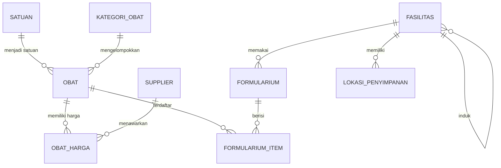
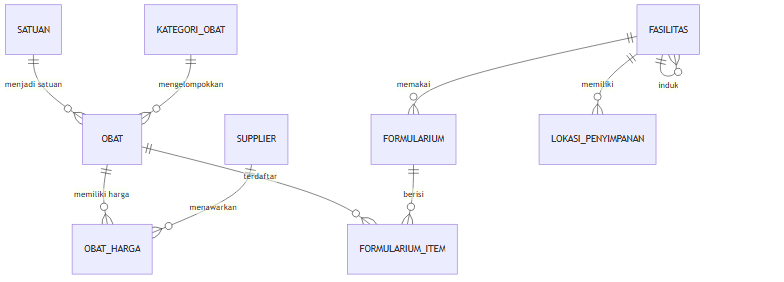
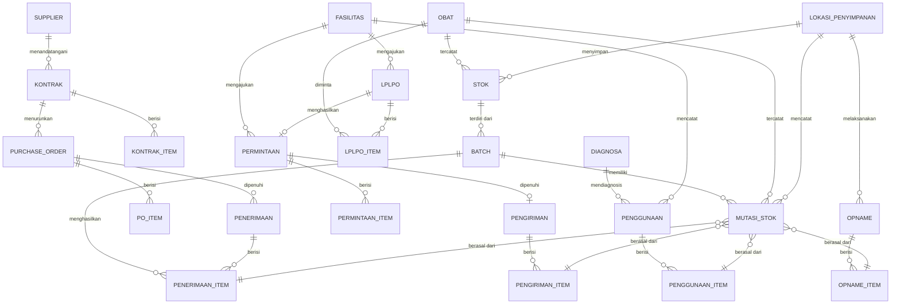
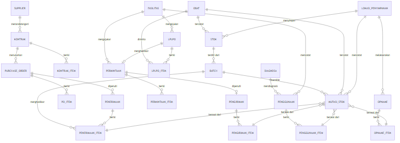
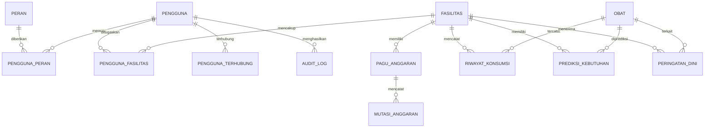
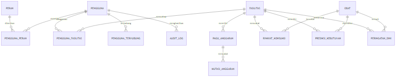
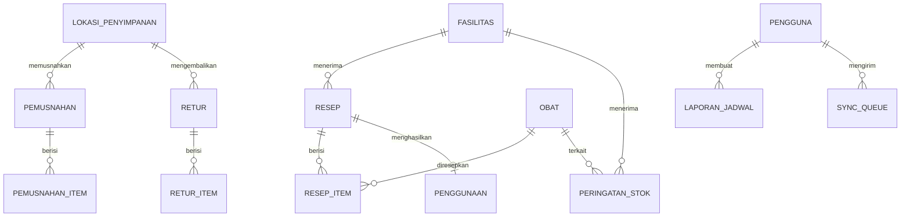
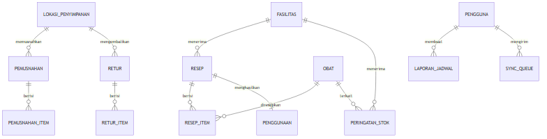

# Data Model - Sistem Manajemen Stok Obat dan BMHP Daerah

| Atribut        | Nilai                          |
| -------------- | ------------------------------ |
| Versi Dokumen  | 1.2 (Draft)                    |
| Status         | Untuk direview                 |
| Pemilik Teknis | Tim Pengembangan               |
| Tanggal        | 27 November 2026               |
| PRD Rujukan    | `docs/PRD.md` versi 1.7        |
| Tech Stack     | `docs/TECH-STACK.md` versi 1.3 |
| Target Pembaca | Developer, DBA, Tech Lead      |

Dokumen ini menjabarkan struktur basis data secara rinci sebagai dasar pembuatan migration
Laravel. Model konseptual mengikuti PRD bagian 9, sedangkan dokumen ini menambahkan entitas
pendukung, tipe data, constraint, indeks, dan strategi relasi.

---

## 1. Konvensi Database

| Aspek        | Ketentuan                                                         |
| ------------ | ----------------------------------------------------------------- |
| Nama tabel   | Bentuk jamak, bahasa Indonesia, snake_case                        |
| Primary key  | `id` bigint unsigned auto increment                               |
| Foreign key  | `<entitas>_id` bigint unsigned, diberi indeks                     |
| Timestamps   | `created_at` dan `updated_at` pada semua tabel kecuali dicatat    |
| Uang         | `decimal(18,2)` dalam rupiah penuh                                |
| Harga satuan | `decimal(15,2)`                                                   |
| Persentase   | `decimal(5,2)` dengan rentang 0 sampai 100                        |
| Enum         | `varchar` dengan validasi aplikasi, agar mudah diubah             |
| JSON         | Kolom `json` untuk data fleksibel dan jejak audit                 |
| Soft delete  | Master data memakai kolom `aktif`; transaksi bersifat append-only |
| Zona waktu   | Semua waktu disimpan dalam UTC, ditampilkan dalam WIB             |
| Charset      | `utf8mb4` dengan collation `utf8mb4_unicode_ci`                   |

Catatan implementasi: enum ditulis sebagai `varchar` agar penambahan nilai tidak memerlukan
migrasi yang mengubah tipe kolom. Validasi nilai enum dilakukan pada Form Request dan
konstanta pada model.

---

## 2. Diagram ERD

### 2.1 ERD Master dan Organisasi

### 2.2 ERD Transaksi dan Stok

### 2.3 ERD Pengguna, Anggaran, dan Prediksi

### 2.4 ERD Entitas Pendukung

---

## 3. Daftar Tabel

| Domain       | Tabel                                                                                                                            | Jumlah |
| ------------ | -------------------------------------------------------------------------------------------------------------------------------- | -----: |
| Master       | `satuan`, `kategori_obat`, `diagnosa`, `supplier`, `formularium`, `formularium_item`                                             |      6 |
| Organisasi   | `fasilitas`, `lokasi_penyimpanan`                                                                                                |      2 |
| Produk       | `obat`, `obat_harga`                                                                                                             |      2 |
| Pengguna     | `peran`, `pengguna`, `pengguna_peran`, `pengguna_fasilitas`, `pengguna_terhubung`, `google_whitelist`, `audit_log`               |      7 |
| Stok         | `stok`, `batch`, `mutasi_stok`                                                                                                   |      3 |
| Pengadaan    | `kontrak`, `kontrak_item`, `purchase_order`, `po_item`, `penerimaan`, `penerimaan_item`                                          |      6 |
| Distribusi   | `permintaan`, `permintaan_item`, `pengiriman`, `pengiriman_item`, `lplpo`, `lplpo_item`                                          |      6 |
| Perencanaan  | `rko`, `rko_item`                                                                                                                |      2 |
| Pelayanan    | `penggunaan`, `penggunaan_item`                                                                                                  |      2 |
| Pengendalian | `opname`, `opname_item`                                                                                                          |      2 |
| Anggaran     | `pagu_anggaran`, `mutasi_anggaran`                                                                                               |      2 |
| Prediksi     | `riwayat_konsumsi`, `prediksi_kebutuhan`, `peringatan_dini`                                                                      |      3 |
| Pendukung    | `pemusnahan`, `pemusnahan_item`, `retur`, `retur_item`, `resep`, `resep_item`, `peringatan_stok`, `laporan_jadwal`, `sync_queue` |      9 |
| **Total**    |                                                                                                                                  | **52** |

Keterangan kolom pada seluruh kamus di bawah ini: `Null` menandakan boleh kosong, `Default`
menandakan nilai bawaan, dan `Keterangan` memuat penanda PK, FK, UNIQUE, atau INDEX.

---

## 4. Master Data

### 4.1 Tabel satuan

| Kolom | Tipe        | Null  | Default | Keterangan          |
| ----- | ----------- | ----- | ------- | ------------------- |
| id    | bigint      | Tidak | -       | PK                  |
| kode  | varchar(20) | Tidak | -       | UNIQUE, contoh TAB  |
| nama  | varchar(50) | Tidak | -       | Tablet, Vial, Botol |
| aktif | boolean     | Tidak | true    | Status penggunaan   |

### 4.2 Tabel kategori_obat

| Kolom | Tipe        | Null  | Default | Keterangan                         |
| ----- | ----------- | ----- | ------- | ---------------------------------- |
| id    | bigint      | Tidak | -       | PK                                 |
| kode  | varchar(20) | Tidak | -       | UNIQUE                             |
| nama  | varchar(80) | Tidak | -       | Antibiotik, Analgesik, dan lainnya |
| aktif | boolean     | Tidak | true    | Status penggunaan                  |

### 4.3 Tabel diagnosa

| Kolom    | Tipe         | Null  | Default | Keterangan          |
| -------- | ------------ | ----- | ------- | ------------------- |
| id       | bigint       | Tidak | -       | PK                  |
| kode     | varchar(10)  | Tidak | -       | UNIQUE, kode ICD-10 |
| nama     | varchar(255) | Tidak | -       | Nama diagnosa       |
| kategori | varchar(100) | Ya    | -       | Kelompok penyakit   |
| aktif    | boolean      | Tidak | true    | Status penggunaan   |

Tabel diisi ringkas, hanya kode yang dipakai fasilitas. Impor dilakukan dari berkas Excel.

### 4.4 Tabel supplier

| Kolom          | Tipe         | Null  | Default | Keterangan            |
| -------------- | ------------ | ----- | ------- | --------------------- |
| id             | bigint       | Tidak | -       | PK                    |
| kode           | varchar(30)  | Tidak | -       | UNIQUE                |
| nama           | varchar(150) | Tidak | -       | Nama penyedia         |
| npwp           | varchar(30)  | Ya    | -       | Nomor pajak           |
| alamat         | text         | Ya    | -       | Alamat lengkap        |
| telepon        | varchar(30)  | Ya    | -       | Nomor kontak          |
| email          | varchar(100) | Ya    | -       | Surat elektronik      |
| kontak_person  | varchar(100) | Ya    | -       | Nama perwakilan       |
| lead_time_hari | smallint     | Tidak | 7       | Rata-rata waktu kirim |
| aktif          | boolean      | Tidak | true    | Status penggunaan     |

### 4.5 Tabel formularium

| Kolom           | Tipe         | Null  | Default | Keterangan                             |
| --------------- | ------------ | ----- | ------- | -------------------------------------- |
| id              | bigint       | Tidak | -       | PK                                     |
| nama            | varchar(100) | Tidak | -       | Nama formularium                       |
| jenis_fasilitas | varchar(20)  | Tidak | -       | puskesmas, rsud, atau dinas            |
| berlaku_mulai   | date         | Tidak | -       | Tanggal mulai berlaku                  |
| berlaku_sampai  | date         | Ya    | -       | Tanggal berakhir, kosong berarti tetap |
| aktif           | boolean      | Tidak | true    | Status penggunaan                      |

### 4.6 Tabel formularium_item

| Kolom          | Tipe    | Null  | Default | Keterangan                  |
| -------------- | ------- | ----- | ------- | --------------------------- |
| id             | bigint  | Tidak | -       | PK                          |
| formularium_id | bigint  | Tidak | -       | FK ke formularium.id        |
| obat_id        | bigint  | Tidak | -       | FK ke obat.id               |
| wajib          | boolean | Tidak | false   | Penanda obat wajib tersedia |

UNIQUE (`formularium_id`, `obat_id`).

---

## 5. Organisasi

### 5.1 Tabel fasilitas

| Kolom       | Tipe         | Null  | Default | Keterangan                                       |
| ----------- | ------------ | ----- | ------- | ------------------------------------------------ |
| id          | bigint       | Tidak | -       | PK                                               |
| parent_id   | bigint       | Ya    | -       | FK ke fasilitas.id (Puskesmas induk untuk Pustu) |
| kode        | varchar(30)  | Tidak | -       | UNIQUE, kode registrasi                          |
| nama        | varchar(150) | Tidak | -       | Nama fasilitas                                   |
| jenis       | varchar(20)  | Tidak | -       | dinas, rsud, puskesmas, pustu                    |
| alamat      | text         | Ya    | -       | Alamat lengkap                                   |
| telepon     | varchar(30)  | Ya    | -       | Nomor kontak                                     |
| email       | varchar(100) | Ya    | -       | Surat elektronik                                 |
| kepala_nama | varchar(100) | Ya    | -       | Nama pimpinan                                    |
| status      | varchar(20)  | Tidak | aktif   | aktif atau nonaktif                              |

INDEX (`parent_id`), INDEX (`jenis`).

### 5.2 Tabel lokasi_penyimpanan

| Kolom        | Tipe         | Null  | Default | Keterangan                                    |
| ------------ | ------------ | ----- | ------- | --------------------------------------------- |
| id           | bigint       | Tidak | -       | PK                                            |
| fasilitas_id | bigint       | Tidak | -       | FK ke fasilitas.id                            |
| nama         | varchar(100) | Tidak | -       | Gudang Farmasi Pusat, Ruang Obat, dan lainnya |
| jenis        | varchar(30)  | Tidak | -       | gudang, ruang_obat, instalasi_farmasi         |
| zona         | varchar(100) | Ya    | -       | Daftar zona penyimpanan                       |
| suhu         | varchar(50)  | Ya    | -       | Rentang suhu penyimpanan                      |
| aktif        | boolean      | Tidak | true    | Status penggunaan                             |

INDEX (`fasilitas_id`, `jenis`).

---

## 6. Produk

### 6.1 Tabel obat

| Kolom            | Tipe         | Null  | Default | Keterangan                                         |
| ---------------- | ------------ | ----- | ------- | -------------------------------------------------- |
| id               | bigint       | Tidak | -       | PK                                                 |
| kode             | varchar(30)  | Tidak | -       | UNIQUE, kode internal atau nasional                |
| nama_generik     | varchar(150) | Tidak | -       | Nama generik                                       |
| nama_merek       | varchar(150) | Ya    | -       | Nama dagang bila ada                               |
| kategori_obat_id | bigint       | Ya    | -       | FK ke kategori_obat.id                             |
| satuan_id        | bigint       | Tidak | -       | FK ke satuan.id                                    |
| bentuk_sediaan   | varchar(50)  | Tidak | -       | Tablet, kapsul, sirup, injeksi                     |
| kekuatan         | varchar(50)  | Ya    | -       | Contoh 500 mg                                      |
| golongan         | varchar(30)  | Tidak | -       | bebas, keras, psikotropika, narkotika, alkes, bmhp |
| nomor_izin_edar  | varchar(50)  | Ya    | -       | Nomor izin edar BPOM                               |
| konversi_kemasan | integer      | Tidak | 1       | Jumlah satuan terkecil per kemasan                 |
| satuan_kemasan   | varchar(30)  | Ya    | -       | Strip, box, dus                                    |
| kondisi_simpan   | varchar(50)  | Ya    | -       | Suhu penyimpanan yang disyaratkan                  |
| lead_time_hari   | smallint     | Tidak | 7       | Rata-rata waktu pengadaan                          |
| aktif            | boolean      | Tidak | true    | Status penggunaan                                  |

INDEX (`golongan`), INDEX (`kategori_obat_id`).

### 6.2 Tabel obat_harga

| Kolom           | Tipe          | Null  | Default | Keterangan                     |
| --------------- | ------------- | ----- | ------- | ------------------------------ |
| id              | bigint        | Tidak | -       | PK                             |
| obat_id         | bigint        | Tidak | -       | FK ke obat.id                  |
| supplier_id     | bigint        | Ya    | -       | FK ke supplier.id              |
| sumber          | varchar(20)   | Tidak | -       | e_katalog, kontrak, atau pasar |
| harga           | decimal(15,2) | Tidak | -       | Harga per satuan terkecil      |
| satuan_id       | bigint        | Tidak | -       | FK ke satuan.id                |
| tanggal_mulai   | date          | Tidak | -       | Awal berlaku harga             |
| tanggal_selesai | date          | Ya    | -       | Akhir berlaku harga            |
| aktif           | boolean       | Tidak | true    | Status penggunaan              |

INDEX (`obat_id`, `tanggal_mulai`).

---

## 7. Pengguna dan Otorisasi

### 7.1 Tabel peran

| Kolom     | Tipe        | Null  | Default | Keterangan           |
| --------- | ----------- | ----- | ------- | -------------------- |
| id        | bigint      | Tidak | -       | PK                   |
| kode      | varchar(40) | Tidak | -       | UNIQUE, contoh ADMIN |
| nama      | varchar(80) | Tidak | -       | Nama peran           |
| deskripsi | text        | Ya    | -       | Penjelasan peran     |
| aktif     | boolean     | Tidak | true    | Status penggunaan    |

### 7.2 Tabel pengguna

| Kolom              | Tipe         | Null  | Default | Keterangan                |
| ------------------ | ------------ | ----- | ------- | ------------------------- |
| id                 | bigint       | Tidak | -       | PK                        |
| nama               | varchar(100) | Tidak | -       | Nama lengkap              |
| username           | varchar(50)  | Tidak | -       | UNIQUE                    |
| email              | varchar(150) | Tidak | -       | UNIQUE                    |
| password           | varchar(255) | Tidak | -       | Hash kata sandi           |
| status             | varchar(20)  | Tidak | aktif   | aktif, nonaktif, terkunci |
| two_factor_secret  | text         | Ya    | -       | Terenkripsi               |
| two_factor_aktif   | boolean      | Tidak | false   | Penanda 2FA               |
| fasilitas_utama_id | bigint       | Ya    | -       | FK ke fasilitas.id        |
| last_login_at      | datetime     | Ya    | -       | Waktu login terakhir      |
| last_login_ip      | varchar(45)  | Ya    | -       | Alamat IP login terakhir  |

INDEX (`status`).

### 7.3 Tabel pengguna_peran

| Kolom       | Tipe   | Null  | Default | Keterangan        |
| ----------- | ------ | ----- | ------- | ----------------- |
| id          | bigint | Tidak | -       | PK                |
| pengguna_id | bigint | Tidak | -       | FK ke pengguna.id |
| peran_id    | bigint | Tidak | -       | FK ke peran.id    |

UNIQUE (`pengguna_id`, `peran_id`).

### 7.4 Tabel pengguna_fasilitas

| Kolom        | Tipe    | Null  | Default | Keterangan         |
| ------------ | ------- | ----- | ------- | ------------------ |
| id           | bigint  | Tidak | -       | PK                 |
| pengguna_id  | bigint  | Tidak | -       | FK ke pengguna.id  |
| fasilitas_id | bigint  | Tidak | -       | FK ke fasilitas.id |
| aktif        | boolean | Tidak | true    | Status penugasan   |

UNIQUE (`pengguna_id`, `fasilitas_id`).

### 7.5 Tabel pengguna_terhubung

| Kolom            | Tipe         | Null  | Default | Keterangan            |
| ---------------- | ------------ | ----- | ------- | --------------------- |
| id               | bigint       | Tidak | -       | PK                    |
| pengguna_id      | bigint       | Tidak | -       | FK ke pengguna.id     |
| provider         | varchar(20)  | Tidak | -       | Contoh google         |
| provider_user_id | varchar(150) | Tidak | -       | ID akun pada penyedia |
| email_provider   | varchar(150) | Ya    | -       | Email pada penyedia   |
| aktif            | boolean      | Tidak | true    | Status koneksi        |

UNIQUE (`provider`, `provider_user_id`).

### 7.6 Tabel google_whitelist

| Kolom          | Tipe         | Null  | Default | Keterangan                   |
| -------------- | ------------ | ----- | ------- | ---------------------------- |
| id             | bigint       | Tidak | -       | PK                           |
| email          | varchar(150) | Tidak | -       | UNIQUE, email yang diizinkan |
| disetujui_oleh | bigint       | Ya    | -       | FK ke pengguna.id            |
| disetujui_at   | datetime     | Ya    | -       | Waktu persetujuan            |
| aktif          | boolean      | Tidak | true    | Status whitelist             |

### 7.7 Tabel audit_log

| Kolom       | Tipe         | Null  | Default | Keterangan                    |
| ----------- | ------------ | ----- | ------- | ----------------------------- |
| id          | bigint       | Tidak | -       | PK                            |
| pengguna_id | bigint       | Ya    | -       | FK ke pengguna.id             |
| aksi        | varchar(50)  | Tidak | -       | create, update, delete, login |
| entitas     | varchar(50)  | Tidak | -       | Nama tabel terkait            |
| entitas_id  | bigint       | Ya    | -       | ID baris terkait              |
| data_lama   | json         | Ya    | -       | Snapshot sebelum perubahan    |
| data_baru   | json         | Ya    | -       | Snapshot sesudah perubahan    |
| ip_address  | varchar(45)  | Ya    | -       | Alamat IP pelaku              |
| user_agent  | varchar(255) | Ya    | -       | Peramban pelaku               |

Tabel ini append-only dan hanya memiliki `created_at`. INDEX (`entitas`, `entitas_id`).

---

## 8. Stok

### 8.1 Tabel stok

| Kolom                 | Tipe        | Null  | Default | Keterangan                  |
| --------------------- | ----------- | ----- | ------- | --------------------------- |
| id                    | bigint      | Tidak | -       | PK                          |
| lokasi_penyimpanan_id | bigint      | Tidak | -       | FK ke lokasi_penyimpanan.id |
| obat_id               | bigint      | Tidak | -       | FK ke obat.id               |
| jumlah                | integer     | Tidak | 0       | Saldo satuan terkecil       |
| stok_min              | integer     | Tidak | 0       | Batas minimum               |
| stok_max              | integer     | Ya    | -       | Batas maksimum              |
| rop                   | integer     | Tidak | 0       | Reorder point statis        |
| safety_stock          | integer     | Tidak | 0       | Stok pengaman               |
| lokasi_rak            | varchar(50) | Ya    | -       | Kode rak penyimpanan        |
| terakhir_mutasi_at    | datetime    | Ya    | -       | Waktu mutasi terakhir       |

UNIQUE (`lokasi_penyimpanan_id`, `obat_id`).

### 8.2 Tabel batch

| Kolom           | Tipe          | Null  | Default | Keterangan                 |
| --------------- | ------------- | ----- | ------- | -------------------------- |
| id              | bigint        | Tidak | -       | PK                         |
| stok_id         | bigint        | Tidak | -       | FK ke stok.id              |
| nomor_batch     | varchar(50)   | Tidak | -       | Nomor batch pabrik         |
| tanggal_expired | date          | Tidak | -       | Tanggal kedaluwarsa        |
| jumlah          | integer       | Tidak | 0       | Sisa pada batch            |
| harga_satuan    | decimal(15,2) | Ya    | -       | Harga perolehan per satuan |
| diterima_at     | date          | Ya    | -       | Tanggal penerimaan batch   |

INDEX (`stok_id`, `tanggal_expired`).

### 8.3 Tabel mutasi_stok

Tabel ini adalah buku besar (ledger) seluruh pergerakan stok. Nilai `stok.jumlah`
merupakan agregat dari mutasi ini dan diperbarui melalui observer pada setiap transaksi.
Tabel bersifat append-only dan hanya memiliki `created_at`.

| Kolom                 | Tipe          | Null  | Default | Keterangan                                        |
| --------------------- | ------------- | ----- | ------- | ------------------------------------------------- |
| id                    | bigint        | Tidak | -       | PK                                                |
| lokasi_penyimpanan_id | bigint        | Tidak | -       | FK ke lokasi_penyimpanan.id                       |
| obat_id               | bigint        | Tidak | -       | FK ke obat.id                                     |
| batch_id              | bigint        | Ya    | -       | FK ke batch.id, kosong untuk penyesuaian          |
| tanggal               | datetime      | Tidak | -       | Waktu terjadinya mutasi                           |
| jenis                 | varchar(30)   | Tidak | -       | Jenis mutasi sesuai daftar enum                   |
| jumlah                | integer       | Tidak | -       | Positif masuk, negatif keluar                     |
| saldo_sebelum         | integer       | Tidak | -       | Saldo sebelum mutasi                              |
| saldo_sesudah         | integer       | Tidak | -       | Saldo setelah mutasi                              |
| harga_satuan          | decimal(15,2) | Ya    | -       | Harga perolehan saat mutasi untuk perhitungan HPP |
| sumber                | varchar(30)   | Tidak | -       | Entitas sumber mutasi                             |
| sumber_id             | bigint        | Ya    | -       | ID dokumen sumber                                 |
| sumber_item_id        | bigint        | Ya    | -       | ID baris item dokumen sumber                      |
| keterangan            | text          | Ya    | -       | Catatan tambahan                                  |
| dicatat_oleh          | bigint        | Ya    | -       | FK ke pengguna.id                                 |
| created_at            | datetime      | Tidak | -       | Waktu pencatatan                                  |

INDEX (`lokasi_penyimpanan_id`, `obat_id`, `tanggal`), INDEX (`sumber`, `sumber_id`),
INDEX (`batch_id`), INDEX (`tanggal`).

---

## 9. Pengadaan

### 9.1 Tabel kontrak

| Kolom           | Tipe          | Null  | Default | Keterangan                  |
| --------------- | ------------- | ----- | ------- | --------------------------- |
| id              | bigint        | Tidak | -       | PK                          |
| nomor           | varchar(50)   | Tidak | -       | UNIQUE                      |
| supplier_id     | bigint        | Tidak | -       | FK ke supplier.id           |
| tanggal_mulai   | date          | Tidak | -       | Awal kontrak                |
| tanggal_selesai | date          | Tidak | -       | Akhir kontrak               |
| nilai           | decimal(18,2) | Tidak | -       | Nilai kontrak               |
| status          | varchar(20)   | Tidak | draf    | draf, aktif, selesai, batal |
| file_dokumen    | varchar(255)  | Ya    | -       | Path berkas kontrak         |

### 9.2 Tabel kontrak_item

| Kolom        | Tipe          | Null  | Default | Keterangan        |
| ------------ | ------------- | ----- | ------- | ----------------- |
| id           | bigint        | Tidak | -       | PK                |
| kontrak_id   | bigint        | Tidak | -       | FK ke kontrak.id  |
| obat_id      | bigint        | Tidak | -       | FK ke obat.id     |
| jumlah       | integer       | Tidak | -       | Kuantitas kontrak |
| harga_satuan | decimal(15,2) | Tidak | -       | Harga satuan      |

UNIQUE (`kontrak_id`, `obat_id`).

### 9.3 Tabel purchase_order

| Kolom            | Tipe          | Null  | Default | Keterangan                                          |
| ---------------- | ------------- | ----- | ------- | --------------------------------------------------- |
| id               | bigint        | Tidak | -       | PK                                                  |
| nomor            | varchar(50)   | Tidak | -       | UNIQUE                                              |
| kontrak_id       | bigint        | Ya    | -       | FK ke kontrak.id                                    |
| supplier_id      | bigint        | Tidak | -       | FK ke supplier.id                                   |
| lokasi_tujuan_id | bigint        | Tidak | -       | FK ke lokasi_penyimpanan.id                         |
| tanggal          | date          | Tidak | -       | Tanggal PO                                          |
| status           | varchar(20)   | Tidak | draf    | draf, disetujui, dikirim, sebagian, diterima, batal |
| total            | decimal(18,2) | Tidak | 0       | Nilai total PO                                      |
| dibuat_oleh      | bigint        | Tidak | -       | FK ke pengguna.id                                   |

INDEX (`supplier_id`, `status`).

### 9.4 Tabel po_item

| Kolom             | Tipe          | Null  | Default | Keterangan              |
| ----------------- | ------------- | ----- | ------- | ----------------------- |
| id                | bigint        | Tidak | -       | PK                      |
| purchase_order_id | bigint        | Tidak | -       | FK ke purchase_order.id |
| obat_id           | bigint        | Tidak | -       | FK ke obat.id           |
| jumlah            | integer       | Tidak | -       | Kuantitas dipesan       |
| harga_satuan      | decimal(15,2) | Tidak | -       | Harga satuan            |
| jumlah_diterima   | integer       | Tidak | 0       | Akumulasi diterima      |

### 9.5 Tabel penerimaan

| Kolom                 | Tipe        | Null  | Default | Keterangan                           |
| --------------------- | ----------- | ----- | ------- | ------------------------------------ |
| id                    | bigint      | Tidak | -       | PK                                   |
| nomor                 | varchar(50) | Tidak | -       | UNIQUE                               |
| purchase_order_id     | bigint      | Tidak | -       | FK ke purchase_order.id              |
| lokasi_penyimpanan_id | bigint      | Tidak | -       | FK ke lokasi_penyimpanan.id          |
| supplier_id           | bigint      | Tidak | -       | FK ke supplier.id                    |
| tanggal               | date        | Tidak | -       | Tanggal penerimaan                   |
| nomor_surat_jalan     | varchar(50) | Ya    | -       | Nomor dokumen pengiriman             |
| status                | varchar(20) | Tidak | draf    | draf, diverifikasi, selesai, selisih |
| diterima_oleh         | bigint      | Tidak | -       | FK ke pengguna.id                    |

### 9.6 Tabel penerimaan_item

| Kolom          | Tipe    | Null  | Default | Keterangan                  |
| -------------- | ------- | ----- | ------- | --------------------------- |
| id             | bigint  | Tidak | -       | PK                          |
| penerimaan_id  | bigint  | Tidak | -       | FK ke penerimaan.id         |
| po_item_id     | bigint  | Tidak | -       | FK ke po_item.id            |
| obat_id        | bigint  | Tidak | -       | FK ke obat.id               |
| batch_id       | bigint  | Ya    | -       | FK ke batch.id hasil terima |
| jumlah         | integer | Tidak | -       | Kuantitas diterima          |
| jumlah_selisih | integer | Tidak | 0       | Selisih terhadap PO         |
| catatan        | text    | Ya    | -       | Keterangan selisih          |

---

## 10. Distribusi

### 10.1 Tabel permintaan

| Kolom          | Tipe        | Null  | Default | Keterangan                                            |
| -------------- | ----------- | ----- | ------- | ----------------------------------------------------- |
| id             | bigint      | Tidak | -       | PK                                                    |
| nomor          | varchar(50) | Tidak | -       | UNIQUE                                                |
| fasilitas_id   | bigint      | Tidak | -       | FK ke fasilitas.id                                    |
| periode        | date        | Tidak | -       | Periode permintaan                                    |
| status         | varchar(20) | Tidak | draf    | draf, diajukan, disetujui, sebagian, ditolak, selesai |
| prioritas      | tinyint     | Tidak | 3       | 1 sampai 4                                            |
| diajukan_oleh  | bigint      | Tidak | -       | FK ke pengguna.id                                     |
| disetujui_oleh | bigint      | Ya    | -       | FK ke pengguna.id                                     |

INDEX (`fasilitas_id`, `status`).

### 10.2 Tabel permintaan_item

| Kolom            | Tipe    | Null  | Default | Keterangan             |
| ---------------- | ------- | ----- | ------- | ---------------------- |
| id               | bigint  | Tidak | -       | PK                     |
| permintaan_id    | bigint  | Tidak | -       | FK ke permintaan.id    |
| obat_id          | bigint  | Tidak | -       | FK ke obat.id          |
| jumlah_diminta   | integer | Tidak | -       | Kuantitas diajukan     |
| jumlah_disetujui | integer | Ya    | -       | Kuantitas disetujui    |
| catatan          | text    | Ya    | -       | Alasan atau keterangan |

UNIQUE (`permintaan_id`, `obat_id`).

### 10.3 Tabel pengiriman

| Kolom               | Tipe         | Null  | Default   | Keterangan                            |
| ------------------- | ------------ | ----- | --------- | ------------------------------------- |
| id                  | bigint       | Tidak | -         | PK                                    |
| nomor               | varchar(50)  | Tidak | -         | UNIQUE                                |
| permintaan_id       | bigint       | Ya    | -         | FK ke permintaan.id                   |
| lokasi_asal_id      | bigint       | Tidak | -         | FK ke lokasi_penyimpanan.id           |
| fasilitas_tujuan_id | bigint       | Tidak | -         | FK ke fasilitas.id                    |
| tanggal_kirim       | date         | Tidak | -         | Tanggal pengiriman                    |
| tanggal_terima      | date         | Ya    | -         | Tanggal diterima                      |
| status              | varchar(20)  | Tidak | disiapkan | disiapkan, dikirim, diterima, selisih |
| kurir               | varchar(100) | Ya    | -         | Nama kurir                            |
| nomor_resi          | varchar(50)  | Ya    | -         | Nomor pelacakan                       |
| dikirim_oleh        | bigint       | Tidak | -         | FK ke pengguna.id                     |
| diterima_oleh       | bigint       | Ya    | -         | FK ke pengguna.id                     |

INDEX (`fasilitas_tujuan_id`, `status`).

### 10.4 Tabel pengiriman_item

| Kolom           | Tipe    | Null  | Default | Keterangan          |
| --------------- | ------- | ----- | ------- | ------------------- |
| id              | bigint  | Tidak | -       | PK                  |
| pengiriman_id   | bigint  | Tidak | -       | FK ke pengiriman.id |
| obat_id         | bigint  | Tidak | -       | FK ke obat.id       |
| batch_id        | bigint  | Ya    | -       | FK ke batch.id      |
| jumlah          | integer | Tidak | -       | Kuantitas dikirim   |
| jumlah_diterima | integer | Ya    | -       | Kuantitas diterima  |
| selisih         | integer | Tidak | 0       | Selisih penerimaan  |

### 10.5 Tabel lplpo

Dokumen Laporan Pemakaian dan Lembar Permintaan Obat yang diajukan fasilitas setiap bulan.
LPLPO berjalan paralel dengan RKO: LPLPO bersifat operasional bulanan, RKO bersifat
perencanaan triwulanan. `periode` menunjuk bulan laporan; pengajuan dilakukan paling lambat
tanggal 5 bulan berikutnya dan menjadi dasar distribusi bulan berikutnya.

| Kolom           | Tipe        | Null  | Default | Keterangan                                            |
| --------------- | ----------- | ----- | ------- | ----------------------------------------------------- |
| id              | bigint      | Tidak | -       | PK                                                    |
| nomor           | varchar(50) | Tidak | -       | UNIQUE                                                |
| fasilitas_id    | bigint      | Tidak | -       | FK ke fasilitas.id                                    |
| periode         | date        | Tidak | -       | Awal bulan laporan                                    |
| status          | varchar(20) | Tidak | draf    | draf, diajukan, disetujui, sebagian, ditolak, selesai |
| total_item      | smallint    | Tidak | 0       | Jumlah item dalam dokumen                             |
| total_diminta   | integer     | Tidak | 0       | Total kuantitas diminta                               |
| total_usul      | integer     | Ya    | -       | Total kuantitas usulan setelah verifikasi             |
| total_disetujui | integer     | Ya    | -       | Total kuantitas disetujui                             |
| diajukan_oleh   | bigint      | Tidak | -       | FK ke pengguna.id                                     |
| tanggal_ajukan  | datetime    | Ya    | -       | Waktu pengajuan                                       |
| disetujui_oleh  | bigint      | Ya    | -       | FK ke pengguna.id                                     |
| tanggal_setujui | datetime    | Ya    | -       | Waktu persetujuan                                     |
| catatan_dinkes  | text        | Ya    | -       | Catatan dari Dinas saat review                        |

UNIQUE (`fasilitas_id`, `periode`), INDEX (`status`).

### 10.6 Tabel lplpo_item

| Kolom              | Tipe          | Null  | Default | Keterangan                        |
| ------------------ | ------------- | ----- | ------- | --------------------------------- |
| id                 | bigint        | Tidak | -       | PK                                |
| lplpo_id           | bigint        | Tidak | -       | FK ke lplpo.id                    |
| obat_id            | bigint        | Tidak | -       | FK ke obat.id                     |
| stok_awal          | integer       | Tidak | 0       | Saldo awal periode                |
| penerimaan         | integer       | Tidak | 0       | Barang masuk selama periode       |
| persediaan         | integer       | Tidak | 0       | Stok awal ditambah penerimaan     |
| jumlah_pakai       | integer       | Tidak | 0       | Pemakaian selama periode          |
| stok_akhir         | integer       | Tidak | 0       | Saldo akhir periode               |
| jumlah_minta       | integer       | Tidak | 0       | Kuantitas yang diminta            |
| jumlah_usul        | integer       | Ya    | -       | Usulan setelah verifikasi         |
| jumlah_disetujui   | integer       | Ya    | -       | Kuantitas final disetujui         |
| harga_satuan       | decimal(15,2) | Ya    | -       | Harga acuan per satuan            |
| nilai_permintaan   | decimal(18,2) | Ya    | -       | Hasil kali jumlah minta dan harga |
| alasan_pengurangan | varchar(255)  | Ya    | -       | Alasan bila permintaan dikurangi  |
| catatan            | text          | Ya    | -       | Keterangan tambahan               |

UNIQUE (`lplpo_id`, `obat_id`).

---

## 11. Perencanaan

### 11.1 Tabel rko

| Kolom          | Tipe        | Null  | Default | Keterangan                                       |
| -------------- | ----------- | ----- | ------- | ------------------------------------------------ |
| id             | bigint      | Tidak | -       | PK                                               |
| nomor          | varchar(50) | Tidak | -       | UNIQUE                                           |
| fasilitas_id   | bigint      | Tidak | -       | FK ke fasilitas.id                               |
| periode        | date        | Tidak | -       | Awal periode RKO                                 |
| status         | varchar(20) | Tidak | draf    | draf, diajukan, diverifikasi, disetujui, ditolak |
| versi          | smallint    | Tidak | 1       | Versi dokumen                                    |
| diajukan_oleh  | bigint      | Tidak | -       | FK ke pengguna.id                                |
| disetujui_oleh | bigint      | Ya    | -       | FK ke pengguna.id                                |

UNIQUE (`fasilitas_id`, `periode`, `versi`).

### 11.2 Tabel rko_item

| Kolom             | Tipe          | Null  | Default | Keterangan              |
| ----------------- | ------------- | ----- | ------- | ----------------------- |
| id                | bigint        | Tidak | -       | PK                      |
| rko_id            | bigint        | Tidak | -       | FK ke rko.id            |
| obat_id           | bigint        | Tidak | -       | FK ke obat.id           |
| pemakaian_periode | integer       | Tidak | 0       | Pemakaian acuan         |
| sisa_stok         | integer       | Tidak | 0       | Sisa stok saat menyusun |
| buffer            | integer       | Tidak | 0       | Stok penyangga          |
| kebutuhan         | integer       | Tidak | -       | Hasil perhitungan       |
| harga_satuan      | decimal(15,2) | Ya    | -       | Harga acuan             |

UNIQUE (`rko_id`, `obat_id`).

---

## 12. Pelayanan

### 12.1 Tabel penggunaan

| Kolom         | Tipe        | Null  | Default | Keterangan                                      |
| ------------- | ----------- | ----- | ------- | ----------------------------------------------- |
| id            | bigint      | Tidak | -       | PK                                              |
| nomor         | varchar(50) | Tidak | -       | UNIQUE                                          |
| fasilitas_id  | bigint      | Tidak | -       | FK ke fasilitas.id                              |
| resep_id      | bigint      | Ya    | -       | FK ke resep.id                                  |
| tanggal       | date        | Tidak | -       | Tanggal pelayanan                               |
| jenis_layanan | varchar(30) | Tidak | -       | rawat_jalan, rawat_inap, ugd, posyandu, lainnya |
| diagnosa_id   | bigint      | Ya    | -       | FK ke diagnosa.id                               |
| pasien_ref    | varchar(50) | Ya    | -       | Referensi pseudonim pasien                      |
| petugas_id    | bigint      | Ya    | -       | FK ke pengguna.id                               |

INDEX (`fasilitas_id`, `tanggal`).

### 12.2 Tabel penggunaan_item

| Kolom         | Tipe        | Null  | Default | Keterangan           |
| ------------- | ----------- | ----- | ------- | -------------------- |
| id            | bigint      | Tidak | -       | PK                   |
| penggunaan_id | bigint      | Tidak | -       | FK ke penggunaan.id  |
| obat_id       | bigint      | Tidak | -       | FK ke obat.id        |
| batch_id      | bigint      | Ya    | -       | FK ke batch.id       |
| jumlah        | integer     | Tidak | -       | Kuantitas diserahkan |
| dosis         | varchar(50) | Ya    | -       | Aturan pakai         |
| keterangan    | text        | Ya    | -       | Catatan tambahan     |

---

## 13. Pengendalian

### 13.1 Tabel opname

| Kolom                 | Tipe          | Null  | Default  | Keterangan                    |
| --------------------- | ------------- | ----- | -------- | ----------------------------- |
| id                    | bigint        | Tidak | -        | PK                            |
| nomor                 | varchar(50)   | Tidak | -        | UNIQUE                        |
| lokasi_penyimpanan_id | bigint        | Tidak | -        | FK ke lokasi_penyimpanan.id   |
| tanggal               | date          | Tidak | -        | Tanggal opname                |
| status                | varchar(20)   | Tidak | berjalan | berjalan, selesai, dibatalkan |
| petugas_id            | bigint        | Tidak | -        | FK ke pengguna.id             |
| disetujui_oleh        | bigint        | Ya    | -        | FK ke pengguna.id             |
| nilai_selisih         | decimal(18,2) | Ya    | -        | Nilai rupiah selisih          |

### 13.2 Tabel opname_item

| Kolom       | Tipe    | Null  | Default | Keterangan               |
| ----------- | ------- | ----- | ------- | ------------------------ |
| id          | bigint  | Tidak | -       | PK                       |
| opname_id   | bigint  | Tidak | -       | FK ke opname.id          |
| obat_id     | bigint  | Tidak | -       | FK ke obat.id            |
| batch_id    | bigint  | Ya    | -       | FK ke batch.id           |
| stok_sistem | integer | Tidak | -       | Saldo menurut sistem     |
| stok_fisik  | integer | Tidak | -       | Hasil hitung fisik       |
| selisih     | integer | Tidak | 0       | Selisih fisik dan sistem |
| keterangan  | text    | Ya    | -       | Penyebab selisih         |

---

## 14. Anggaran

### 14.1 Tabel pagu_anggaran

| Kolom          | Tipe          | Null  | Default | Keterangan               |
| -------------- | ------------- | ----- | ------- | ------------------------ |
| id             | bigint        | Tidak | -       | PK                       |
| fasilitas_id   | bigint        | Tidak | -       | FK ke fasilitas.id       |
| periode        | smallint      | Tidak | -       | Tahun anggaran           |
| sumber_dana    | varchar(20)   | Tidak | -       | apbd, dak, blud, lainnya |
| nilai          | decimal(18,2) | Tidak | -       | Nilai pagu               |
| status         | varchar(20)   | Tidak | draf    | draf, aktif, ditutup     |
| disetujui_oleh | bigint        | Ya    | -       | FK ke pengguna.id        |

UNIQUE (`fasilitas_id`, `periode`, `sumber_dana`).

### 14.2 Tabel mutasi_anggaran

| Kolom            | Tipe          | Null  | Default | Keterangan                                 |
| ---------------- | ------------- | ----- | ------- | ------------------------------------------ |
| id               | bigint        | Tidak | -       | PK                                         |
| pagu_anggaran_id | bigint        | Tidak | -       | FK ke pagu_anggaran.id                     |
| jenis            | varchar(20)   | Tidak | -       | komitmen, realisasi, realokasi, pembayaran |
| nilai            | decimal(18,2) | Tidak | -       | Nilai mutasi                               |
| referensi        | varchar(100)  | Ya    | -       | Nomor PO atau dokumen sumber               |
| tanggal          | date          | Tidak | -       | Tanggal mutasi                             |
| dicatat_oleh     | bigint        | Tidak | -       | FK ke pengguna.id                          |
| keterangan       | text          | Ya    | -       | Catatan tambahan                           |

INDEX (`pagu_anggaran_id`, `jenis`).

---

## 15. Prediksi

### 15.1 Tabel riwayat_konsumsi

| Kolom             | Tipe    | Null  | Default | Keterangan               |
| ----------------- | ------- | ----- | ------- | ------------------------ |
| id                | bigint  | Tidak | -       | PK                       |
| obat_id           | bigint  | Tidak | -       | FK ke obat.id            |
| fasilitas_id      | bigint  | Tidak | -       | FK ke fasilitas.id       |
| periode           | date    | Tidak | -       | Awal bulan periode       |
| jumlah_keluar     | integer | Tidak | 0       | Total pemakaian bulan    |
| jumlah_pasien     | integer | Ya    | -       | Jumlah pasien terlayani  |
| jumlah_stok_akhir | integer | Ya    | -       | Saldo akhir bulan        |
| dikunci           | boolean | Tidak | false   | Penanda periode terkunci |

UNIQUE (`obat_id`, `fasilitas_id`, `periode`).

### 15.2 Tabel prediksi_kebutuhan

| Kolom            | Tipe         | Null  | Default | Keterangan               |
| ---------------- | ------------ | ----- | ------- | ------------------------ |
| id               | bigint       | Tidak | -       | PK                       |
| obat_id          | bigint       | Tidak | -       | FK ke obat.id            |
| fasilitas_id     | bigint       | Tidak | -       | FK ke fasilitas.id       |
| periode_prediksi | date         | Tidak | -       | Bulan yang diprediksi    |
| prediksi_jumlah  | integer      | Tidak | -       | Hasil prediksi kebutuhan |
| confidence       | decimal(5,2) | Tidak | -       | 0 sampai 100             |
| metode           | varchar(50)  | Tidak | -       | Nama metode              |
| faktor_pendorong | varchar(255) | Ya    | -       | Tren atau musiman        |
| dihitung_at      | datetime     | Tidak | -       | Waktu perhitungan        |

UNIQUE (`obat_id`, `fasilitas_id`, `periode_prediksi`).

### 15.3 Tabel peringatan_dini

| Kolom               | Tipe         | Null  | Default | Keterangan             |
| ------------------- | ------------ | ----- | ------- | ---------------------- |
| id                  | bigint       | Tidak | -       | PK                     |
| obat_id             | bigint       | Tidak | -       | FK ke obat.id          |
| fasilitas_id        | bigint       | Tidak | -       | FK ke fasilitas.id     |
| tanggal_deteksi     | date         | Tidak | -       | Tanggal deteksi        |
| tingkat             | varchar(20)  | Tidak | -       | info, waspada, kritis  |
| risk_score          | decimal(3,2) | Tidak | -       | 0.00 sampai 1.00       |
| estimasi_hari_habis | smallint     | Ya    | -       | Perkiraan hari tersisa |
| rekomendasi         | text         | Ya    | -       | Saran tindakan         |
| ditindaklanjuti     | boolean      | Tidak | false   | Status tindak lanjut   |

INDEX (`fasilitas_id`, `tingkat`).

---

## 16. Entitas Pendukung

### 16.1 Tabel pemusnahan

| Kolom                 | Tipe         | Null  | Default | Keterangan                       |
| --------------------- | ------------ | ----- | ------- | -------------------------------- |
| id                    | bigint       | Tidak | -       | PK                               |
| lokasi_penyimpanan_id | bigint       | Tidak | -       | FK ke lokasi_penyimpanan.id      |
| nomor                 | varchar(50)  | Tidak | -       | UNIQUE                           |
| tanggal               | date         | Tidak | -       | Tanggal pemusnahan               |
| alasan                | varchar(255) | Tidak | -       | Rusak, kedaluwarsa, atau lainnya |
| status                | varchar(20)  | Tidak | draf    | draf, diverifikasi, selesai      |
| berita_acara_path     | varchar(255) | Ya    | -       | Berkas berita acara              |
| disetujui_oleh        | bigint       | Ya    | -       | FK ke pengguna.id                |

### 16.2 Tabel pemusnahan_item

| Kolom         | Tipe         | Null  | Default | Keterangan            |
| ------------- | ------------ | ----- | ------- | --------------------- |
| id            | bigint       | Tidak | -       | PK                    |
| pemusnahan_id | bigint       | Tidak | -       | FK ke pemusnahan.id   |
| obat_id       | bigint       | Tidak | -       | FK ke obat.id         |
| batch_id      | bigint       | Ya    | -       | FK ke batch.id        |
| jumlah        | integer      | Tidak | 0       | Kuantitas dimusnahkan |
| keterangan    | varchar(255) | Ya    | -       | Kondisi atau catatan  |

### 16.3 Tabel retur

| Kolom                 | Tipe         | Null  | Default | Keterangan                         |
| --------------------- | ------------ | ----- | ------- | ---------------------------------- |
| id                    | bigint       | Tidak | -       | PK                                 |
| lokasi_penyimpanan_id | bigint       | Tidak | -       | FK ke lokasi_penyimpanan.id        |
| nomor                 | varchar(50)  | Tidak | -       | UNIQUE                             |
| tanggal               | date         | Tidak | -       | Tanggal retur                      |
| jenis                 | varchar(20)  | Tidak | -       | unit_ke_gudang, gudang_ke_supplier |
| status                | varchar(20)  | Tidak | draf    | draf, diajukan, diterima, ditolak  |
| alasan                | varchar(255) | Ya    | -       | Alasan pengembalian                |

### 16.4 Tabel retur_item

| Kolom    | Tipe        | Null  | Default | Keterangan                |
| -------- | ----------- | ----- | ------- | ------------------------- |
| id       | bigint      | Tidak | -       | PK                        |
| retur_id | bigint      | Tidak | -       | FK ke retur.id            |
| obat_id  | bigint      | Tidak | -       | FK ke obat.id             |
| batch_id | bigint      | Ya    | -       | FK ke batch.id            |
| jumlah   | integer     | Tidak | 0       | Kuantitas diretur         |
| kondisi  | varchar(50) | Ya    | -       | Baik, rusak, atau lainnya |

### 16.5 Tabel resep

| Kolom         | Tipe        | Null  | Default | Keterangan                                    |
| ------------- | ----------- | ----- | ------- | --------------------------------------------- |
| id            | bigint      | Tidak | -       | PK                                            |
| fasilitas_id  | bigint      | Tidak | -       | FK ke fasilitas.id                            |
| nomor         | varchar(50) | Tidak | -       | UNIQUE                                        |
| tanggal       | date        | Tidak | -       | Tanggal resep                                 |
| dokter_id     | bigint      | Tidak | -       | FK ke pengguna.id                             |
| pasien_ref    | varchar(50) | Ya    | -       | Referensi pasien terenkripsi                  |
| jenis_layanan | varchar(30) | Tidak | -       | rawat_jalan, rawat_inap, ugd, dll.            |
| status        | varchar(20) | Tidak | draf    | draf, diajukan, ditelaah, diserahkan, ditolak |
| catatan       | text        | Ya    | -       | Catatan telaah                                |

### 16.6 Tabel resep_item

| Kolom             | Tipe         | Null  | Default | Keterangan                  |
| ----------------- | ------------ | ----- | ------- | --------------------------- |
| id                | bigint       | Tidak | -       | PK                          |
| resep_id          | bigint       | Tidak | -       | FK ke resep.id              |
| obat_id           | bigint       | Tidak | -       | FK ke obat.id               |
| jumlah            | integer      | Tidak | 0       | Kuantitas                   |
| dosis             | varchar(100) | Ya    | -       | Aturan pakai                |
| jenis             | varchar(20)  | Tidak | reguler | reguler, racikan            |
| racikan_nama      | varchar(100) | Ya    | -       | Nama racikan                |
| racikan_komposisi | json         | Ya    | -       | Komposisi bahan per bungkus |

### 16.7 Tabel peringatan_stok

| Kolom        | Tipe        | Null  | Default | Keterangan                                                |
| ------------ | ----------- | ----- | ------- | --------------------------------------------------------- |
| id           | bigint      | Tidak | -       | PK                                                        |
| obat_id      | bigint      | Tidak | -       | FK ke obat.id                                             |
| fasilitas_id | bigint      | Tidak | -       | FK ke fasilitas.id                                        |
| jenis        | varchar(20) | Tidak | -       | stok, kedaluwarsa                                         |
| tingkat      | varchar(20) | Tidak | -       | normal, waspada, kritis, kosong, kelebihan, sangat_kritis |
| referensi_id | bigint      | Ya    | -       | batch.id untuk alert kedaluwarsa                          |
| status       | varchar(20) | Tidak | aktif   | aktif, ditindaklanjuti, kedaluwarsa                       |
| dibuat_at    | datetime    | Tidak | -       | Waktu deteksi                                             |

### 16.8 Tabel laporan_jadwal

| Kolom       | Tipe        | Null  | Default | Keterangan                                         |
| ----------- | ----------- | ----- | ------- | -------------------------------------------------- |
| id          | bigint      | Tidak | -       | PK                                                 |
| pengguna_id | bigint      | Tidak | -       | FK ke pengguna.id                                  |
| jenis       | varchar(30) | Tidak | -       | harian, bulanan, triwulanan, tahunan, sipnap, sipd |
| frekuensi   | varchar(20) | Tidak | -       | harian, bulanan, triwulanan                        |
| penerima    | json        | Ya    | -       | Daftar email penerima                              |
| format      | varchar(10) | Tidak | pdf     | pdf, csv, xlsx                                     |
| aktif       | boolean     | Tidak | true    | Status jadwal                                      |
| next_run_at | datetime    | Ya    | -       | Jadwal pengiriman berikutnya                       |

### 16.9 Tabel sync_queue

| Kolom        | Tipe         | Null  | Default  | Keterangan                     |
| ------------ | ------------ | ----- | -------- | ------------------------------ |
| id           | bigint       | Tidak | -        | PK                             |
| pengguna_id  | bigint       | Tidak | -        | FK ke pengguna.id              |
| perangkat_id | varchar(100) | Ya    | -        | Identitas perangkat luring     |
| entitas      | varchar(50)  | Tidak | -        | Nama entitas yang disinkronkan |
| entitas_id   | varchar(50)  | Ya    | -        | ID lokal entitas               |
| aksi         | varchar(20)  | Tidak | -        | create, update, delete         |
| payload      | json         | Tidak | -        | Data yang dikirim              |
| status       | varchar(20)  | Tidak | tertunda | tertunda, terkirim, gagal      |
| percobaan    | smallint     | Tidak | 0        | Jumlah percobaan sinkronisasi  |
| created_at   | datetime     | Tidak | -        | Waktu antrean dibuat           |

---

## 17. Nilai Enum Baku

| Kolom                       | Nilai yang Diizinkan                                                                                                           |
| --------------------------- | ------------------------------------------------------------------------------------------------------------------------------ |
| `fasilitas.jenis`           | dinas, rsud, puskesmas, pustu                                                                                                  |
| `fasilitas.status`          | aktif, nonaktif                                                                                                                |
| `lokasi_penyimpanan.jenis`  | gudang, ruang_obat, instalasi_farmasi                                                                                          |
| `obat.golongan`             | bebas, bebas_terbatas, keras, psikotropika, narkotika, alkes, bmhp                                                             |
| `pengguna.status`           | aktif, nonaktif, terkunci                                                                                                      |
| `kontrak.status`            | draf, aktif, selesai, batal                                                                                                    |
| `purchase_order.status`     | draf, menunggu_persetujuan, disetujui, dikirim, sebagian, diterima, batal                                                      |
| `penerimaan.status`         | draf, diverifikasi, selesai, selisih                                                                                           |
| `permintaan.status`         | draf, diajukan, disetujui, sebagian, ditolak, selesai                                                                          |
| `pengiriman.status`         | disiapkan, dikirim, diterima, selisih                                                                                          |
| `rko.status`                | draf, diajukan, diverifikasi, disetujui, ditolak                                                                               |
| `penggunaan.jenis_layanan`  | rawat_jalan, rawat_inap, ugd, posyandu, lainnya                                                                                |
| `mutasi_stok.jenis`         | masuk, keluar, penyesuaian_naik, penyesuaian_turun, rusak, expired, retur_masuk, retur_keluar, transfer_masuk, transfer_keluar |
| `lplpo.status`              | draf, diajukan, disetujui, sebagian, ditolak, selesai                                                                          |
| `opname.status`             | berjalan, selesai, dibatalkan                                                                                                  |
| `pagu_anggaran.sumber_dana` | apbd, dak, blud, lainnya                                                                                                       |
| `pagu_anggaran.status`      | draf, aktif, ditutup                                                                                                           |
| `mutasi_anggaran.jenis`     | komitmen, realisasi, realokasi, pembayaran                                                                                     |
| `peringatan_dini.tingkat`   | info, waspada, kritis                                                                                                          |
| `pemusnahan.status`         | draf, diverifikasi, selesai                                                                                                    |
| `retur.jenis`               | unit_ke_gudang, gudang_ke_supplier                                                                                             |
| `retur.status`              | draf, diajukan, diterima, ditolak                                                                                              |
| `resep.status`              | draf, diajukan, ditelaah, diserahkan, ditolak                                                                                  |
| `resep_item.jenis`          | reguler, racikan                                                                                                               |
| `peringatan_stok.jenis`     | stok, kedaluwarsa                                                                                                              |
| `peringatan_stok.tingkat`   | normal, waspada, kritis, kosong, kelebihan, sangat_kritis                                                                      |
| `peringatan_stok.status`    | aktif, ditindaklanjuti, kedaluwarsa                                                                                            |
| `laporan_jadwal.jenis`      | harian, bulanan, triwulanan, tahunan, sipnap, sipd                                                                             |
| `laporan_jadwal.frekuensi`  | harian, bulanan, triwulanan                                                                                                    |
| `laporan_jadwal.format`     | pdf, csv, xlsx                                                                                                                 |
| `sync_queue.aksi`           | create, update, delete                                                                                                         |
| `sync_queue.status`         | tertunda, terkirim, gagal                                                                                                      |

---

## 18. Indeks yang Direkomendasikan

| Tabel              | Indeks                                           | Alasan                         |
| ------------------ | ------------------------------------------------ | ------------------------------ |
| stok               | UNIQUE (lokasi_penyimpanan_id, obat_id)          | Satu saldo per item per lokasi |
| batch              | (stok_id, tanggal_expired)                       | Urutan FEFO                    |
| mutasi_stok        | (lokasi_penyimpanan_id, obat_id, tanggal)        | Kartu stok per item            |
| mutasi_stok        | (sumber, sumber_id)                              | Back-trace ke dokumen sumber   |
| lplpo              | UNIQUE (fasilitas_id, periode)                   | Satu LPLPO per bulan           |
| lplpo_item         | UNIQUE (lplpo_id, obat_id)                       | Cegah duplikasi item           |
| penerimaan_item    | (penerimaan_id, obat_id)                         | Rekap penerimaan               |
| pengiriman_item    | (pengiriman_id, obat_id)                         | Rekap pengiriman               |
| permintaan_item    | UNIQUE (permintaan_id, obat_id)                  | Cegah duplikasi item           |
| riwayat_konsumsi   | UNIQUE (obat_id, fasilitas_id, periode)          | Sumber prediksi                |
| prediksi_kebutuhan | UNIQUE (obat_id, fasilitas_id, periode_prediksi) | Idempotensi prediksi           |
| peringatan_dini    | (fasilitas_id, tingkat)                          | Daftar peringatan aktif        |
| mutasi_anggaran    | (pagu_anggaran_id, jenis)                        | Rekap serapan anggaran         |
| audit_log          | (entitas, entitas_id)                            | Penelusuran riwayat entitas    |
| obat               | (golongan), (kategori_obat_id)                   | Filter dan laporan             |

---

## 19. Strategi Foreign Key

| Relasi                               | Aturan      | Alasan                          |
| ------------------------------------ | ----------- | ------------------------------- |
| Item transaksi ke dokumen induk      | CASCADE     | Item tidak bermakna tanpa induk |
| Dokumen ke master (obat, fasilitas)  | RESTRICT    | Cegah hapus data yang dipakai   |
| Referensi opsional (diagnosa, batch) | SET NULL    | Boleh kosong bila sumber hilang |
| Audit log ke pengguna                | SET NULL    | Riwayat tetap tersimpan         |
| Mutasi stok ke dokumen sumber        | SET NULL    | Dokumen lama tetap terarsip     |
| Master data yang dinonaktifkan       | Tidak hapus | Pakai kolom `aktif`             |

Catatan: penghapusan transaksi tidak dilakukan. Koreksi memakai dokumen pembatalan atau
penyesuaian agar jejak audit tetap utuh.

---

## 20. Seed Data Wajib

| Data               | Isi Minimal                                                                                                                                                                                                                  |
| ------------------ | ---------------------------------------------------------------------------------------------------------------------------------------------------------------------------------------------------------------------------- |
| Peran              | ADMIN_DINKES, KEPALA_DINAS, KEPALA_BIDANG, APOTEKER_GUDANG, APOTEKER_PUSKESMAS, APOTEKER_RSUD, DIREKTUR_RSUD, KEPALA_PUSKESMAS, PETUGAS_GUDANG, PETUGAS_FARMASI, DOKTER, PEJABAT_PENGADAAN, PEJABAT_KEUANGAN, KURIR, AUDITOR |
| Satuan             | Tablet, Kapsul, Vial, Ampul, Botol, Sachet, Strip, Box                                                                                                                                                                       |
| Kategori obat      | Antibiotik, Analgesik, Antihipertensi, Antidiabetik, Vitamin, BMHP                                                                                                                                                           |
| Fasilitas          | Dinas Kesehatan dan satu contoh RSUD                                                                                                                                                                                         |
| Lokasi penyimpanan | Gudang Farmasi Pusat dan satu ruang obat contoh                                                                                                                                                                              |
| Formularium        | Formularium dasar Puskesmas dan RSUD                                                                                                                                                                                         |
| Pengguna awal      | Satu administrator dengan 2FA aktif                                                                                                                                                                                          |

---

## 21. Dokumen Terkait

| Dokumen                | Isi                                     | Status   |
| ---------------------- | --------------------------------------- | -------- |
| `docs/PRD.md`          | Kebutuhan produk dan fungsional         | Tersedia |
| `docs/TECH-STACK.md`   | Tech stack dan arsitektur teknis        | Tersedia |
| `docs/mockup/`         | Mockup antarmuka dan katalog komponen   | Tersedia |
| `docs/API-CONTRACT.md` | Kontrak API internal dan skemanya       | Tersedia |
| `docs/INTEGRATION.md`  | Integrasi sistem eksternal              | Tersedia |
| `docs/examples/`       | Contoh tabel dan diagram sesuai standar | Tersedia |
