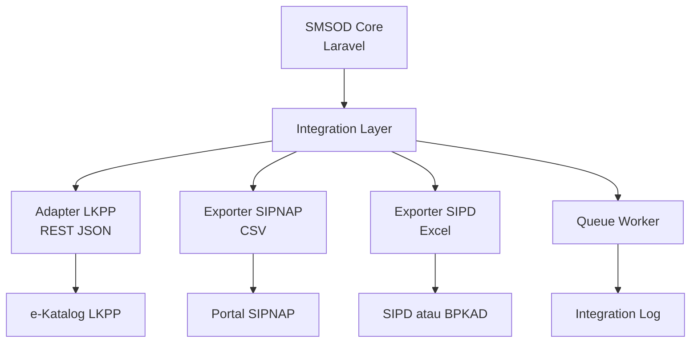
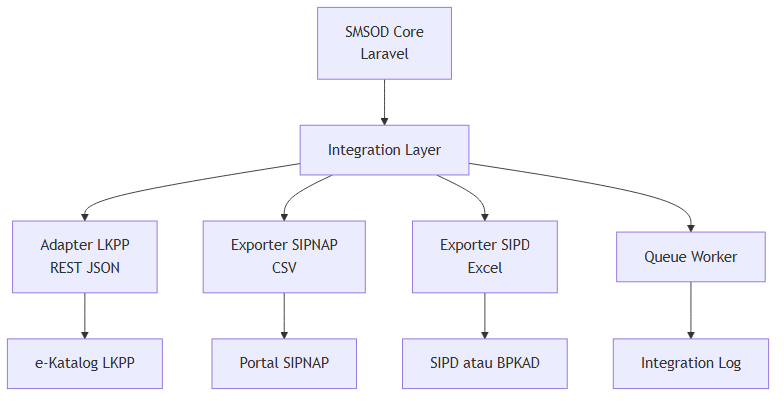
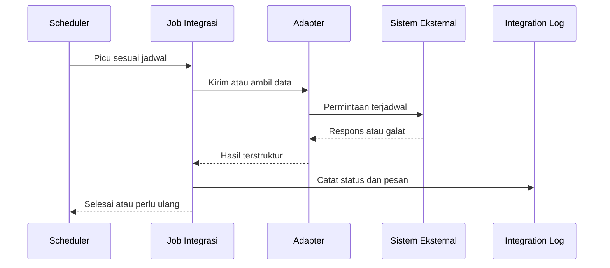
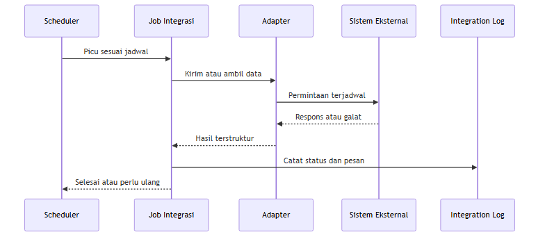

# Integrasi Sistem - SMSOD

| Atribut        | Nilai                          |
| -------------- | ------------------------------ |
| Versi Dokumen  | 1.0 (Draft)                    |
| Status         | Untuk direview                 |
| Pemilik Teknis | Tim Pengembangan               |
| Tanggal        | 24 November 2026               |
| PRD Rujukan    | `docs/PRD.md` versi 1.6        |
| Tech Stack     | `docs/TECH-STACK.md` versi 1.2 |
| Target Pembaca | Developer, Tech Lead, DevOps   |

Dokumen ini menjabarkan cara integrasi SMSOD dengan sistem eksternal pada fase MVP, yaitu
LKPP, SIPNAP, dan SIPD. Integrasi SATU SEHAT dan e-Puskesmas direncanakan pada fase
berikutnya dan belum dirinci di sini.

---

## 1. Ringkasan Integrasi

| Sistem         | Arah                | Format         | Frekuensi              | Status MVP |
| -------------- | ------------------- | -------------- | ---------------------- | ---------- |
| LKPP e-Katalog | Dua arah            | REST JSON      | Mingguan dan on-demand | Wajib      |
| SIPNAP         | SMSOD ke SIPNAP     | CSV standar    | Bulanan                | Wajib      |
| SIPD           | SMSOD ke SIPD       | Excel template | Bulanan                | Wajib      |
| SATU SEHAT     | SMSOD ke SATU SEHAT | FHIR R4        | Harian                 | Fase 2     |
| e-Puskesmas    | Dua arah            | API atau CSV   | Harian                 | Fase 3     |

### 1.1 Arsitektur Integrasi





### 1.2 Prinsip Integrasi

1. Setiap integrasi dibungkus adapter agar sumber eksternal mudah diganti.
2. Semua permintaan keluar bersifat idempoten dan aman diulang.
3. Kegagalan dicatat pada `integration_log` dan dapat dicoba ulang manual.
4. Kredensial disimpan pada variabel lingkungan dan tidak masuk repositori.
5. Setiap integrasi memiliki jalur cadangan manual berupa impor atau ekspor berkas.
6. Data yang dikirim tidak memuat identitas pasien kecuali diwajibkan regulasi.

---

## 2. Integrasi LKPP

### 2.1 Tujuan dan Cakupan

LKPP menyediakan katalog elektronik untuk pengadaan barang dan jasa pemerintah. Integrasi
ini memungkinkan SMSOD mengambil produk dan harga, membuat pesanan, serta memantau status
pesanan tanpa input ulang.

### 2.2 Data yang Dipertukarkan

| Data             | Arah          | Kegunaan                       |
| ---------------- | ------------- | ------------------------------ |
| Produk obat      | LKPP ke SMSOD | Master item dan harga acuan    |
| Penyedia         | LKPP ke SMSOD | Daftar vendor terverifikasi    |
| Purchase order   | SMSOD ke LKPP | Pemesanan melalui e-Purchasing |
| Status pesanan   | LKPP ke SMSOD | Pelacakan pengiriman           |
| Invoice dan BAST | Dua arah      | Kelengkapan dokumen pembayaran |

### 2.3 Mekanisme dan Autentikasi

| Aspek       | Ketentuan                                       |
| ----------- | ----------------------------------------------- |
| Protokol    | HTTPS REST JSON                                 |
| Autentikasi | OAuth 2.0 client credentials                    |
| Token       | Berlaku terbatas, disimpan pada cache           |
| Rate limit  | Mengikuti ketentuan penyedia                    |
| Lingkungan  | Sandbox untuk pengujian, produksi untuk operasi |

### 2.4 Contoh Implementasi

```php
// app/Services/Integration/LkppService.php
namespace App\Services\Integration;

use Illuminate\Support\Facades\Cache;
use Illuminate\Support\Facades\Http;

class LkppService
{
    public function searchProducts(string $keyword, int $page = 1): array
    {
        $response = Http::withToken($this->token())
            ->retry(3, 1000)
            ->get(config('integration.lkpp.base_url') . '/products', [
                'q' => $keyword,
                'page' => $page,
                'category' => 'farmasi',
            ]);

        $response->throw();

        return $response->json('data', []);
    }

    public function createPurchaseOrder(array $payload): array
    {
        $response = Http::withToken($this->token())
            ->retry(2, 2000)
            ->post(config('integration.lkpp.base_url') . '/purchase-orders', $payload);

        $response->throw();

        return $response->json();
    }

    private function token(): string
    {
        return Cache::remember('lkpp_token', now()->addMinutes(50), function () {
            $response = Http::asForm()->post(
                config('integration.lkpp.token_url'),
                [
                    'grant_type' => 'client_credentials',
                    'client_id' => config('integration.lkpp.client_id'),
                    'client_secret' => config('integration.lkpp.client_secret'),
                ],
            );

            $response->throw();

            return $response->json('access_token');
        });
    }
}
```

### 2.5 Penanganan Kegagalan dan Fallback

- Bila token gagal diperbarui, job ditandai gagal dan dicoba ulang dengan backoff.
- Bila API tidak tersedia, admin dapat mengimpor berkas produk dari portal e-Katalog.
- PO yang gagal terkirim disimpan berstatus `pending_integration` dan dapat dikirim ulang.
- Selisih harga antara katalog dan PO dicatat untuk verifikasi pejabat pengadaan.

### 2.6 Checklist Kesiapan

1. Registrasi organisasi pada portal LKPP selesai.
2. Client ID dan secret tersedia untuk sandbox dan produksi.
3. Pemetaan kategori obat SMSOD dengan kategori katalog disepakati.
4. Jalur impor manual diuji sebagai cadangan.
5. Pengguna penanggung jawab integrasi ditetapkan.

---

## 3. Integrasi SIPNAP

### 3.1 Tujuan dan Cakupan

SIPNAP menerima laporan ketersediaan dan pemakaian obat dari fasilitas kesehatan. Pada MVP,
integrasi dilakukan melalui ekspor berkas CSV sesuai template resmi, lalu diunggah ke
portal SIPNAP.

### 3.2 Format Laporan

| Kolom          | Sumber Data                        | Catatan                      |
| -------------- | ---------------------------------- | ---------------------------- |
| Kode fasilitas | `fasilitas.kode`                   | Wajib sesuai registrasi      |
| Periode        | Bulan laporan                      | Format YYYY-MM               |
| Kode obat      | `obat.kode`                        | Ikuti kode nasional bila ada |
| Nama obat      | `obat.nama_generik`                | Nama generik                 |
| Satuan         | `satuan.nama`                      | Satuan terkecil              |
| Stok awal      | Agregat `mutasi_stok`              | Saldo awal periode           |
| Penerimaan     | Agregat `mutasi_stok` jenis masuk  | Total masuk                  |
| Pemakaian      | Agregat `mutasi_stok` jenis keluar | Total keluar                 |
| Stok akhir     | `stok.jumlah`                      | Saldo akhir periode          |
| Keterangan     | Catatan manual                     | Opsional                     |

### 3.3 Alur Pelaporan

1. Job bulanan menghitung agregat mutasi stok per item per fasilitas.
2. Sistem menyusun CSV sesuai urutan kolom template SIPNAP.
3. Berkas divalidasi terhadap daftar wajib dan tipe data.
4. Operator mengunduh berkas dan mengunggah ke portal SIPNAP.
5. Hasil unggah dicatat pada `integration_log` beserta status.

### 3.4 Contoh Generator CSV

```php
// app/Services/Integration/SipnapExporter.php
namespace App\Services\Integration;

use App\Models\Fasilitas;
use App\Models\MutasiStok;
use Illuminate\Support\Collection;

class SipnapExporter
{
    public function build(int $fasilitasId, string $periode): Collection
    {
        $fasilitas = Fasilitas::findOrFail($fasilitasId);

        return MutasiStok::query()
            ->selectRaw('obat_id, SUM(CASE WHEN jumlah > 0 THEN jumlah ELSE 0 END) as masuk')
            ->selectRaw('SUM(CASE WHEN jumlah < 0 THEN -jumlah ELSE 0 END) as keluar')
            ->where('lokasi_penyimpanan_id', $fasilitas->lokasiUtama()->value('id'))
            ->whereBetween('tanggal', [$periode . '-01', $periode . '-31'])
            ->groupBy('obat_id')
            ->with('obat.satuan')
            ->get()
            ->map(fn ($row) => [
                'kode_fasilitas' => $fasilitas->kode,
                'periode' => $periode,
                'kode_obat' => $row->obat->kode,
                'nama_obat' => $row->obat->nama_generik,
                'satuan' => $row->obat->satuan->nama,
                'penerimaan' => (int) $row->masuk,
                'pemakaian' => (int) $row->keluar,
            ]);
    }
}
```

### 3.5 Validasi dan Penanganan Kesalahan

- Baris tanpa kode obat valid ditolak dan dilaporkan pada berkas kesalahan.
- Periode harus sesuai bulan berjalan atau bulan sebelumnya.
- Fasilitas tanpa lokasi penyimpanan aktif tidak dapat mengekspor laporan.
- Berkas yang gagal diunggah dapat dibuat ulang tanpa menggandakan data.

### 3.6 Checklist Kesiapan

1. Akun SIPNAP per fasilitas tersedia.
2. Template kolom terbaru diunduh dari portal SIPNAP.
3. Pemetaan kode obat SMSOD dengan kode nasional selesai.
4. Jadwal ekspor bulanan disepakati dengan penanggung jawab.
5. Prosedur unggah manual dan penyimpanan bukti telah ditetapkan.

---

## 4. Integrasi SIPD

### 4.1 Tujuan dan Cakupan

SIPD menampung anggaran dan realisasi keuangan daerah. Integrasi MVP berupa ekspor berkas
Excel untuk kebutuhan SPJ dan rekonsiliasi realisasi obat, mengikuti template dari BPKAD.

### 4.2 Pemetaan Kode Akun

| Jenis Belanja | Kode Akun Contoh | Keterangan              |
| ------------- | ---------------- | ----------------------- |
| Belanja obat  | 5.2.02.01.01     | Obat-obatan             |
| Belanja BMHP  | 5.2.02.01.02     | Bahan medis habis pakai |
| Belanja alkes | 5.2.02.01.03     | Alat kesehatan          |

Kode akun di atas hanya contoh. Nilai final harus mengikuti kode akun yang ditetapkan
BPKAD setempat.

### 4.3 Format SPJ

| Kolom         | Sumber Data                 |
| ------------- | --------------------------- |
| Nomor dokumen | `mutasi_anggaran.referensi` |
| Tanggal       | `mutasi_anggaran.tanggal`   |
| Jenis belanja | Pemetaan kategori obat      |
| Kode akun     | Tabel pemetaan kode akun    |
| Nilai         | `mutasi_anggaran.nilai`     |
| Uraian        | Nama item dan jumlah        |
| Penyedia      | `supplier.nama`             |
| Nomor BAST    | `penerimaan.nomor`          |

### 4.4 Contoh Generator Excel

```php
// app/Services/Integration/SipdExporter.php
namespace App\Services\Integration;

use App\Models\MutasiAnggaran;
use Maatwebsite\Excel\Concerns\FromCollection;
use Maatwebsite\Excel\Concerns\WithHeadings;

class SipdExporter implements FromCollection, WithHeadings
{
    public function __construct(private readonly string $periode) {}

    public function collection()
    {
        return MutasiAnggaran::query()
            ->where('jenis', 'pembayaran')
            ->whereBetween('tanggal', [$this->periode . '-01', $this->periode . '-31'])
            ->with(['paguAnggaran.fasilitas'])
            ->get()
            ->map(fn ($row) => [
                'nomor_dokumen' => $row->referensi,
                'tanggal' => $row->tanggal->format('Y-m-d'),
                'kode_akun' => config('integration.sipd.kode_akun_obat'),
                'nilai' => $row->nilai,
                'uraian' => $row->keterangan,
            ]);
    }

    public function headings(): array
    {
        return ['Nomor Dokumen', 'Tanggal', 'Kode Akun', 'Nilai', 'Uraian'];
    }
}
```

### 4.5 Koordinasi dengan BPKAD

- Konfirmasi versi SIPD yang digunakan dan ketersediaan API.
- Minta template SPJ terbaru beserta aturan penamaan berkas.
- Sepakati jadwal pengiriman dan penanggung jawab rekonsiliasi.
- Simpan bukti ekspor dan unggah untuk kebutuhan audit.

### 4.6 Checklist Kesiapan

1. Template SPJ terbaru diperoleh dari BPKAD.
2. Pemetaan kode akun disetujui.
3. Akun pengguna SIPD untuk penanggung jawab tersedia.
4. Prosedur rekonsiliasi bulanan disepakati.
5. Berkas ekspor diuji pada lingkungan uji BPKAD.

---

## 5. Integration Layer

### 5.1 Alur Sinkronisasi Terjadwal





### 5.2 Struktur Kode

```text
app/
├── Services/Integration/
│   ├── LkppService.php
│   ├── SipnapExporter.php
│   ├── SipdExporter.php
│   └── IntegrationLogger.php
├── Jobs/Integration/
│   ├── SyncLkppProducts.php
│   ├── ExportSipnapReport.php
│   └── ExportSipdPeriod.php
├── Models/
│   └── IntegrationLog.php
└── Console/Commands/
    └── IntegrationStatusCommand.php
```

### 5.3 Penanganan Galat dan Retry

| Kondisi                      | Tindakan                               |
| ---------------------------- | -------------------------------------- |
| Galat jaringan sementara     | Retry otomatis 3 kali dengan backoff   |
| Token kedaluwarsa            | Perbarui token lalu ulangi permintaan  |
| Respons 4xx validasi         | Tandai gagal, kirim notifikasi admin   |
| Respons 5xx penyedia         | Retry terjadwal dan catat pada log     |
| Berkas tidak sesuai template | Hentikan dan laporkan baris bermasalah |

### 5.4 Logging dan Monitoring

- Setiap percobaan integrasi dicatat pada tabel `integration_log`.
- Kolom penting: sistem, aksi, status, kode respons, pesan, waktu, dan durasi.
- Dashboard admin menampilkan status integrasi terakhir per sistem.
- Peringatan dikirim bila integrasi gagal lebih dari dua kali berturut-turut.

### 5.5 Konfigurasi Environment

```bash
# LKPP
LKPP_BASE_URL=https://e-katalog.lkpp.go.id/api/v1
LKPP_TOKEN_URL=https://e-katalog.lkpp.go.id/oauth/token
LKPP_CLIENT_ID=
LKPP_CLIENT_SECRET=

# SIPNAP
SIPNAP_TEMPLATE_VERSION=2026
SIPNAP_DEADLINE_DAY=10

# SIPD
SIPD_KODE_AKUN_OBAT=5.2.02.01.01
SIPD_KODE_AKUN_BMHP=5.2.02.01.02
```

---

## 6. Pengujian Integrasi

### 6.1 Lingkungan Sandbox

| Sistem | Ketersediaan Sandbox | Catatan                      |
| ------ | -------------------- | ---------------------------- |
| LKPP   | Tersedia             | Gunakan kredensial uji       |
| SIPNAP | Tidak ada            | Uji dengan berkas contoh     |
| SIPD   | Tergantung BPKAD     | Koordinasikan lingkungan uji |

### 6.2 Skenario Uji

| Kode | Skenario                                       | Harapan                                   |
| ---- | ---------------------------------------------- | ----------------------------------------- |
| I-01 | Sinkronisasi produk LKPP berhasil              | Master obat bertambah                     |
| I-02 | Token LKPP kedaluwarsa                         | Token diperbarui otomatis                 |
| I-03 | API LKPP tidak tersedia                        | Job gagal tercatat, impor manual tersedia |
| I-04 | Ekspor SIPNAP periode tanpa data               | Berkas kosong dengan header               |
| I-05 | Ekspor SIPNAP dengan item tidak valid          | Baris dilaporkan, ekspor tetap jalan      |
| I-06 | Ekspor SIPD menghasilkan kolom sesuai template | Berkas diterima BPKAD                     |
| I-07 | Retry otomatis pada galat jaringan             | Percobaan ulang tercatat                  |

### 6.3 Mock dan Fixture

- Respons LKPP disimulasikan dengan `Http::fake()` pada pengujian.
- Berkas template SIPNAP dan SIPD disimpan pada `tests/Fixtures/`.
- Setiap adapter memiliki pengujian kontrak untuk memastikan bentuk respons.

---

## 7. Rencana Bertahap

| Fase   | Integrasi          | Prasyarat                             |
| ------ | ------------------ | ------------------------------------- |
| Fase 1 | LKPP master produk | Registrasi dan kredensial             |
| Fase 1 | SIPNAP ekspor CSV  | Template dan akun fasilitas           |
| Fase 1 | SIPD ekspor Excel  | Template BPKAD dan pemetaan akun      |
| Fase 2 | SATU SEHAT FHIR    | Adapter FHIR dan pemetaan terminologi |
| Fase 3 | e-Puskesmas        | Identifikasi vendor dan akses API     |

---

## 8. Dokumen Terkait

| Dokumen                | Isi                                   | Status   |
| ---------------------- | ------------------------------------- | -------- |
| `docs/PRD.md`          | Kebutuhan produk dan fungsional       | Tersedia |
| `docs/TECH-STACK.md`   | Tech stack dan arsitektur teknis      | Tersedia |
| `docs/DATA-MODEL.md`   | Skema basis data dan kamus kolom      | Tersedia |
| `docs/mockup/`         | Mockup antarmuka dan katalog komponen | Tersedia |
| `docs/API-CONTRACT.md` | Kontrak API internal dan skema        | Tersedia |
