# PRD — Sistem Manajemen Stok Obat dan BMHP Dinas Kesehatan Kabupaten

| Atribut         | Nilai                                              |
| --------------- | -------------------------------------------------- |
| Nama Produk     | Sistem Manajemen Stok Obat dan BMHP Daerah (SMSOD) |
| Versi Dokumen   | 1.7 (Draft)                                        |
| Status          | Untuk direview                                     |
| Pemilik Produk  | Dinas Kesehatan Kabupaten                          |
| Penyusun        | Tim Pengembangan                                   |
| Tanggal         | 27 November 2026                                   |
| Target Pembaca  | Kepala Dinas, Apoteker, Tim IT, Vendor             |
| Dokumen Terkait | `docs/mockup/`, `docs/API-CONTRACT.md`             |

Dokumen ini mendefinisikan kebutuhan produk untuk aplikasi pengelolaan stok obat dan
Bahan Medis Habis Pakai (BMHP) pada lingkup Dinas Kesehatan Kabupaten. Cakupan entitas
tertinggi adalah Dinas Kesehatan Kabupaten, dengan fasilitas kesehatan di bawahnya berupa
Puskesmas (beserta Puskesmas Pembantu) dan Rumah Sakit Umum Daerah (RSUD) yang berstatus
BLUD.

Mockup antarmuka dan kontrak API tidak dibahas di dokumen ini. Keduanya ditulis pada file
terpisah agar PRD tetap fokus pada kebutuhan bisnis dan fungsional.

---

## 1. Executive Summary

Sistem Manajemen Stok Obat dan BMHP Daerah (SMSOD) adalah aplikasi berbasis web yang
mengelola siklus persediaan obat dan BMHP secara terpusat di level Dinas Kesehatan
Kabupaten, sekaligus memberikan otonomi operasional yang terkendali kepada Puskesmas dan
RSUD.

Masalah utama yang diselesaikan adalah fragmentasi data stok antar fasilitas kesehatan,
ketidaksesuaian antara stok sistem dan stok fisik, keterlambatan deteksi kekosongan obat,
penumpukan stok yang berujung kedaluwarsa, serta pelaporan yang masih manual dan tidak
seragam.

Sistem ini menyatukan empat kemampuan inti:

- Perencanaan kebutuhan obat berbasis konsumsi, morbiditas, dan analisis ABC-VEN.
- Pengadaan terintegrasi e-Katalog LKPP dengan jejak audit lengkap.
- Distribusi bertingkat dari Gudang Farmasi Pusat Dinas Kesehatan ke Puskesmas dan RSUD.
- Pengendalian persediaan real-time dengan peringatan stok kritis dan kedaluwarsa.

Hasil yang diharapkan adalah ketersediaan obat esensial di atas 90 persen, penurunan
angka kedaluwarsa di bawah 1 persen, dan akurasi stok di atas 95 persen dalam dua belas
bulan setelah implementasi penuh.

---

## 2. Latar Belakang dan Masalah

### 2.1 Konteks Organisasi

Dinas Kesehatan Kabupaten bertanggung jawab atas pembinaan kefarmasian seluruh fasilitas
kesehatan di wilayahnya. Secara operasional, terdapat dua kelompok fasilitas dengan
karakter tata kelola yang berbeda.

| Aspek              | Puskesmas                       | RSUD                                 |
| ------------------ | ------------------------------- | ------------------------------------ |
| Status organisasi  | UPTD Dinas Kesehatan            | Unit organisasi Pemda berstatus BLUD |
| Kewenangan belanja | Melalui DPA Dinas Kesehatan     | APBD dan pendapatan BLUD sendiri     |
| Pengadaan obat     | Sepenuhnya oleh Dinas Kesehatan | Mandiri untuk obat umum              |
| Pembinaan teknis   | Langsung                        | Oleh Dinas Kesehatan                 |
| Pelaporan          | Wajib ke Dinas Kesehatan        | Wajib ke Dinas Kesehatan             |

Implikasi bagi produk: Puskesmas dikelola penuh secara end-to-end, sedangkan RSUD dikelola
secara semi-managed, yaitu pengawasan, pelaporan, dan distribusi obat program, tanpa
mengambil alih pengadaan obat umum yang menjadi kewenangan BLUD.

### 2.2 Masalah yang Dihadapi

| Kode | Masalah                             | Dampak                                            |
| ---- | ----------------------------------- | ------------------------------------------------- |
| M-01 | Data stok tersebar di banyak file   | Rekap lambat, angka tidak konsisten antar laporan |
| M-02 | Stok sistem tidak sama dengan fisik | Hidden stockout, salah rencana pengadaan          |
| M-03 | Deteksi kekosongan obat terlambat   | Pasien tidak terlayani, rujukan meningkat         |
| M-04 | Penumpukan stok tanpa kendali       | Modal kerja terikat, obat kedaluwarsa             |
| M-05 | Penerapan FEFO tidak konsisten      | Obat mendekati kedaluwarsa terlewat               |
| M-06 | Pelaporan manual dan tidak seragam  | Beban administratif, laporan ke pusat terlambat   |
| M-07 | Distribusi tidak berbasis prioritas | Puskesmas kritis tidak terpenuhi lebih dahulu     |
| M-08 | Tidak ada jejak audit pengadaan     | Risiko temuan audit dan potensi penyimpangan      |

### 2.3 Kondisi Saat Ini (As-Is)

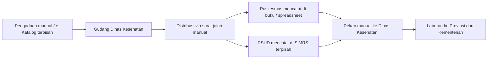


Titik lemah utama berada pada transisi C ke D dan D ke F, karena pencatatan ganda dan
keterlambatan input menyebabkan data tidak sinkron.

---

## 3. Tujuan dan Kriteria Keberhasilan

### 3.1 Tujuan Produk

1. Menyatukan data stok obat dan BMHP seluruh fasilitas kesehatan dalam satu sumber
   kebenaran.
2. Mempercepat perencanaan dan pengadaan melalui perhitungan otomatis dan integrasi
   e-Katalog.
3. Menjamin ketersediaan obat esensial melalui peringatan dini dan distribusi berbasis
   prioritas.
4. Menekan angka kedaluwarsa dan penumpukan stok melalui pengendalian persediaan.
5. Menghasilkan laporan standar secara otomatis dan konsisten.

### 3.2 Kriteria Keberhasilan (KPI)

| KPI                 | Definisi                                              | Target   | Frekuensi  |
| ------------------- | ----------------------------------------------------- | -------- | ---------- |
| Availability Rate   | Item tersedia dibagi total item RKO dikali 100 persen | ≥ 90%    | Bulanan    |
| Stockout Rate       | Item kosong dibagi total item formularium             | ≤ 5%     | Mingguan   |
| Stock Accuracy      | Item tanpa selisih dibagi total item opname           | ≥ 95%    | Bulanan    |
| Expired Rate        | Nilai obat kedaluwarsa dibagi total nilai keluar      | ≤ 1%     | Triwulanan |
| Order Fulfillment   | Permintaan terpenuhi dibagi total permintaan          | ≥ 95%    | Bulanan    |
| Overstock Rate      | Nilai stok di atas maksimum dibagi total inventori    | ≤ 10%    | Triwulanan |
| Waktu Rekap Laporan | Waktu menghasilkan laporan bulanan konsolidasi        | ≤ 10 mnt | Bulanan    |

### 3.3 Metrik Adopsi

| Metrik                             | Target 12 bulan |
| ---------------------------------- | --------------- |
| Fasilitas aktif menggunakan sistem | 100%            |
| Transaksi tercatat di sistem       | ≥ 98%           |
| Pengguna terlatih                  | ≥ 95%           |

---

## 4. Stakeholders dan Personas

### 4.1 Daftar Stakeholder

| Stakeholder            | Peran                                | Kepentingan Utama                        |
| ---------------------- | ------------------------------------ | ---------------------------------------- |
| Kepala Dinas Kesehatan | Pemilik kebijakan dan anggaran       | Ketersediaan obat dan efisiensi anggaran |
| Kepala Bidang Farmasi  | Penanggung jawab teknis kefarmasian  | Akurasi data dan kepatuhan regulasi      |
| Apoteker Gudang Dinas  | Pengelola gudang farmasi kabupaten   | Stok akurat, distribusi lancar           |
| Petugas Gudang         | Eksekutor penerimaan dan pengeluaran | Kemudahan input dan picking              |
| Kepala Puskesmas       | Penanggung jawab fasilitas           | Ketersediaan obat di fasilitas           |
| Apoteker Puskesmas     | Pengelola farmasi Puskesmas          | Perencanaan dan pelayanan obat           |
| Direktur RSUD          | Penanggung jawab RS                  | Kepatuhan pelaporan dan obat program     |
| Apoteker RSUD          | Pengelola farmasi RS                 | Integrasi data dan pelaporan             |
| Auditor Inspektorat    | Pengawas internal                    | Jejak audit dan transparansi             |
| Tim IT Dinas           | Pengelola teknis                     | Keamanan, ketersediaan, pemeliharaan     |

### 4.2 Persona Utama

**Persona 1 — Ibu Ratna, Apoteker Gudang Dinas**

- Usia 34 tahun, pengalaman 8 tahun di gudang farmasi kabupaten.
- Kebutuhan: melihat stok seluruh item dalam satu layar, memprioritaskan distribusi,
  dan mendeteksi item mendekati kedaluwarsa.
- Frustrasi: rekap permintaan Puskesmas dilakukan manual di spreadsheet.

**Persona 2 — Bapak Andi, Apoteker Puskesmas**

- Usia 29 tahun, mengelola farmasi Puskesmas dengan dua Puskesmas Pembantu.
- Kebutuhan: mengajukan permintaan cepat, melihat sisa stok, dan mencatat pelayanan.
- Frustrasi: sering menerima obat yang tidak sesuai kebutuhan dan stok sistem tidak akurat.

**Persona 3 — Ibu Sari, Apoteker RSUD**

- Usia 40 tahun, mengelola instalasi farmasi RSUD BLUD.
- Kebutuhan: melaporkan ketersediaan obat program dan memantau formularium daerah.
- Frustrasi: harus mengisi laporan ganda untuk Dinas dan Kementerian.

**Persona 4 — Bapak Hendra, Kepala Bidang Farmasi**

- Usia 48 tahun, pengambil keputusan teknis.
- Kebutuhan: dashboard ringkas, laporan siap kirim, dan peringatan risiko.
- Frustrasi: angka dari tiap Puskesmas berbeda dan tidak dapat dibandingkan.

---

## 5. Scope

### 5.1 In-Scope

| Area         | Cakupan                                                           |
| ------------ | ----------------------------------------------------------------- |
| Perencanaan  | RKO Puskesmas, RKO RSUD obat program, konsolidasi Dinas           |
| Pengadaan    | Integrasi e-Katalog, PO, penerimaan, BAST                         |
| Penyimpanan  | Multi lokasi (gudang, ruang obat), rak, batch, expired, FEFO      |
| Distribusi   | Dinas ke Puskesmas, Dinas ke RSUD (program), internal, LPLPO      |
| Pelayanan    | Dispensing Puskesmas dan RSUD, pemakaian per pasien               |
| Pengendalian | Stock opname, reorder point, safety stock, alert, mutasi stok     |
| Prediksi     | ROP dinamis, tren, prediksi kebutuhan, peringatan dini            |
| Pelaporan    | Laporan harian sampai tahunan, ekspor standar                     |
| Administrasi | Manajemen pengguna, peran, fasilitas, master data obat dan lokasi |

### 5.2 Out-of-Scope

| Area                          | Alasan                                            |
| ----------------------------- | ------------------------------------------------- |
| Pengadaan obat umum RSUD      | Kewenangan BLUD, hanya dicatat untuk monitoring   |
| Billing dan klaim BPJS        | Ditangani SIMRS dan sistem klaim terpisah         |
| Rekam medis elektronik penuh  | Hanya integrasi ringkas untuk data resep          |
| Akuntansi dan jurnal keuangan | Hanya menyediakan data pendukung, bukan pembukuan |
| Telemedicine                  | Di luar domain logistik farmasi                   |
| Aplikasi mobile native        | Fase awal berbasis web responsif                  |

### 5.3 Batasan

- Aplikasi harus dapat berjalan pada infrastruktur pemerintah daerah dengan bandwidth
  terbatas.
- Sebagian Puskesmas Pembantu memiliki koneksi internet tidak stabil.
- Data historis dari sistem lama perlu dimigrasikan secara bertahap, termasuk data
  konsumsi minimal 12 bulan per item per fasilitas agar modul prediksi dapat aktif.

---

## 6. Arsitektur Sistem

### 6.1 Hierarki Entitas

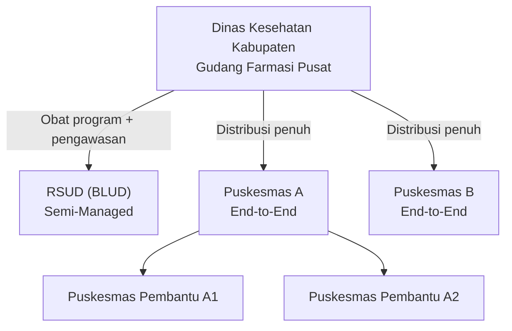

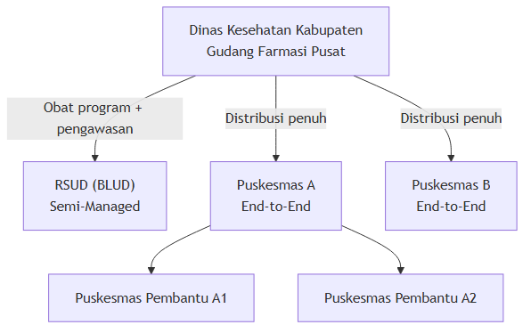

### 6.2 Model Pengelolaan per Entitas

| Kapabilitas            | Dinas Kesehatan | Puskesmas   | RSUD         |
| ---------------------- | --------------- | ----------- | ------------ |
| Perencanaan kebutuhan  | Konsolidasi     | Penuh       | Obat program |
| Pengadaan              | Penuh           | Tidak       | Mandiri      |
| Penerimaan barang      | Penuh           | Penuh       | Penuh        |
| Distribusi keluar      | Penuh           | Internal    | Internal     |
| Pelayanan pasien       | Tidak           | Penuh       | Penuh        |
| Stock opname           | Supervisi       | Penuh       | Penuh        |
| Monitoring stok        | Semua fasilitas | Sendiri     | Sendiri      |
| Pelaporan              | Konsolidasi     | Otomatis    | Bulanan      |
| Anggaran dan realisasi | Budget holder   | Cost center | Mandiri BLUD |
| Prediksi kebutuhan     | Konsolidasi     | Usulan      | Usulan       |
| LPLPO bulanan          | Verifikasi      | Mengajukan  | Tidak        |

### 6.3 Prinsip Arsitektur

1. Multi-fasilitas dengan isolasi data per fasilitas dan akses lintas fasilitas khusus
   untuk peran Dinas.
2. Audit trail wajib untuk setiap mutasi stok, tanpa pengecualian.
3. Soft delete untuk master data agar referensi historis tetap utuh.
4. Idempotensi pada proses penerimaan dan distribusi untuk mencegah pencatatan ganda.
5. Dukungan mode input tertunda untuk fasilitas dengan koneksi tidak stabil, termasuk
   Pustu yang perangkatnya dikelola oleh Puskesmas induk.
6. Otorisasi berbasis peran dengan cakupan akses per fasilitas dan per modul.
7. Hanya Dinas Kesehatan yang memiliki gudang fisik; Puskesmas dan RSUD memiliki ruang
   obat atau instalasi farmasi untuk penyimpanan operasional.

---

## 7. Business Process End-to-End

### 7.1 Alur Utama

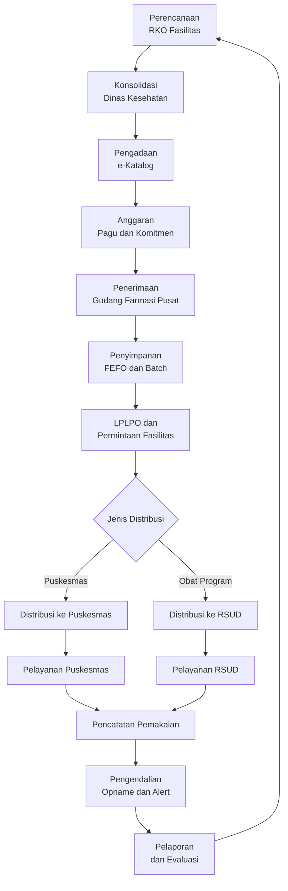

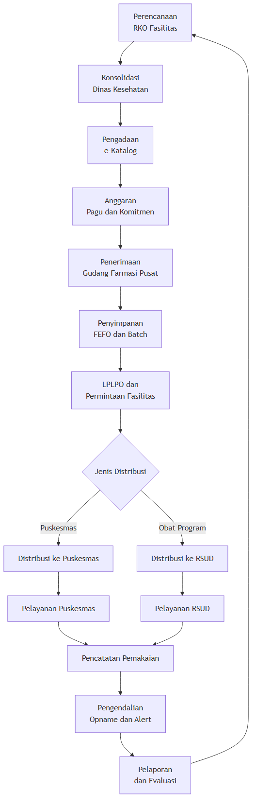

### 7.2 Aktor dan Tanggung Jawab Proses

| Tahap        | Aktor Utama                 | Keluaran                      |
| ------------ | --------------------------- | ----------------------------- |
| Perencanaan  | Apoteker Puskesmas dan RSUD | Dokumen RKO                   |
| Konsolidasi  | Apoteker Gudang Dinas       | Rencana pengadaan gabungan    |
| Pengadaan    | Pejabat Pengadaan           | PO dan kontrak                |
| Penerimaan   | Petugas Gudang              | BAST dan stok masuk           |
| Penyimpanan  | Petugas Gudang              | Lokasi rak dan batch tercatat |
| Distribusi   | Petugas Gudang dan Kurir    | Surat jalan dan BAST          |
| Pelayanan    | Apoteker Fasilitas          | Catatan dispensing            |
| Pengendalian | Apoteker dan Auditor        | Berita acara opname           |
| Pelaporan    | Kepala Bidang Farmasi       | Laporan standar               |

---

## 8. Fitur per Modul

### 8.1 Modul Perencanaan (RKO)

#### 8.1.1 Ringkasan Modul Perencanaan

Modul ini menghitung kebutuhan obat tiap fasilitas berdasarkan data konsumsi, morbiditas,
sisa stok, waktu tunggu, dan stok penyangga, lalu mengonsolidasikannya di level Dinas.

#### 8.1.2 Aktor dan Hak Akses Perencanaan

| Peran                 | Hak                                    |
| --------------------- | -------------------------------------- |
| Apoteker Puskesmas    | Membuat, mengubah, mengajukan RKO      |
| Apoteker RSUD         | Membuat RKO obat program               |
| Apoteker Gudang Dinas | Melihat, memverifikasi, mengonsolidasi |
| Kepala Bidang Farmasi | Menyetujui rencana pengadaan           |

#### 8.1.3 Fitur Modul Perencanaan

1. Perhitungan otomatis metode konsumsi berdasarkan pemakaian periode sebelumnya.
2. Perhitungan metode morbiditas berdasarkan angka kesakitan per diagnosa.
3. Penyesuaian otomatis untuk buffer stock dan lead time stock.
4. Analisis ABC dan VEN beserta kombinasi ABC-VEN untuk prioritas.
5. Simulasi skenario kebutuhan dengan parameter yang dapat diubah.
6. Konsolidasi otomatis RKO seluruh fasilitas menjadi rencana pengadaan.
7. Deteksi duplikasi dan anomali jumlah yang tidak wajar.
8. Riwayat versi RKO dan jejak persetujuan.

#### 8.1.4 Alur Modul Perencanaan

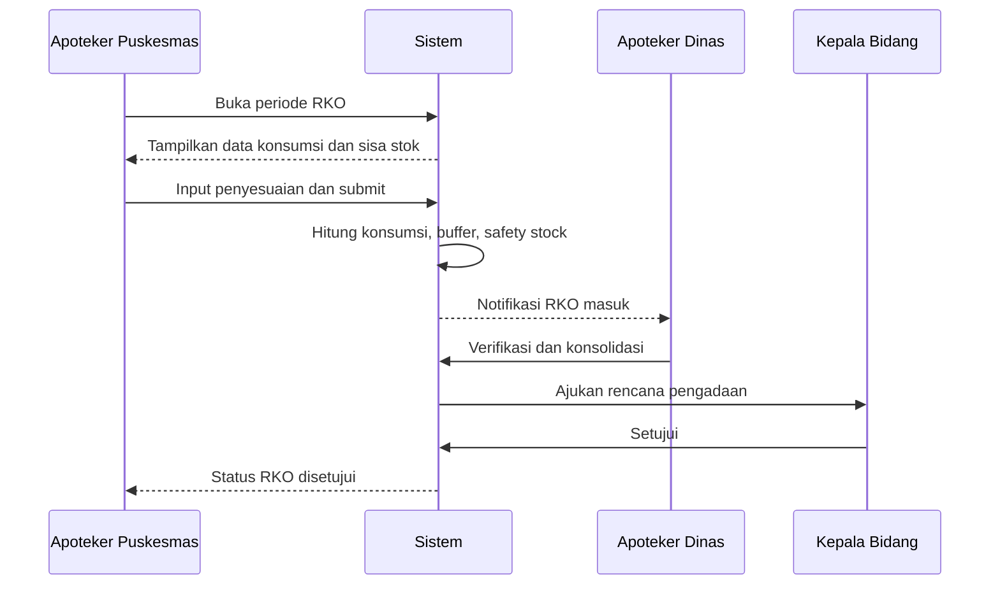

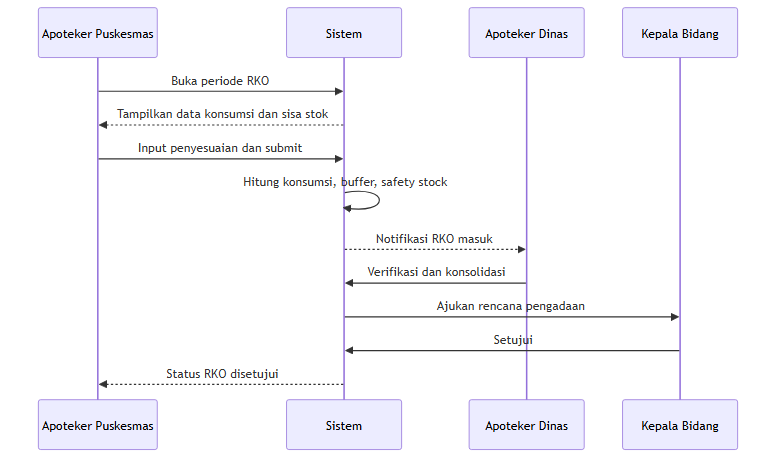

#### 8.1.5 Aturan Bisnis Perencanaan

- RKO diajukan per triwulan dengan tenggat H-30 sebelum periode berjalan.
- Perhitungan metode konsumsi menggunakan rata-rata pemakaian tiga sampai enam bulan.
- Buffer stock ditetapkan berdasarkan kebijakan Dinas dan dapat berbeda per kategori obat.
- Item kategori V (Vital) tidak boleh diusulkan nol tanpa alasan tertulis.
- Perubahan RKO setelah disetujui memerlukan persetujuan ulang.

#### 8.1.6 Contoh Data Perencanaan

Contoh RKO Puskesmas untuk periode triwulan I 2027:

| Kode    | Nama Obat            | Satuan | Pemakaian 3 Bln | Sisa Stok | Buffer | Kebutuhan |
| ------- | -------------------- | ------ | --------------: | --------: | -----: | --------: |
| OBT-001 | Amoksisilin 500 mg   | Tablet |           3.600 |       400 |    300 |     3.500 |
| OBT-002 | Parasetamol 500 mg   | Tablet |           5.400 |       800 |    450 |     5.050 |
| OBT-003 | Metformin 500 mg     | Tablet |           1.800 |       250 |    150 |     1.700 |
| OBT-004 | Amlodipin 10 mg      | Tablet |           2.700 |       300 |    220 |     2.620 |
| OBT-005 | Kotrimoksazol 480 mg | Tablet |             900 |       150 |     80 |       830 |
| OBT-006 | Oralit Serbuk        | Sachet |           1.200 |       200 |    100 |     1.100 |
| OBT-007 | Salbutamol Inhaler   | Botol  |              60 |        12 |     10 |        58 |
| OBT-008 | Insulin Glargine     | Vial   |              30 |         6 |      4 |        28 |

Catatan: kebutuhan dihitung sebagai pemakaian ditambah buffer dikurangi sisa stok, dengan
pembulatan ke atas sesuai satuan terkecil.

### 8.2 Modul Pengadaan

#### 8.2.1 Ringkasan Modul Pengadaan

Modul ini mengelola proses pengadaan dari rencana yang disetujui hingga penerbitan pesanan,
dengan integrasi e-Katalog untuk fasilitas yang wajib mengikuti mekanisme tersebut.

#### 8.2.2 Aktor dan Hak Akses Pengadaan

| Peran                 | Hak                                        |
| --------------------- | ------------------------------------------ |
| Pejabat Pengadaan     | Membuat PO dan memilih penyedia            |
| Apoteker Gudang Dinas | Menyusun keranjang pengadaan               |
| Kepala Bidang Farmasi | Menyetujui PO sampai dengan Rp 200.000.000 |
| Kepala Dinas          | Menyetujui PO di atas Rp 200.000.000       |
| Auditor               | Melihat riwayat pengadaan secara read-only |

#### 8.2.3 Fitur Modul Pengadaan

1. Keranjang pengadaan otomatis dari rencana yang disetujui.
2. Integrasi katalog elektronik untuk pencarian produk dan harga.
3. Pembuatan PO, kontrak, dan surat pesanan obat.
4. Persetujuan berjenjang berdasarkan nilai pengadaan.
5. Pelacakan status pesanan dari dipesan hingga diterima.
6. Pencatatan penerimaan sebagian dan penerimaan bertahap.
7. Perbandingan harga historis per item dan per penyedia.
8. Deteksi penyedia dengan riwayat keterlambatan.

#### 8.2.4 Aturan Bisnis Pengadaan

- Pengadaan wajib merujuk pada RKO yang telah disetujui.
- Pengadaan di atas Rp 200.000.000 memerlukan persetujuan Kepala Dinas setelah
  persetujuan Kepala Bidang Farmasi.
- Penerimaan tidak boleh melebihi jumlah pada PO tanpa adendum.
- Setiap PO wajib memiliki nomor unik yang tidak dapat digunakan ulang.
- Item tanpa nomor izin edar yang berlaku tidak boleh dipesan.

#### 8.2.5 Contoh Data Pengadaan

| No PO        | Tanggal    | Penyedia          | Jumlah Item |       Nilai | Status               |
| ------------ | ---------- | ----------------- | ----------: | ----------: | -------------------- |
| PO/2027/0001 | 2027-01-05 | PT Sehat Farma    |          18 | 245.000.000 | Diterima             |
| PO/2027/0002 | 2027-01-08 | PT Medika Jaya    |          12 | 132.500.000 | Sebagian             |
| PO/2027/0003 | 2027-01-12 | PT Global Medika  |           9 |  87.300.000 | Dikirim              |
| PO/2027/0004 | 2027-01-15 | PT Sehat Farma    |          22 | 310.750.000 | Menunggu persetujuan |
| PO/2027/0005 | 2027-01-20 | PT Nusantara Obat |           7 |  54.900.000 | Draf                 |

### 8.3 Modul Penerimaan dan Penyimpanan

#### 8.3.1 Ringkasan Modul Penerimaan dan Penyimpanan

Modul ini mencatat penerimaan barang dari penyedia, memverifikasi kesesuaian dokumen dan
fisik, lalu menempatkan barang pada lokasi penyimpanan dengan pencatatan batch dan tanggal
kedaluwarsa. Lokasi penyimpanan terdiri atas gudang pada Dinas Kesehatan, ruang obat pada
Puskesmas, dan instalasi farmasi pada RSUD. Pustu tidak memiliki lokasi penyimpanan
tersendiri pada MVP; stok Pustu dicatat sebagai bagian dari ruang obat Puskesmas induk.

#### 8.3.2 Aktor dan Hak Akses Penerimaan

| Peran           | Hak                                          |
| --------------- | -------------------------------------------- |
| Petugas Gudang  | Menerima, memeriksa, menempatkan barang      |
| Apoteker Gudang | Memverifikasi mutu dan menyetujui penerimaan |
| Auditor         | Melihat dokumen penerimaan                   |

#### 8.3.3 Fitur Modul Penerimaan dan Penyimpanan

1. Penerimaan berdasarkan PO dengan validasi jumlah dan item.
2. Pencatatan nomor batch dan tanggal kedaluwarsa per unit penerimaan.
3. Pemindaian barcode untuk mempercepat input.
4. Penempatan otomatis ke lokasi rak berdasarkan aturan kategori.
5. Pencetakan label lokasi, batch, dan peringatan kedaluwarsa.
6. Penerimaan sebagian dan penanganan selisih kirim.
7. Karantina otomatis untuk barang yang belum lolos pemeriksaan mutu.
8. Pemetaan zona penyimpanan sesuai suhu dan kategori obat.
9. Pencatatan otomatis mutasi stok pada setiap penerimaan.

#### 8.3.4 Zona Penyimpanan Standar

| Zona      | Peruntukan                      | Kondisi Suhu    |
| --------- | ------------------------------- | --------------- |
| Zona A    | Obat fast-moving kategori A     | 15–25 °C        |
| Zona B    | Obat medium-moving kategori B   | 15–25 °C        |
| Zona C    | Obat slow-moving kategori C     | 15–25 °C        |
| Cold      | Vaksin dan produk rantai dingin | 2–8 °C          |
| Frozen    | Produk beku tertentu            | ≤ -15 °C        |
| Narkotika | Narkotika dan psikotropika      | Lemari terkunci |
| Karantina | Barang menunggu pemeriksaan     | Sesuai jenis    |
| Retur     | Barang akan dikembalikan        | Sesuai jenis    |
| Musnah    | Barang rusak atau kedaluwarsa   | Terpisah        |

Gudang Farmasi Pusat menerapkan seluruh zona. Ruang obat Puskesmas umumnya hanya memakai
zona A, B, dan C sesuai kapasitas, sedangkan Instalasi Farmasi RSUD dapat memakai zona
lengkap termasuk cold dan frozen.

#### 8.3.5 Contoh Kartu Stok

Kartu stok item Amoksisilin 500 mg, Gudang Farmasi Pusat, periode Januari 2027:

| Tanggal    | No Dokumen   | Jenis       | Masuk | Keluar |  Sisa | Batch   | Expired    |
| ---------- | ------------ | ----------- | ----: | -----: | ----: | ------- | ---------- |
| 2027-01-05 | PO/2027/0001 | Masuk       | 5.000 |      0 | 5.000 | AMX2401 | 2028-12-31 |
| 2027-01-10 | DO/2027/0012 | Keluar      |     0 |  1.200 | 3.800 | AMX2401 | 2028-12-31 |
| 2027-01-15 | DO/2027/0018 | Keluar      |     0 |    900 | 2.900 | AMX2401 | 2028-12-31 |
| 2027-01-20 | PO/2027/0002 | Masuk       | 3.000 |      0 | 5.900 | AMX2402 | 2029-03-31 |
| 2027-01-25 | DO/2027/0025 | Keluar      |     0 |  1.500 | 4.400 | AMX2401 | 2028-12-31 |
| 2027-01-28 | ADJ/2027/003 | Penyesuaian |     0 |     40 | 4.360 | AMX2401 | 2028-12-31 |

#### 8.3.6 Contoh Data Lokasi Penyimpanan

| ID     | Nama Lokasi            | Fasilitas       | Jenis             | Zona                                                       |
| ------ | ---------------------- | --------------- | ----------------- | ---------------------------------------------------------- |
| LP-001 | Gudang Farmasi Pusat   | Dinas Kesehatan | gudang            | A, B, C, Cold, Frozen, Narkotika, Karantina, Retur, Musnah |
| LP-002 | Ruang Obat Puskesmas A | Puskesmas A     | ruang_obat        | A, B, C                                                    |
| LP-003 | Ruang Obat Puskesmas B | Puskesmas B     | ruang_obat        | A, B                                                       |
| LP-004 | Instalasi Farmasi RSUD | RSUD            | instalasi_farmasi | A, B, C, Cold, Frozen, Narkotika, Karantina, Retur, Musnah |
| LP-005 | Ruang Obat Pustu A1    | Pustu A1        | ruang_obat        | A                                                          |

### 8.4 Modul Distribusi

#### 8.4.1 Ringkasan Modul Distribusi

Modul ini mengelola permintaan dari fasilitas, penentuan prioritas, penyiapan barang,
pengiriman, dan konfirmasi penerimaan di fasilitas tujuan.

#### 8.4.2 Aktor dan Hak Akses Distribusi

| Peran                 | Hak                                         |
| --------------------- | ------------------------------------------- |
| Apoteker Puskesmas    | Mengajukan dan mengonfirmasi permintaan     |
| Apoteker RSUD         | Mengajukan permintaan obat program          |
| Apoteker Gudang Dinas | Memverifikasi, memprioritaskan, menerbitkan |
| Petugas Gudang        | Menyiapkan dan mengeluarkan barang          |
| Kurir                 | Memperbarui status pengiriman               |

#### 8.4.3 Fitur Modul Distribusi

1. Formulir permintaan per item dengan validasi terhadap RKO dan stok Dinas.
2. Mesin prioritas berdasarkan tingkat kekritisan stok fasilitas.
3. Rekomendasi alokasi otomatis ketika stok terbatas.
4. Pembuatan surat jalan dan surat pengeluaran barang.
5. Picking list dengan urutan pengambilan sesuai FEFO.
6. Pelacakan status pengiriman.
7. Konfirmasi penerimaan dengan pencatatan selisih.
8. Redistribusi antar Puskesmas untuk menyeimbangkan stok.
9. Pencatatan otomatis mutasi stok pada setiap pengiriman.

#### 8.4.4 Alur Distribusi

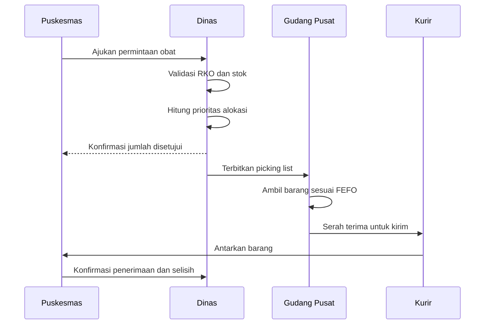


#### 8.4.5 Aturan Alokasi Prioritas

| Prioritas | Kondisi                               | Perlakuan                    |
| --------- | ------------------------------------- | ---------------------------- |
| 1         | Stok fasilitas di bawah safety stock  | Dipenuhi penuh lebih dahulu  |
| 2         | Stok fasilitas di bawah reorder point | Dipenuhi setelah prioritas 1 |
| 3         | Stok fasilitas dalam batas aman       | Dipenuhi proporsional        |
| 4         | Stok fasilitas di atas maksimum       | Ditunda atau dikurangi       |

#### 8.4.6 Contoh Data Distribusi

| No DO        | Tanggal    | Tujuan         | Item | Jumlah | Status   | Selisih |
| ------------ | ---------- | -------------- | ---: | -----: | -------- | ------: |
| DO/2027/0012 | 2027-01-10 | Puskesmas A    |    8 |  4.500 | Diterima |       0 |
| DO/2027/0018 | 2027-01-15 | Puskesmas B    |    6 |  3.200 | Diterima |       0 |
| DO/2027/0025 | 2027-01-25 | Puskesmas C    |    9 |  5.100 | Diterima |      20 |
| DO/2027/0031 | 2027-02-02 | RSUD (program) |    4 |  1.800 | Diterima |       0 |
| DO/2027/0035 | 2027-02-08 | Puskesmas A    |    7 |  2.900 | Dikirim  |       — |

### 8.5 Modul Pelayanan dan Dispensing

#### 8.5.1 Ringkasan Modul Pelayanan dan Dispensing

Modul ini mencatat penggunaan obat untuk pasien di Puskesmas dan RSUD sehingga pemakaian
riil dapat menjadi dasar perencanaan periode berikutnya.

#### 8.5.2 Aktor dan Hak Akses Pelayanan

| Peran           | Hak                                    |
| --------------- | -------------------------------------- |
| Dokter          | Menulis resep elektronik               |
| Apoteker        | Menelaah, menyiapkan, menyerahkan obat |
| Petugas Farmasi | Menyiapkan dan mencatat penyerahan     |

#### 8.5.3 Fitur Modul Pelayanan dan Dispensing

1. Penerimaan resep elektronik dari modul pelayanan atau sistem eksternal.
2. Telaah resep meliputi dosis, interaksi, dan duplikasi.
3. Pengurangan stok otomatis saat penyerahan obat.
4. Pencatatan pemakaian per item, per pasien, dan per diagnosa.
5. Penanganan resep racikan dengan komposisi bahan.
6. Pencatatan obat tidak terlayani beserta alasannya.
7. Pengembalian obat dari unit ke ruang obat atau gudang dengan pencatatan.
8. Rekap pemakaian untuk umpan balik perencanaan.
9. Pencatatan mutasi stok otomatis saat penyerahan obat.

#### 8.5.4 Aturan Bisnis Pelayanan

- Stok tidak boleh menjadi negatif; penyerahan diblokir bila stok tidak mencukupi.
- Obat dengan batch mendekati kedaluwarsa diprioritaskan keluar.
- Narkotika dan psikotropika memerlukan pencatatan khusus dan persetujuan apoteker.
- Obat rusak atau kedaluwarsa tidak boleh diserahkan dan harus masuk jalur pemusnahan.

#### 8.5.5 Contoh Data Pemakaian

Rekap pemakaian Puskesmas A, Januari 2027 (belum termasuk Pustu):

| Kode    | Nama Obat            | Jumlah Keluar | Jumlah Pasien | Rata-rata per Pasien |
| ------- | -------------------- | ------------: | ------------: | -------------------: |
| OBT-001 | Amoksisilin 500 mg   |         1.200 |           400 |                    3 |
| OBT-002 | Parasetamol 500 mg   |         1.800 |           600 |                    3 |
| OBT-003 | Metformin 500 mg     |           600 |           200 |                    3 |
| OBT-004 | Amlodipin 10 mg      |           900 |           300 |                    3 |
| OBT-005 | Kotrimoksazol 480 mg |           300 |           100 |                    3 |

### 8.6 Modul Pengendalian Persediaan

#### 8.6.1 Ringkasan Modul Pengendalian Persediaan

Modul ini menjaga keseimbangan stok melalui perhitungan titik pemesanan kembali, stok
pengaman, stock opname, serta peringatan dini untuk kekosongan dan kedaluwarsa.

#### 8.6.2 Aktor dan Hak Akses Pengendalian

| Peran              | Hak                                    |
| ------------------ | -------------------------------------- |
| Apoteker Fasilitas | Menjalankan opname dan menindaklanjuti |
| Apoteker Gudang    | Menyetujui penyesuaian stok            |
| Auditor            | Memverifikasi berita acara opname      |

#### 8.6.3 Fitur Modul Pengendalian Persediaan

1. Perhitungan safety stock dan reorder point per item per fasilitas.
2. Penetapan batas minimum dan maksimum stok.
3. Peringatan otomatis untuk stok kritis, kekosongan, dan kelebihan.
4. Peringatan kedaluwarsa berjenjang 6, 3, dan 1 bulan.
5. Modul stock opname dengan blanko per lokasi dan rekonsiliasi selisih.
6. Analisis fast, slow, dan non-moving item.
7. Usulan redistribusi antar fasilitas berdasarkan kelebihan dan kekurangan.
8. Pencatatan pemusnahan beserta berita acara.
9. Pencatatan mutasi stok untuk opname dan penyesuaian.

#### 8.6.4 Formula Pengendalian

```text
Safety Stock   = (Pemakaian Maks × Lead Time Maks) − (Pemakaian Rata × Lead Time Rata)
Reorder Point  = (Pemakaian Rata × Lead Time Rata) + Safety Stock
Max Stock      = Reorder Point + Kuantitas Pemesanan Ekonomis
EOQ            = sqrt(2 × Kebutuhan Tahunan × Biaya Pesan ÷ Biaya Simpan per Unit)
```

#### 8.6.5 Tingkatan Peringatan

| Tingkat   | Kondisi                         | Warna     | Tindakan                      |
| --------- | ------------------------------- | --------- | ----------------------------- |
| Normal    | Stok di antara ROP dan maksimum | Hijau     | Pemantauan rutin              |
| Waspada   | Stok di bawah ROP               | Kuning    | Ajukan permintaan             |
| Kritis    | Stok di bawah safety stock      | Merah     | Prioritas distribusi          |
| Kosong    | Stok sama dengan nol            | Merah tua | Eskalasi dan substitusi       |
| Kelebihan | Stok di atas maksimum           | Biru      | Tunda pengadaan, redistribusi |

#### 8.6.6 Contoh Hasil Stock Opname

| Kode    | Nama Obat          | Stok Sistem | Stok Fisik | Selisih | Keterangan              |
| ------- | ------------------ | ----------: | ---------: | ------: | ----------------------- |
| OBT-001 | Amoksisilin 500 mg |       4.360 |      4.350 |     -10 | Selisih hitung          |
| OBT-002 | Parasetamol 500 mg |       6.200 |      6.200 |       0 | Sesuai                  |
| OBT-003 | Metformin 500 mg   |       1.850 |      1.880 |     +30 | Input distribusi kurang |
| OBT-004 | Amlodipin 10 mg    |       2.640 |      2.640 |       0 | Sesuai                  |
| OBT-009 | Vitamin A Kapsul   |         500 |        480 |     -20 | Kemasan rusak           |

#### 8.6.7 Contoh Analisis ABC-VEN

| Kode    | Nilai Pemakaian | Kumulatif | Kelas ABC | Kategori VEN  | Prioritas |
| ------- | --------------: | --------: | --------- | ------------- | --------- |
| OBT-004 |     180.000.000 |       38% | A         | Vital         | AV        |
| OBT-003 |     120.000.000 |       63% | A         | Essential     | AE        |
| OBT-002 |      72.000.000 |       78% | A         | Essential     | AE        |
| OBT-001 |      54.000.000 |       89% | B         | Vital         | BV        |
| OBT-007 |      36.000.000 |       96% | B         | Essential     | BE        |
| OBT-005 |      12.000.000 |       99% | C         | Essential     | CE        |
| OBT-006 |       6.000.000 |      100% | C         | Non-Essential | CN        |

Prioritas AV dan BV mendapat kendali ketat, pemantauan harian, dan jaminan ketersediaan.
Prioritas CN dapat dikurangi frekuensi pengadaannya.

#### 8.6.8 Contoh Pemantauan Kedaluwarsa

| Kode    | Nama Obat          | Batch   | Expired    | Sisa | Sisa Hari | Status        |
| ------- | ------------------ | ------- | ---------- | ---: | --------: | ------------- |
| OBT-010 | Vaksin Campak      | VC2401  | 2027-02-15 |  120 |        30 | Sangat Kritis |
| OBT-011 | Insulin Reguler    | IR2402  | 2027-04-30 |   40 |       104 | Waspada       |
| OBT-012 | Tetrasiklin 250 mg | TC2312  | 2027-08-31 |  300 |       227 | Aman          |
| OBT-013 | Serum Anti Rabies  | SAR2401 | 2027-01-20 |    8 |         4 | Sangat Kritis |

Acuan perhitungan sisa hari adalah 16 Januari 2027. Ambang peringatan kedaluwarsa:

| Tingkat       | Sisa Hari | Warna     | Tindakan                           |
| ------------- | --------: | --------- | ---------------------------------- |
| Aman          |     > 180 | Hijau     | Pemantauan rutin                   |
| Waspada       |    91–180 | Kuning    | Prioritaskan pemakaian             |
| Kritis        |     31–90 | Merah     | Ajukan redistribusi atau pemakaian |
| Sangat Kritis |      ≤ 30 | Merah tua | Redistribusi atau pemusnahan       |

Label tingkat kedaluwarsa ini terpisah dari status stok pada §8.6.5.

### 8.7 Modul Pelaporan dan Monitoring

#### 8.7.1 Ringkasan Modul Pelaporan dan Monitoring

Modul ini menyusun laporan standar secara otomatis dan menyediakan dashboard pemantauan
bagi pimpinan serta pengelola teknis.

#### 8.7.2 Aktor dan Hak Akses Pelaporan

| Peran                 | Hak                          |
| --------------------- | ---------------------------- |
| Kepala Dinas          | Dashboard seluruh fasilitas  |
| Kepala Bidang Farmasi | Dashboard dan ekspor laporan |
| Apoteker Fasilitas    | Laporan fasilitas sendiri    |
| Auditor               | Akses baca seluruh laporan   |

#### 8.7.3 Fitur Modul Pelaporan dan Monitoring

1. Dashboard ketersediaan, kekosongan, dan nilai inventori.
2. Laporan harian mutasi stok per lokasi penyimpanan.
3. Laporan bulanan ketersediaan obat dan BMHP.
4. Laporan triwulanan realisasi RKO dan analisis ABC-VEN.
5. Laporan kedaluwarsa dan pemusnahan.
6. Laporan kinerja fasilitas dengan peringkat.
7. Ekspor laporan ke format standar untuk pelaporan ke pusat.
8. Penjadwalan pengiriman laporan otomatis.

#### 8.7.4 Contoh Dashboard Ringkas

| Indikator         | Nilai | Target | Status    |
| ----------------- | ----: | -----: | --------- |
| Availability Rate |   92% |  ≥ 90% | Tercapai  |
| Stockout Rate     |    4% |   ≤ 5% | Tercapai  |
| Stock Accuracy    |   96% |  ≥ 95% | Tercapai  |
| Expired Rate      |  0,8% |   ≤ 1% | Tercapai  |
| Order Fulfillment |   94% |  ≥ 95% | Perhatian |
| Overstock Rate    |   11% |  ≤ 10% | Perhatian |

Status Tercapai/Perhatian adalah label dashboard, terpisah dari status serapan anggaran
pada §8.8.7.

#### 8.7.5 Contoh Laporan Ketersediaan Fasilitas

| Fasilitas   | Item RKO | Tersedia | Kosong | Availability | Peringkat |
| ----------- | -------: | -------: | -----: | -----------: | --------: |
| Puskesmas A |      120 |      114 |      6 |          95% |         1 |
| Puskesmas B |      118 |      108 |     10 |          92% |         2 |
| Puskesmas C |      125 |      112 |     13 |          90% |         3 |
| RSUD        |      210 |      189 |     21 |          90% |         4 |
| Puskesmas D |      115 |       98 |     17 |          85% |         5 |

### 8.8 Modul Anggaran dan Realisasi

#### 8.8.1 Ringkasan Modul Anggaran

Modul ini mengelola alokasi anggaran obat dan realisasinya per fasilitas kesehatan.
Dinas Kesehatan berperan sebagai pemegang anggaran (budget holder), Puskesmas berperan
sebagai pusat biaya (cost center) yang memakai anggaran melalui permintaan, sedangkan
RSUD mengelola anggarannya secara mandiri sebagai BLUD dan hanya melaporkan realisasi
obat program ke Dinas.

Realisasi tercatat otomatis pada dua titik: komitmen saat PO diterbitkan dan realisasi
aktual saat barang diterima. Komitmen yang dimaksud adalah komitmen yang belum direalisasi
(outstanding), sehingga tidak terjadi penghitungan ganda. Dengan cara ini sisa pagu setiap
fasilitas selalu dapat dilihat secara real-time.

#### 8.8.2 Aktor dan Hak Akses Anggaran

| Peran                 | Hak                                                     |
| --------------------- | ------------------------------------------------------- |
| Kepala Dinas          | Menetapkan pagu dan menyetujui realokasi                |
| Kepala Bidang Farmasi | Mengelola pagu dan memantau realisasi seluruh fasilitas |
| Pejabat Keuangan      | Merekonsiliasi komitmen otomatis, pembayaran, dan BAST  |
| Apoteker Puskesmas    | Melihat pagu, sisa, dan mengajukan permintaan           |
| Apoteker RSUD         | Mengelola anggaran mandiri dan melaporkan realisasi     |
| Auditor               | Melihat seluruh realisasi secara read-only              |

#### 8.8.3 Fitur Modul Anggaran

1. Penetapan pagu anggaran per fasilitas per periode dan per sumber dana.
2. Pencatatan komitmen otomatis saat PO diterbitkan.
3. Pencatatan realisasi aktual otomatis saat barang diterima.
4. Perhitungan sisa pagu dan persentase serapan secara real-time.
5. Peringatan serapan rendah pada triwulan III dan pagu hampir habis.
6. Realokasi pagu antar fasilitas dengan persetujuan berjenjang.
7. Pencatatan sumber dana (APBD, DAK, dan BLUD) pada setiap transaksi.
8. Rekonsiliasi realisasi dengan dokumen pembayaran dan BAST.

#### 8.8.4 Alur Alokasi dan Realisasi

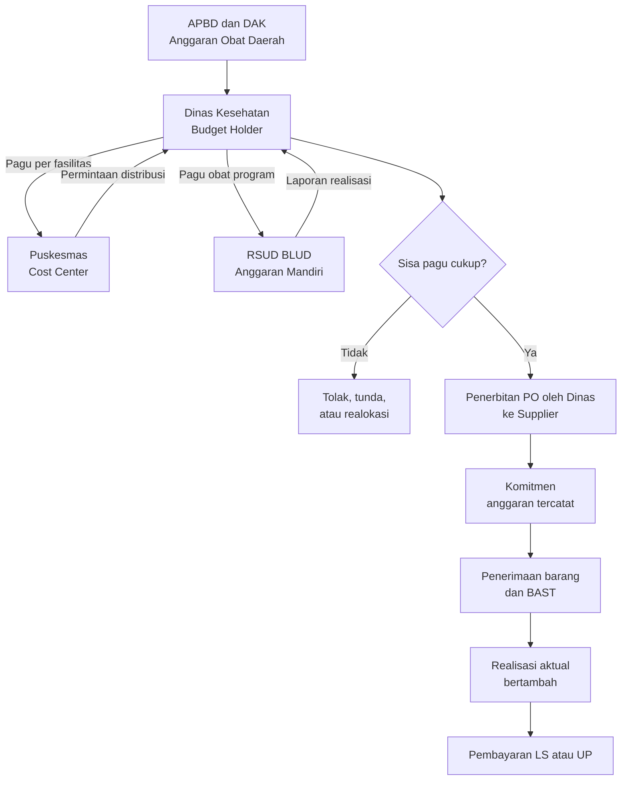

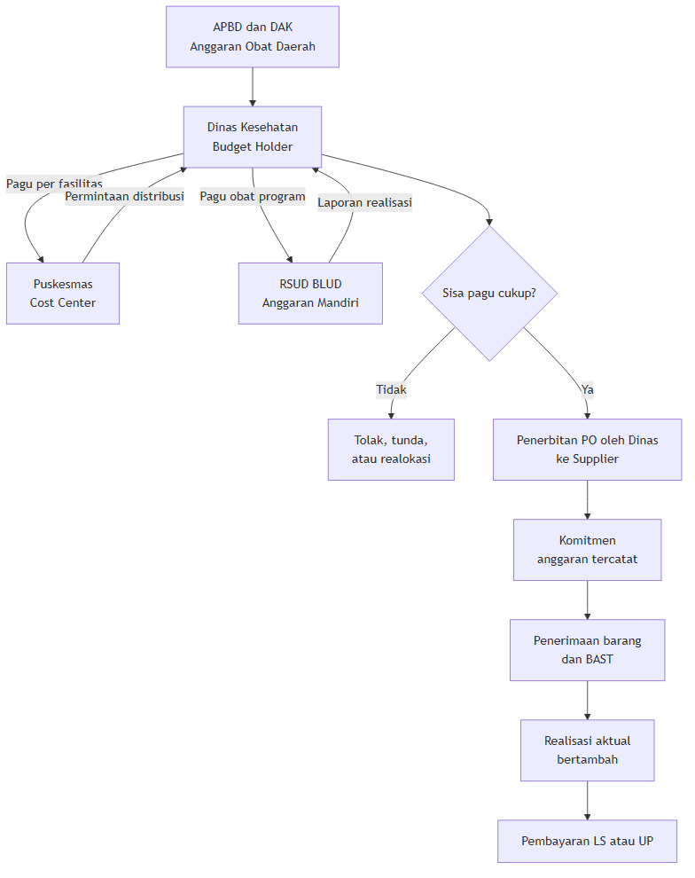

#### 8.8.5 Aturan Bisnis Anggaran

- Pagu ditetapkan per tahun anggaran dan hanya dapat diubah melalui mekanisme revisi.
- Permintaan tidak boleh melebihi sisa pagu fasilitas yang tersedia.
- Komitmen outstanding mengurangi pagu tersedia; saat realisasi tercatat, komitmen
  outstanding berkurang dan realisasi bertambah.
- Setiap transaksi wajib mencantumkan sumber dana agar tidak terjadi duplikasi.
- Realokasi pagu antar fasilitas memerlukan persetujuan Kepala Dinas.
- RSUD mengelola pagu mandiri dan melaporkan realisasi obat program ke Dinas.
- Pagu, komitmen, dan realisasi tidak boleh bernilai negatif.

#### 8.8.6 Contoh Data Realisasi Anggaran

| Fasilitas    | Sumber Dana |            Pagu |       Komitmen |       Realisasi |            Sisa | Serapan |
| ------------ | ----------- | --------------: | -------------: | --------------: | --------------: | ------: |
| Puskesmas A  | APBD        |     150.000.000 |     12.000.000 |      87.500.000 |      50.500.000 |     58% |
| Puskesmas B  | APBD + DAK  |     120.000.000 |              0 |     108.000.000 |      12.000.000 |     90% |
| Puskesmas C  | DAK         |      90.000.000 |      8.000.000 |      36.000.000 |      46.000.000 |     40% |
| RSUD program | DAK         |      80.000.000 |              0 |      52.000.000 |      28.000.000 |     65% |
| **Total**    | —           | **440.000.000** | **20.000.000** | **283.500.000** | **136.500.000** | **64%** |

Sisa pagu dihitung sebagai pagu dikurangi komitmen outstanding dan realisasi. Persentase
serapan dihitung dari realisasi dibagi pagu.

#### 8.8.7 Status Serapan Anggaran

| Status        | Kondisi                                | Tindakan                         |
| ------------- | -------------------------------------- | -------------------------------- |
| Aman          | Serapan 40–85% dan sisa di atas 15%    | Pemantauan rutin                 |
| Rendah        | Serapan di bawah 40% pada triwulan III | Evaluasi dan percepat permintaan |
| Hampir habis  | Sisa pagu di bawah 15%                 | Ajukan realokasi atau tambahan   |
| Habis         | Sisa pagu sama dengan nol              | Blokir permintaan baru           |
| Over komitmen | Komitmen melebihi pagu                 | Blokir PO dan eskalasi           |

Batas 40% termasuk kategori Aman; status Rendah hanya berlaku mulai triwulan III. Status
serapan ini terpisah dari label dashboard Tercapai/Perhatian pada §8.7.4.

### 8.9 Modul Manajemen Pengguna

#### 8.9.1 Ringkasan Modul Pengguna

Modul ini mengelola akun, peran, dan penugasan pengguna ke fasilitas kesehatan. Setiap
pengguna hanya dapat mengakses data sesuai peran dan fasilitas yang ditugaskan, sementara
peran Dinas dapat melihat data lintas fasilitas. Modul ini juga mencatat aktivitas kritis
pengguna untuk keperluan audit. Autentikasi dapat menggunakan kata sandi atau Google
OAuth 2.0 untuk peran non-administrator.

#### 8.9.2 Aktor dan Hak Akses Pengguna

| Peran               | Hak                                                        |
| ------------------- | ---------------------------------------------------------- |
| Administrator Dinas | Mengelola seluruh akun, peran, dan penugasan               |
| Kepala Dinas        | Melihat daftar pengguna dan menyetujui akun tingkat kepala |
| Kepala Puskesmas    | Melihat pengguna pada fasilitasnya                         |
| Pengguna            | Mengubah profil dan kata sandi sendiri                     |

#### 8.9.3 Fitur Modul Pengguna

1. Pembuatan, perubahan, dan penonaktifan akun pengguna.
2. Pengelolaan peran beserta kumpulan hak aksesnya.
3. Penugasan pengguna ke satu atau lebih fasilitas kesehatan.
4. Kebijakan kata sandi dan alur reset kata sandi.
5. Autentikasi dua faktor (2FA) berbasis TOTP.
6. Pencatatan audit trail untuk login, logout, dan aksi kritis.
7. Alur undangan, verifikasi, dan aktivasi akun baru.
8. Penonaktifan otomatis akun yang tidak aktif dalam jangka waktu tertentu.
9. Autentikasi dengan Google OAuth 2.0 sebagai alternatif login untuk peran non-admin.
10. Pengelolaan whitelist akun Google yang diizinkan oleh administrator.

#### 8.9.4 Alur Onboarding dan Login

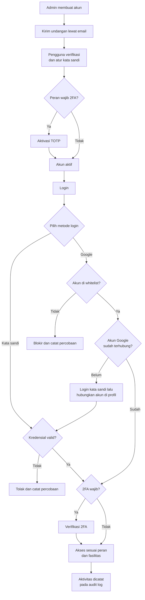

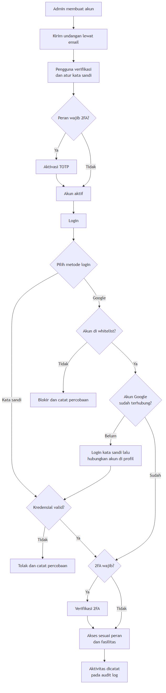

#### 8.9.5 Aturan Bisnis Pengguna

- Kata sandi minimal 12 karakter dengan kombinasi huruf, angka, dan simbol.
- Kata sandi kedaluwarsa setiap 90 hari dan tidak boleh sama dengan tiga kata sandi terakhir.
- Akun terkunci sementara setelah lima percobaan login gagal.
- Akun yang tidak aktif selama 90 hari dinonaktifkan otomatis.
- 2FA wajib untuk peran administrator, kepala dinas, dan kepala bidang.
- Satu pengguna dapat ditugaskan ke lebih dari satu fasilitas dengan peran berbeda.
- Penonaktifan akun tidak menghapus riwayat audit dan transaksi.
- Setiap perubahan peran atau penugasan dicatat pada audit log.
- Login dengan Google hanya tersedia untuk peran non-administrator.
- Akun Google wajib masuk whitelist yang disetujui administrator sebelum digunakan.
- Penghubungan akun Google dilakukan manual oleh pengguna setelah login dengan kata sandi.
- Peran yang mewajibkan 2FA tetap harus menyelesaikan 2FA setelah login dengan Google.

#### 8.9.6 Contoh Data Pengguna

| Nama Pengguna  | Peran                 | Fasilitas       | 2FA   | Status   |
| -------------- | --------------------- | --------------- | ----- | -------- |
| ratna.apoteker | Apoteker Gudang Dinas | Dinas Kesehatan | Ya    | Aktif    |
| andi.apoteker  | Apoteker Puskesmas    | Puskesmas A     | Tidak | Aktif    |
| sari.apoteker  | Apoteker RSUD         | RSUD            | Ya    | Aktif    |
| hendra.kabid   | Kepala Bidang Farmasi | Dinas Kesehatan | Ya    | Aktif    |
| budi.gudang    | Petugas Gudang        | Puskesmas A     | Tidak | Nonaktif |

#### 8.9.7 Model Peran Baku

| Kode Peran         | Nama Peran            | Cakupan Akses                                                               |
| ------------------ | --------------------- | --------------------------------------------------------------------------- |
| ADMIN_DINKES       | Administrator Dinas   | Seluruh modul dan seluruh fasilitas                                         |
| KEPALA_DINAS       | Kepala Dinas          | Baca seluruh fasilitas; setujui pagu, realokasi, dan PO di atas Rp 200 juta |
| KEPALA_BIDANG      | Kepala Bidang Farmasi | Baca seluruh fasilitas; setujui RKO, LPLPO, dan PO sampai Rp 200 juta       |
| APOTEKER_GUDANG    | Apoteker Gudang Dinas | Pengadaan, penerimaan, penyimpanan, distribusi, dan stok                    |
| APOTEKER_PUSKESMAS | Apoteker Puskesmas    | RKO, LPLPO, stok, dan dispensing pada fasilitasnya                          |
| APOTEKER_RSUD      | Apoteker RSUD         | RKO obat program, stok, dispensing, dan pelaporan RSUD                      |
| DIREKTUR_RSUD      | Direktur RSUD         | Monitoring dan pelaporan RSUD                                               |
| KEPALA_PUSKESMAS   | Kepala Puskesmas      | Monitoring, persetujuan, dan pelaporan Puskesmas                            |
| PETUGAS_GUDANG     | Petugas Gudang        | Penerimaan, picking, dan stock opname                                       |
| PETUGAS_FARMASI    | Petugas Farmasi       | Menyiapkan dan menyerahkan obat                                             |
| DOKTER             | Dokter                | Menulis resep elektronik pada fasilitasnya                                  |
| PEJABAT_PENGADAAN  | Pejabat Pengadaan     | Membuat PO dan memilih penyedia                                             |
| PEJABAT_KEUANGAN   | Pejabat Keuangan      | Merekonsiliasi komitmen, pembayaran, dan BAST                               |
| KURIR              | Kurir                 | Memperbarui status pengiriman                                               |
| AUDITOR            | Auditor               | Baca seluruh data tanpa hak ubah                                            |

### 8.10 Modul Prediksi dan Kecerdasan Buatan

#### 8.10.1 Ringkasan Modul Prediksi

Modul ini memberikan dukungan keputusan berbasis data untuk memperkirakan kebutuhan obat
dan mendeteksi risiko kekosongan lebih awal. Cakupan versi awal mencakup empat kemampuan:
ROP dinamis, analisis tren dan musiman, prediksi kebutuhan, serta peringatan dini.

Hasil prediksi bersifat sebagai rekomendasi. Keputusan akhir pengadaan dan distribusi
tetap berada pada apoteker dan pejabat yang berwenang.

#### 8.10.2 Aktor dan Hak Akses Prediksi

| Peran                 | Hak                                                   |
| --------------------- | ----------------------------------------------------- |
| Kepala Bidang Farmasi | Melihat prediksi seluruh fasilitas                    |
| Apoteker Gudang Dinas | Menjalankan prediksi dan menindaklanjuti peringatan   |
| Apoteker Fasilitas    | Melihat prediksi fasilitasnya dan memberi umpan balik |
| Auditor               | Melihat riwayat prediksi dan peringatan               |

#### 8.10.3 Fitur Modul Prediksi

1. Perhitungan ROP dinamis berdasarkan konsumsi aktual dan hasil prediksi.
2. Analisis tren dan pola musiman per item per fasilitas.
3. Prediksi kebutuhan satu sampai tiga bulan ke depan.
4. Peringatan dini potensi kekosongan obat beserta rekomendasi jumlah.
5. Deteksi anomali pemakaian dengan metode statistik.
6. Skor keyakinan (confidence) pada setiap hasil prediksi.
7. Peninjauan dan koreksi hasil prediksi oleh apoteker.
8. Riwayat prediksi dan pengukuran akurasi untuk evaluasi model.

#### 8.10.4 Alur Prediksi dan Peringatan

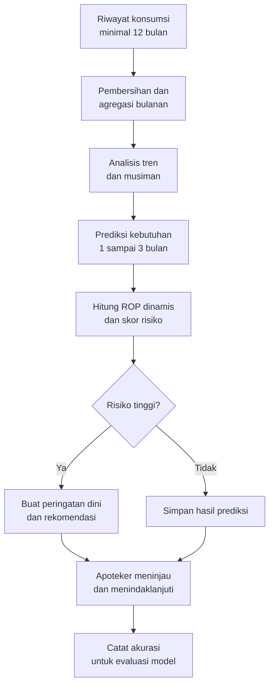

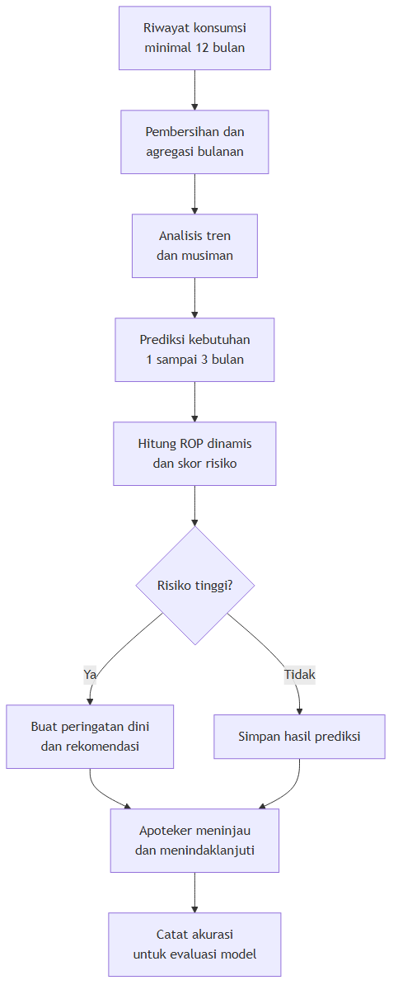

#### 8.10.5 Aturan Bisnis Prediksi

- Prediksi utama dijalankan jika tersedia data historis minimal 12 bulan. Jika belum
  tersedia, sistem memakai rata-rata bergerak 3–6 bulan dan menandainya sebagai estimasi
  rendah.
- Hasil prediksi adalah pendukung keputusan, bukan keputusan otomatis.
- Prediksi dengan confidence di bawah 60 persen ditandai sebagai estimasi rendah.
- Item kategori Vital tetap wajib memiliki safety stock manual sebagai lapis pengaman.
- Koreksi apoteker disimpan sebagai umpan balik dan tidak menimpa data historis.
- Model dilatih ulang minimal setiap bulan atau saat pola pemakaian berubah signifikan.
- Data pasien tidak digunakan; prediksi hanya memakai agregat pemakaian.

#### 8.10.6 Metode dan Algoritma

| Metode                | Kegunaan                         | Kompleksitas |
| --------------------- | -------------------------------- | ------------ |
| Exponential Smoothing | Prediksi kebutuhan jangka pendek | Sedang       |
| Rata-rata bergerak    | Baseline pembanding              | Rendah       |
| Z-score dan IQR       | Deteksi anomali pemakaian        | Rendah       |
| Risk scoring          | Peringatan dini kekosongan       | Sedang       |

```text
Konsumsi_prediksi_t = α × Konsumsi_aktual_(t-1) + (1 − α) × Konsumsi_prediksi_(t-1)
ROP_dinamis         = (Konsumsi_prediksi_t × Lead Time) + Safety Stock_dinamis
Risk Score          = bobot × max(0, 1 − (hari_stok_tersisa ÷ lead_time))
```

Semakin kecil sisa hari dibanding lead time, semakin tinggi skor risiko. Nilai skor
dibatasi pada rentang 0 sampai bobot.

Nilai α ditetapkan antara 0,2 sampai 0,3 agar prediksi responsif namun tetap stabil.

#### 8.10.7 Contoh Data Prediksi

| Obat               | Fasilitas   | Periode | Prediksi | Confidence | Tren   |
| ------------------ | ----------- | ------- | -------: | ---------: | ------ |
| Amoksisilin 500 mg | Puskesmas A | 2027-03 |    4.200 |        85% | Naik   |
| Parasetamol 500 mg | Puskesmas A | 2027-03 |    5.600 |        88% | Stabil |
| Salbutamol Inhaler | Puskesmas B | 2027-03 |       72 |        74% | Naik   |
| Insulin Glargine   | Puskesmas B | 2027-03 |       34 |        81% | Stabil |
| Oralit Serbuk      | Puskesmas C | 2027-03 |    1.250 |        79% | Turun  |

| Obat               | Fasilitas   | Stok | Konsumsi per Hari | Estimasi Habis | Risiko  |
| ------------------ | ----------- | ---: | ----------------: | -------------: | ------- |
| Insulin Glargine   | Puskesmas B |   28 |                 3 |         9 hari | Kritis  |
| Salbutamol Inhaler | Puskesmas A |   18 |                 2 |         9 hari | Kritis  |
| Amoksisilin 500 mg | Puskesmas C |  900 |                45 |        20 hari | Waspada |
| Oralit Serbuk      | Puskesmas B |  600 |                15 |        40 hari | Aman    |

Pada kondisi kritis, sistem menyarankan jumlah permintaan berdasarkan prediksi kebutuhan
ditambah safety stock, lalu apoteker memverifikasi sebelum diajukan. Angka prediksi pada
tabel ini mencakup pelayanan Puskesmas induk dan Pustu, sedangkan angka pada §8.5.5 hanya
mencakup Puskesmas induk.

### 8.11 Modul LPLPO

#### 8.11.1 Ringkasan Modul LPLPO

LPLPO (Laporan Pemakaian dan Lembar Permintaan Obat) adalah dokumen bulanan yang diajukan
fasilitas kepada Dinas Kesehatan. Dokumen ini memuat stok awal, penerimaan, persediaan,
pemakaian, stok akhir, dan jumlah permintaan per item, lalu menjadi dasar distribusi bulan
berikutnya.

LPLPO berjalan paralel dengan RKO. LPLPO bersifat operasional bulanan, sedangkan RKO
bersifat perencanaan triwulanan yang lebih analitis.

#### 8.11.2 Aktor dan Hak Akses LPLPO

| Peran                 | Hak                                           |
| --------------------- | --------------------------------------------- |
| Apoteker Puskesmas    | Menyusun, mengajukan, dan merevisi LPLPO      |
| Apoteker Gudang Dinas | Memverifikasi dan menetapkan jumlah disetujui |
| Kepala Bidang Farmasi | Menyetujui LPLPO di atas Rp 50.000.000        |
| Auditor               | Melihat riwayat LPLPO                         |

Pustu tidak mengajukan LPLPO mandiri pada MVP; kebutuhan Pustu dikonsolidasikan oleh
Puskesmas induk.

#### 8.11.3 Fitur Modul LPLPO

1. Pembuatan LPLPO bulanan per fasilitas.
2. Pengisian otomatis stok awal, penerimaan, stok akhir, dan jumlah pakai dari mutasi stok.
3. Input jumlah permintaan per item dengan validasi stok dan anggaran.
4. Verifikasi dan penetapan jumlah usul oleh Dinas.
5. Persetujuan berjenjang untuk LPLPO di atas Rp 50.000.000.
6. Revisi LPLPO yang dikembalikan dengan riwayat versi.
7. Cetak LPLPO resmi dalam format PDF.
8. Pembentukan permintaan distribusi otomatis dari LPLPO yang disetujui.

#### 8.11.4 Alur LPLPO

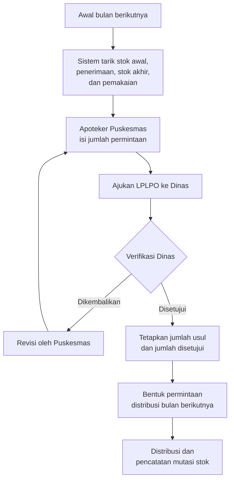

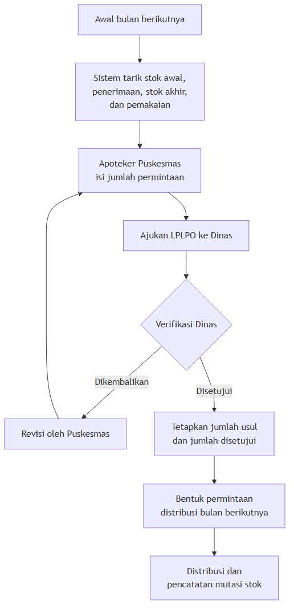

#### 8.11.5 Aturan Bisnis LPLPO

- LPLPO diajukan paling lambat tanggal 5 bulan berikutnya setelah periode laporan.
- Stok awal, penerimaan, stok akhir, dan jumlah pakai diambil otomatis dari mutasi stok.
- Stok akhir wajib sama dengan stok awal ditambah penerimaan dikurangi pemakaian.
- Satu fasilitas hanya memiliki satu LPLPO per periode.
- LPLPO yang telah disetujui tidak dapat diubah; perubahan dibuat dokumen baru.
- Jumlah disetujui boleh berbeda dari jumlah diminta dengan alasan tercatat.
- LPLPO yang disetujui menjadi dasar permintaan distribusi bulan berikutnya.
- LPLPO dengan nilai permintaan di atas Rp 50.000.000 memerlukan persetujuan Kepala
  Bidang Farmasi.
- LPLPO tidak menggantikan RKO; keduanya berjalan paralel.

#### 8.11.6 Contoh Data LPLPO

LPLPO Puskesmas A, periode Januari 2027, diajukan 3 Februari 2027:

| Kode    | Nama Obat          | Stok Awal | Penerimaan | Persediaan | Dipakai | Stok Akhir | Diminta | Usul | Disetujui | Alasan                   |
| ------- | ------------------ | --------: | ---------: | ---------: | ------: | ---------: | ------: | ---: | --------: | ------------------------ |
| OBT-001 | Amoksisilin 500 mg |     1.500 |          0 |      1.500 |   1.200 |        300 |     400 |  400 |       400 | -                        |
| OBT-002 | Parasetamol 500 mg |     2.500 |          0 |      2.500 |   1.800 |        700 |     500 |  500 |       500 | -                        |
| OBT-007 | Salbutamol Inhaler |        12 |          0 |         12 |       9 |          3 |      30 |   20 |        15 | Stok pusat terbatas      |
| OBT-009 | Vitamin A Kapsul   |       500 |          0 |        500 |      50 |        450 |     200 |  100 |       100 | Stok cukup 6 bulan       |
| OBT-011 | Insulin Glargine   |         6 |          0 |          6 |       4 |          2 |      20 |   12 |        10 | Prioritas fasilitas lain |

#### 8.11.7 Perbedaan LPLPO dan RKO

| Aspek        | LPLPO                                                   | RKO                             |
| ------------ | ------------------------------------------------------- | ------------------------------- |
| Periode      | Bulanan                                                 | Triwulanan                      |
| Sifat        | Operasional                                             | Perencanaan strategis           |
| Dasar hitung | Pemakaian riil dan sisa stok                            | Konsumsi, morbiditas, ABC-VEN   |
| Pengaju      | Puskesmas (mencakup Pustu)                              | Puskesmas dan RSUD obat program |
| Penyetuju    | Apoteker Gudang Dinas; Kepala Bidang di atas Rp 50 juta | Kepala Bidang Farmasi           |
| Keluaran     | Dasar distribusi bulan berikutnya                       | Dasar pengadaan triwulanan      |

### 8.12 Modul Master Data

#### 8.12.1 Ringkasan Modul Master Data

Modul ini mengelola data referensi yang dipakai seluruh modul: obat dan BMHP, satuan,
kategori, supplier, formularium, fasilitas, serta lokasi penyimpanan.

#### 8.12.2 Aktor dan Hak Akses Master Data

| Peran                 | Hak                                                         |
| --------------------- | ----------------------------------------------------------- |
| Administrator Dinas   | Mengelola seluruh master data                               |
| Apoteker Gudang Dinas | Mengelola obat, satuan, kategori, supplier, dan formularium |
| Kepala Bidang Farmasi | Menyetujui perubahan formularium                            |
| Auditor               | Melihat riwayat perubahan                                   |

#### 8.12.3 Fitur Modul Master Data

1. Pengelolaan obat dan BMHP termasuk NIE, bentuk sediaan, kekuatan, dan satuan.
2. Pengelolaan satuan, kategori, serta klasifikasi ABC-VEN.
3. Pengelolaan supplier dan riwayat harga.
4. Pengelolaan formularium daerah beserta itemnya.
5. Pengelolaan fasilitas beserta hierarki Puskesmas–Pustu.
6. Pengelolaan lokasi penyimpanan, zona, rak, dan suhu.
7. Penonaktifan data tanpa menghapus riwayat.
8. Audit trail untuk setiap perubahan master data.

#### 8.12.4 Aturan Bisnis Master Data

- Kode obat mengikuti kode nasional bila tersedia.
- Item tanpa NIE yang berlaku tidak dapat diaktifkan untuk pengadaan.
- Perubahan formularium memerlukan persetujuan Kepala Bidang Farmasi.
- Fasilitas Pustu wajib memiliki fasilitas induk berjenis Puskesmas.
- Lokasi penyimpanan tidak dapat dihapus jika masih memiliki stok aktif.

---

## 9. Data Model

### 9.1 Entitas Utama

```mermaid
erDiagram
    FASILITAS ||--o{ LOKASI_PENYIMPANAN : memiliki
    FASILITAS ||--o{ FASILITAS : induk
    LOKASI_PENYIMPANAN ||--o{ STOK : menyimpan
    OBAT ||--o{ STOK : tercatat
    STOK ||--o{ BATCH : terdiri_dari
    LOKASI_PENYIMPANAN ||--o{ PENERIMAAN : menerima
    PENERIMAAN ||--o{ PENERIMAAN_ITEM : berisi
    PENERIMAAN_ITEM }o--|| BATCH : menghasilkan
    SUPPLIER ||--o{ KONTRAK : menyediakan
    KONTRAK ||--o{ KONTRAK_ITEM : berisi
    KONTRAK ||--o{ PURCHASE_ORDER : menurunkan
    PURCHASE_ORDER ||--o{ PO_ITEM : berisi
    PURCHASE_ORDER ||--o{ PENERIMAAN : dipenuhi
    FASILITAS ||--o{ PERMINTAAN : mengajukan
    PERMINTAAN ||--o{ PERMINTAAN_ITEM : berisi
    PERMINTAAN ||--o| PENGIRIMAN : dipenuhi
    LOKASI_PENYIMPANAN ||--o{ PENGIRIMAN : mengirim
    PENGIRIMAN ||--o{ PENGIRIMAN_ITEM : berisi
    FASILITAS ||--o{ RKO : menyusun
    RKO ||--o{ RKO_ITEM : berisi
    FASILITAS ||--o{ PENGGUNAAN : mencatat
    PENGGUNAAN ||--o{ PENGGUNAAN_ITEM : berisi
    OBAT ||--o{ PENGGUNAAN_ITEM : dipakai
    LOKASI_PENYIMPANAN ||--o{ OPNAME : melaksanakan
    OPNAME ||--o{ OPNAME_ITEM : berisi
    PENGGUNA ||--o{ AUDIT_LOG : menghasilkan
    FASILITAS ||--o{ PAGU_ANGGARAN : memiliki
    PAGU_ANGGARAN ||--o{ MUTASI_ANGGARAN : mencatat
    PENGGUNA ||--o{ PENGGUNA_PERAN : memiliki
    PERAN ||--o{ PENGGUNA_PERAN : diberikan
    PENGGUNA ||--o{ PENGGUNA_FASILITAS : di_assign
    FASILITAS ||--o{ PENGGUNA_FASILITAS : mencakup
    PENGGUNA ||--o{ PENGGUNA_TERHUBUNG : memiliki
    FASILITAS ||--o{ RIWAYAT_KONSUMSI : mencatat
    OBAT ||--o{ RIWAYAT_KONSUMSI : tercatat
    FASILITAS ||--o{ PREDIKSI_KEBUTUHAN : memiliki
    OBAT ||--o{ PREDIKSI_KEBUTUHAN : diprediksi
    FASILITAS ||--o{ PERINGATAN_DINI : menerima
    OBAT ||--o{ PERINGATAN_DINI : terkait
    LOKASI_PENYIMPANAN ||--o{ MUTASI_STOK : mencatat
    OBAT ||--o{ MUTASI_STOK : tercatat
    BATCH ||--o{ MUTASI_STOK : memiliki
    FASILITAS ||--o{ LPLPO : mengajukan
    LPLPO ||--o{ LPLPO_ITEM : berisi
    OBAT ||--o{ LPLPO_ITEM : diminta
    LPLPO ||--o| PERMINTAAN : menghasilkan
    LOKASI_PENYIMPANAN ||--o{ PEMUSNAHAN : memusnahkan
    PEMUSNAHAN ||--o{ PEMUSNAHAN_ITEM : berisi
    LOKASI_PENYIMPANAN ||--o{ RETUR : mengembalikan
    RETUR ||--o{ RETUR_ITEM : berisi
    FASILITAS ||--o{ RESEP : menerima
    RESEP ||--o{ RESEP_ITEM : berisi
    FASILITAS ||--o{ PERINGATAN_STOK : menerima
    OBAT ||--o{ PERINGATAN_STOK : terkait
    PENGGUNA ||--o{ LAPORAN_JADWAL : membuat
```


Detail atribut, tipe data, constraint, dan entitas pendukung dijelaskan pada
`docs/DATA-MODEL.md`.

### 9.2 Kamus Entitas Inti

| Entitas            | Deskripsi                              | Atribut Kunci                                                                                                                                       |
| ------------------ | -------------------------------------- | --------------------------------------------------------------------------------------------------------------------------------------------------- |
| Fasilitas          | Dinas, RSUD, Puskesmas, Pustu          | id, parent_id, nama, jenis, status, kode_registrasi                                                                                                 |
| Lokasi Penyimpanan | Lokasi penyimpanan per fasilitas       | id, fasilitas_id, nama, jenis, zona, suhu                                                                                                           |
| Obat               | Master item obat dan BMHP              | id, kode, nama, nomor_izin_edar, satuan, kategori, bentuk_sediaan, kekuatan, abc_ven, formularium                                                   |
| Stok               | Saldo per item per lokasi penyimpanan  | id, lokasi_penyimpanan_id, obat_id, jumlah, min, max, safety_stock, rop                                                                             |
| Batch              | Rincian batch pada stok                | id, stok_id, nomor_batch, expired, jumlah                                                                                                           |
| Supplier           | Penyedia barang                        | id, nama, npwp, alamat, kontak, status                                                                                                              |
| Kontrak            | Kontrak pengadaan                      | id, supplier_id, nomor, tanggal, nilai, status                                                                                                      |
| PO                 | Pesanan pembelian                      | id, nomor, kontrak_id, supplier_id, tanggal, nilai, status                                                                                          |
| PO Item            | Rincian item PO                        | id, purchase_order_id, obat_id, jumlah, harga_satuan, jumlah_diterima                                                                               |
| Penerimaan         | Dokumen penerimaan barang              | id, lokasi_penyimpanan_id, po_id, tanggal, status                                                                                                   |
| Permintaan         | Permintaan dari fasilitas              | id, fasilitas_id, periode, status, prioritas                                                                                                        |
| Pengiriman         | Dokumen pengiriman                     | id, lokasi_penyimpanan_id, permintaan_id, tanggal, status                                                                                           |
| RKO                | Rencana kebutuhan obat                 | id, fasilitas_id, periode, status, versi                                                                                                            |
| Penggunaan         | Catatan pemakaian obat                 | id, fasilitas_id, resep_id, tanggal, jenis_layanan, diagnosa_id                                                                                     |
| Resep              | Resep elektronik                       | id, fasilitas_id, nomor, tanggal, dokter_id, status                                                                                                 |
| Resep Item         | Rincian obat dan racikan               | id, resep_id, obat_id, jumlah, dosis, jenis                                                                                                         |
| Opname             | Sesi stock opname                      | id, lokasi_penyimpanan_id, tanggal, status, selisih_nilai                                                                                           |
| Pemusnahan         | Berita acara pemusnahan                | id, lokasi_penyimpanan_id, nomor, tanggal, status                                                                                                   |
| Retur              | Pengembalian obat                      | id, lokasi_penyimpanan_id, nomor, tanggal, jenis, status                                                                                            |
| Peringatan Stok    | Alert stok dan kedaluwarsa             | id, obat_id, fasilitas_id, jenis, tingkat, referensi_id, status                                                                                     |
| Laporan Jadwal     | Jadwal ekspor laporan                  | id, pengguna_id, jenis, frekuensi, penerima, aktif                                                                                                  |
| Audit Log          | Jejak seluruh perubahan data           | id, pengguna_id, aksi, entitas, waktu, data_lama                                                                                                    |
| Pagu Anggaran      | Alokasi dana per fasilitas per periode | id, fasilitas_id, periode, sumber_dana, nilai                                                                                                       |
| Mutasi Anggaran    | Komitmen, realisasi, dan realokasi     | id, pagu_id, jenis, nilai, referensi                                                                                                                |
| Peran              | Kumpulan hak akses                     | id, kode, nama, deskripsi                                                                                                                           |
| Pengguna Peran     | Relasi pengguna dengan peran           | id, pengguna_id, peran_id                                                                                                                           |
| Pengguna Fasilitas | Penugasan pengguna ke fasilitas        | id, pengguna_id, fasilitas_id, aktif                                                                                                                |
| Pengguna Terhubung | Akun eksternal yang terhubung          | id, pengguna_id, provider, provider_user_id, aktif                                                                                                  |
| Riwayat Konsumsi   | Agregat pemakaian bulanan per item     | id, obat_id, fasilitas_id, periode, jumlah_keluar                                                                                                   |
| Prediksi Kebutuhan | Hasil prediksi kebutuhan per item      | id, obat_id, fasilitas_id, periode_prediksi, jumlah, confidence, metode                                                                             |
| Peringatan Dini    | Deteksi risiko kekosongan obat         | id, obat_id, fasilitas_id, tingkat, risk_score, estimasi_hari, rekomendasi                                                                          |
| Mutasi Stok        | Buku besar pergerakan stok             | id, lokasi_penyimpanan_id, obat_id, batch_id, jenis, jumlah, saldo_sesudah, sumber, sumber_id                                                       |
| LPLPO              | Dokumen permintaan obat bulanan        | id, nomor, fasilitas_id, periode, status, total_diminta, total_usul, total_disetujui                                                                |
| LPLPO Item         | Rincian item pada dokumen LPLPO        | id, lplpo_id, obat_id, stok_awal, penerimaan, persediaan, jumlah_pakai, stok_akhir, jumlah_minta, jumlah_usul, jumlah_disetujui, alasan_pengurangan |

### 9.3 Aturan Data

1. Setiap mutasi stok wajib memiliki dokumen sumber yang valid.
2. Saldo stok dihitung dari akumulasi batch, bukan nilai yang diisi manual.
3. Nomor batch dan tanggal kedaluwarsa wajib untuk semua item farmasi.
4. Penghapusan master data menggunakan penonaktifan, bukan penghapusan fisik.
5. Audit log tidak dapat diubah atau dihapus oleh pengguna mana pun.
6. Data riwayat konsumsi yang telah dikunci periodenya tidak boleh diubah.
7. `safety_stock` dan `rop` dihitung dengan formula §8.6.4 dan disimpan sebagai parameter
   per item per lokasi.
8. `stok.jumlah` adalah saldo cache yang wajib direkonsiliasi dengan akumulasi batch pada
   setiap mutasi.
9. `lplpo_item.stok_akhir` wajib sama dengan `stok_awal + penerimaan − jumlah_pakai`.
10. Fasilitas Pustu wajib memiliki `parent_id` yang menunjuk fasilitas Puskesmas induk.

---

## 10. Integrasi Sistem

| Sistem                  | Tujuan Integrasi                  | Mekanisme             | Prioritas |
| ----------------------- | --------------------------------- | --------------------- | --------- |
| Katalog Elektronik LKPP | Sumber produk dan harga pengadaan | API atau ekspor-impor | Tinggi    |
| e-Monev Katalog (RKO)   | Pelaporan rencana kebutuhan obat  | Ekspor format standar | Tinggi    |
| SIPNAP                  | Pelaporan narkotika/psikotropika  | Ekspor CSV standar    | Tinggi    |
| SIPD                    | Data realisasi anggaran daerah    | Ekspor Excel          | Tinggi    |
| SATUSEHAT               | Interoperabilitas data kesehatan  | API sesuai standar    | Menengah  |
| SIMRS RSUD              | Data pemakaian dan stok RSUD      | API atau sinkronisasi | Menengah  |
| e-Puskesmas             | Data pelayanan dan resep          | API atau sinkronisasi | Menengah  |
| Sistem akuntansi daerah | Data nilai inventori              | Ekspor berkala        | Rendah    |

Prinsip integrasi:

- Sinkronisasi bersifat idempoten dan dapat diulang tanpa menggandakan data.
- Kegagalan integrasi dicatat dan dapat dicoba ulang secara manual.
- Data master obat mengikuti kode nasional bila tersedia.
- Semua pertukaran data menggunakan koneksi terenkripsi.

Detail mekanisme integrasi MVP untuk LKPP, e-Monev RKO, SIPNAP, dan SIPD dijelaskan pada
`docs/INTEGRATION.md`.

---

## 11. Non-Functional Requirements

### 11.1 Kinerja

| Parameter                          | Target                             |
| ---------------------------------- | ---------------------------------- |
| Waktu muat halaman utama           | ≤ 2 detik pada jaringan normal     |
| Waktu respons pencarian stok       | ≤ 1 detik untuk 10.000 item        |
| Waktu pembuatan laporan bulanan    | ≤ 10 menit untuk seluruh fasilitas |
| Pengguna bersamaan                 | ≥ 300 pengguna aktif               |
| Transaksi per menit pada jam sibuk | ≥ 200 transaksi                    |

### 11.2 Ketersediaan dan Ketahanan

| Parameter             | Target                                             |
| --------------------- | -------------------------------------------------- |
| Uptime layanan        | ≥ 99,5% per bulan                                  |
| Waktu pemulihan (RTO) | ≤ 4 jam                                            |
| Kehilangan data (RPO) | ≤ 15 menit                                         |
| Pencadangan           | Harian penuh, inkremental setiap 15 menit (binlog) |
| Mode luring           | Input tertunda untuk Pustu                         |

### 11.3 Keamanan

1. Autentikasi pengguna dengan kata sandi kuat dan opsi autentikasi dua faktor.
2. Otorisasi berbasis peran dan fasilitas.
3. Enkripsi data saat transit dan saat disimpan.
4. Audit log untuk seluruh aksi kritis.
5. Pembatasan sesi dan logout otomatis setelah tidak aktif.
6. Pemisahan data antar fasilitas kecuali untuk peran Dinas.
7. Kebijakan akun, peran, 2FA, dan audit aktivitas diuraikan pada bagian 8.9.

### 11.4 Usabilitas dan Aksesibilitas

1. Antarmuka responsif untuk desktop dan tablet.
2. Alur input utama tidak lebih dari lima langkah.
3. Dukungan pemindaian barcode untuk input cepat.
4. Pesan kesalahan berbahasa Indonesia yang jelas dan dapat ditindaklanjuti.
5. Kontras warna memadai dan dapat digunakan pada layar terang.

### 11.5 Pemeliharaan

1. Konfigurasi master data dapat diubah tanpa mengubah kode.
2. Log aplikasi terpusat dan mudah ditelusuri.
3. Migrasi basis data terkelola dan dapat dibalik.
4. Dokumentasi teknis diperbarui bersamaan dengan rilis.

---

## 12. Kepatuhan Regulasi

| Regulasi                                       | Pokok Pengaturan                             | Kaitan Produk                    |
| ---------------------------------------------- | -------------------------------------------- | -------------------------------- |
| UU 44/2009 tentang Rumah Sakit                 | Kedudukan dan pembinaan rumah sakit          | Model pengelolaan RSUD           |
| PP 12/2019 tentang Pengelolaan Keuangan Daerah | Fleksibilitas pengelolaan BLUD               | Otonomi pengadaan obat umum RSUD |
| Permenkes 72/2016                              | Standar pelayanan kefarmasian di rumah sakit | Alur farmasi RSUD                |
| Permenkes 73/2016                              | Standar pelayanan kefarmasian di apotek      | Rujukan praktik dispensing       |
| Permenkes 74/2016                              | Standar pelayanan kefarmasian di Puskesmas   | Alur farmasi Puskesmas           |
| Permenkes 26/2020                              | Perubahan atas Permenkes 74/2016             | Penyesuaian standar Puskesmas    |
| Ketentuan DAK Nonfisik Kesehatan               | Pendanaan obat dan BMHP sesuai juknis        | Distribusi bertingkat            |
| Ketentuan pengadaan barang dan jasa            | Mekanisme e-Katalog dan e-Purchasing         | Modul pengadaan                  |

Catatan: nomor dan judul regulasi perlu diverifikasi ulang dengan JDIH Kementerian
Kesehatan sebelum dijadikan dasar hukum formal pada dokumen kontrak.

Prinsip kepatuhan yang diterapkan:

1. Seluruh transaksi memiliki jejak audit yang dapat diperiksa.
2. Pemisahan tugas antara pemesan, penyetuju, dan penerima.
3. Penerapan FEFO pada seluruh pengeluaran barang farmasi.
4. Penyimpanan khusus untuk narkotika, psikotropika, dan produk rantai dingin.
5. Laporan mengikuti format standar yang berlaku.

---

## 13. Risks and Mitigations

| Kode | Risiko                           | Dampak | Probabilitas | Mitigasi                                   |
| ---- | -------------------------------- | ------ | ------------ | ------------------------------------------ |
| R-01 | Kualitas data awal rendah        | Tinggi | Tinggi       | Pembersihan data dan validasi bertahap     |
| R-02 | Koneksi internet tidak stabil    | Sedang | Tinggi       | Mode luring dan sinkronisasi tertunda      |
| R-03 | Resistensi pengguna              | Tinggi | Sedang       | Pelatihan, pendampingan, dan quick win     |
| R-04 | Integrasi e-Katalog terlambat    | Sedang | Sedang       | Jalur impor manual sebagai cadangan        |
| R-05 | Kebocoran data pasien            | Tinggi | Rendah       | Enkripsi, RBAC, dan audit berkala          |
| R-06 | Anggaran pengadaan tidak menentu | Tinggi | Sedang       | Prioritas ABC-VEN dan perencanaan bertahap |
| R-07 | Ketergantungan pada satu vendor  | Sedang | Rendah       | Dokumentasi dan serah terima pengetahuan   |
| R-08 | Bencana dan kehilangan data      | Tinggi | Rendah       | Pencadangan luar lokasi dan uji pemulihan  |

---

## 14. Roadmap and Phasing

### 14.1 Fase Pengembangan

| Fase   | Fokus                                                 | Durasi    | Keluaran                         |
| ------ | ----------------------------------------------------- | --------- | -------------------------------- |
| Fase 0 | Discovery, pembersihan data, desain arsitektur        | 4 minggu  | Dokumen desain dan data bersih   |
| Fase 1 | Master data, pengguna, lokasi penyimpanan, stok dasar | 8 minggu  | Fondasi sistem                   |
| Fase 2 | Penerimaan, penyimpanan, pengendalian                 | 13 minggu | Gudang dan ruang obat beroperasi |
| Fase 3 | Perencanaan dan pengadaan                             | 8 minggu  | RKO dan PO terintegrasi          |
| Fase 4 | Distribusi dan pelayanan                              | 10 minggu | Alur end-to-end                  |
| Fase 5 | Pelaporan, integrasi, dan penyempurnaan               | 8 minggu  | Laporan otomatis dan integrasi   |
| Fase 6 | Peluncuran bertahap dan pendampingan                  | 6 minggu  | Semua fasilitas aktif            |

### 14.2 Timeline

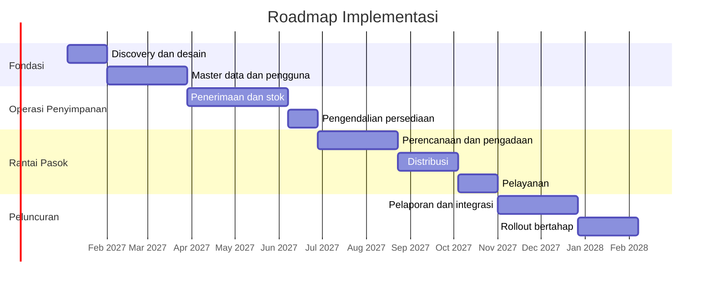


### 14.3 Strategi Peluncuran

1. Pilot pada satu Puskesmas dan satu RSUD selama satu bulan.
2. Evaluasi dan perbaikan sebelum perluasan.
3. Peluncuran bergelombang per klaster wilayah.
4. Pendampingan intensif pada dua minggu pertama tiap fasilitas.

---

## 15. Appendices

### 15.1 Glosarium

| Istilah              | Definisi                                                         |
| -------------------- | ---------------------------------------------------------------- |
| BMHP                 | Bahan Medis Habis Pakai                                          |
| BLUD                 | Badan Layanan Umum Daerah                                        |
| RKO                  | Rencana Kebutuhan Obat                                           |
| ROP                  | Reorder Point, titik jumlah stok untuk memesan kembali           |
| Safety Stock         | Stok pengaman untuk mengantisipasi ketidakpastian                |
| Buffer Stock         | Stok penyangga pada perencanaan kebutuhan                        |
| Lead Time            | Selang waktu antara pemesanan dan penerimaan barang              |
| FEFO                 | First Expired First Out, keluar berdasarkan kedaluwarsa terdekat |
| FIFO                 | First In First Out, keluar berdasarkan urutan masuk              |
| ABC                  | Klasifikasi item berdasarkan nilai pemakaian                     |
| VEN                  | Klasifikasi item berdasarkan vital, esensial, non-esensial       |
| Stockout             | Kondisi stok suatu item kosong                                   |
| Stagnant             | Kondisi stok tidak bergerak dalam periode tertentu               |
| Opname               | Kegiatan penghitungan fisik persediaan                           |
| BAST                 | Berita Acara Serah Terima                                        |
| Gudang Farmasi Pusat | Gudang obat utama milik Dinas Kesehatan Kabupaten                |
| Ruang Obat           | Lokasi penyimpanan obat di Puskesmas untuk pelayanan harian      |
| Instalasi Farmasi    | Lokasi penyimpanan dan pengelolaan obat di RSUD                  |
| ROP Dinamis          | Titik pemesanan kembali yang menyesuaikan pola konsumsi          |
| Confidence           | Tingkat keyakinan model terhadap hasil prediksi                  |
| Early Warning System | Sistem peringatan dini potensi kekosongan obat                   |
| LPLPO                | Laporan Pemakaian dan Lembar Permintaan Obat, dokumen bulanan    |
| Mutasi Stok          | Catatan setiap pergerakan stok masuk, keluar, dan penyesuaian    |
| Pustu                | Puskesmas Pembantu                                               |

### 15.2 Daftar Regulasi Rujukan

1. Undang-Undang Nomor 44 Tahun 2009 tentang Rumah Sakit.
2. Peraturan Pemerintah Nomor 12 Tahun 2019 tentang Pengelolaan Keuangan Daerah.
3. Peraturan Menteri Kesehatan Nomor 72 Tahun 2016 tentang Standar Pelayanan Kefarmasian
   di Rumah Sakit.
4. Peraturan Menteri Kesehatan Nomor 73 Tahun 2016 tentang Standar Pelayanan Kefarmasian
   di Apotek.
5. Peraturan Menteri Kesehatan Nomor 74 Tahun 2016 tentang Standar Pelayanan Kefarmasian
   di Puskesmas.
6. Peraturan Menteri Kesehatan Nomor 26 Tahun 2020 tentang Perubahan atas Permenkes
   Nomor 74 Tahun 2016.
7. Ketentuan pengadaan barang dan jasa pemerintah yang berlaku, termasuk mekanisme
   e-Katalog dan e-Purchasing.
8. Petunjuk teknis DAK Nonfisik Bidang Kesehatan yang berlaku pada tahun anggaran berjalan.

### 15.3 Contoh Format Laporan Bulanan

| Kolom        | Deskripsi                         |
| ------------ | --------------------------------- |
| Kode Obat    | Kode item pada master data        |
| Nama Obat    | Nama generik sesuai formularium   |
| Satuan       | Satuan terkecil pengeluaran       |
| Stok Awal    | Saldo awal periode                |
| Penerimaan   | Total barang masuk                |
| Pengeluaran  | Total barang keluar               |
| Penyesuaian  | Koreksi hasil opname              |
| Stok Akhir   | Saldo akhir periode               |
| Stok Minimum | Batas minimum yang ditetapkan     |
| Keterangan   | Catatan kekosongan atau kelebihan |

### 15.4 Contoh Checklist Implementasi Fasilitas

1. Master data fasilitas dan lokasi penyimpanan terdaftar.
2. Pengguna dan peran telah dibuat serta diuji.
3. Saldo awal stok telah dimigrasikan dan diverifikasi.
4. Lokasi rak dan zona penyimpanan telah dipetakan.
5. Perangkat pemindai barcode tersedia dan teruji.
6. Petugas telah mengikuti pelatihan dan simulasi.
7. Prosedur cadangan manual tersedia saat gangguan.
8. Jadwal stock opname pertama telah ditetapkan.

### 15.5 Dokumen Terkait

| Dokumen                | Isi                                     | Status   |
| ---------------------- | --------------------------------------- | -------- |
| `docs/mockup/`         | Mockup antarmuka dan katalog komponen   | Tersedia |
| `docs/API-CONTRACT.md` | Kontrak API internal dan skemanya       | Tersedia |
| `docs/examples/`       | Contoh tabel dan diagram sesuai standar | Tersedia |
| `docs/TECH-STACK.md`   | Tech stack dan arsitektur teknis        | Tersedia |
| `docs/DATA-MODEL.md`   | Skema basis data dan kamus kolom        | Tersedia |
| `docs/INTEGRATION.md`  | Panduan integrasi sistem eksternal      | Tersedia |
