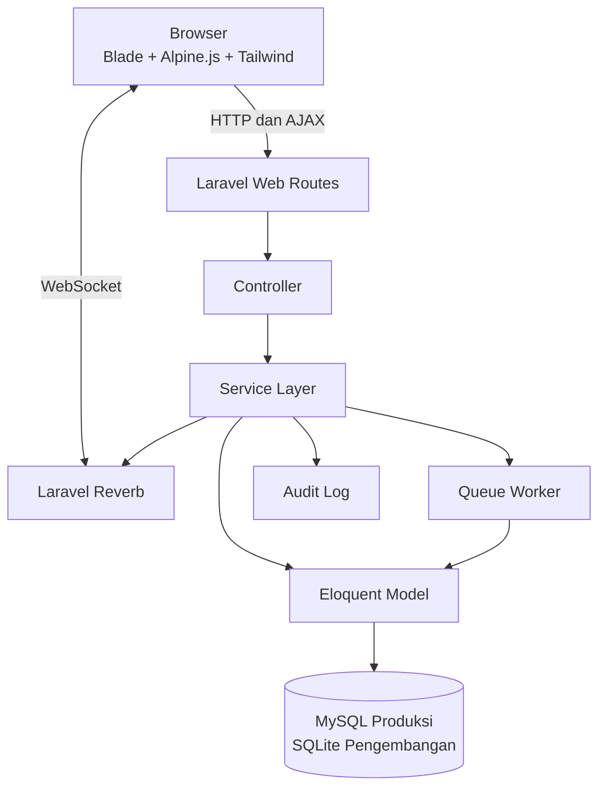
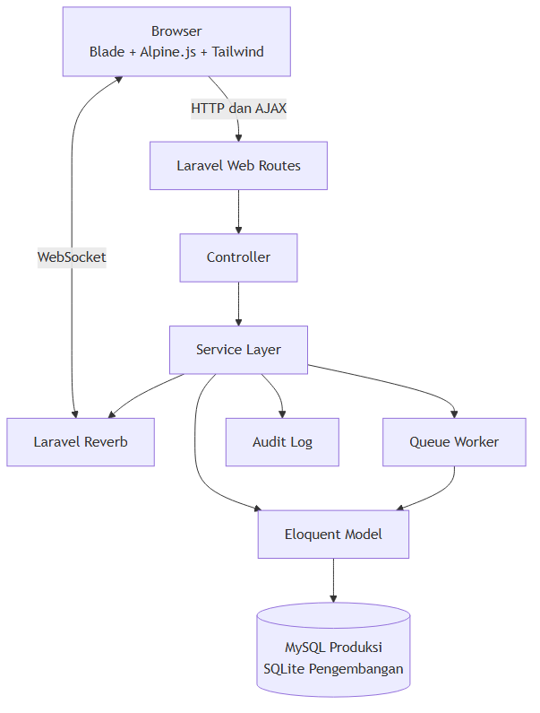
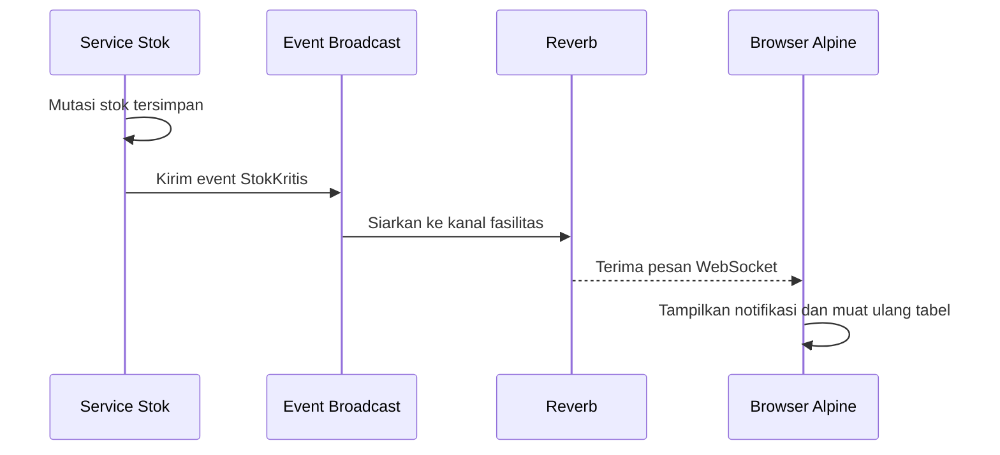
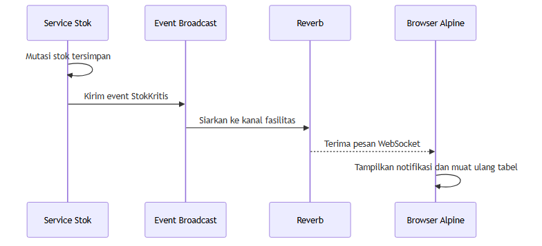
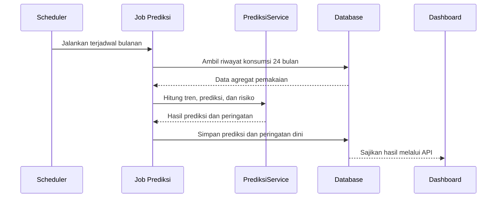
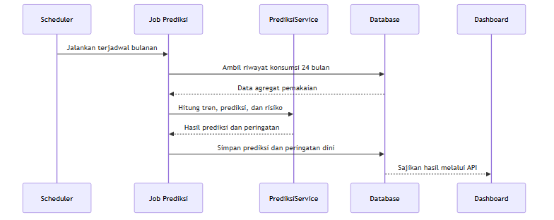

# Tech Stack - Sistem Manajemen Stok Obat dan BMHP Daerah

| Atribut        | Nilai                                        |
| -------------- | -------------------------------------------- |
| Versi Dokumen  | 1.3 (Draft)                                  |
| Status         | Untuk direview                               |
| Pemilik Teknis | Tim Pengembangan                             |
| Tanggal        | 27 November 2026                             |
| PRD Rujukan    | `docs/PRD.md` versi 1.7                      |
| Target Pembaca | Developer, Tech Lead, DevOps, Auditor Teknis |

Dokumen ini melengkapi `docs/PRD.md` dengan keputusan teknis, struktur kode, dan panduan
implementasi. Kebutuhan bisnis dan fungsional tetap merujuk pada PRD agar tidak terjadi
duplikasi sumber kebenaran.

---

## 1. Ringkasan Stack

| Layer             | Teknologi       | Versi  | Fungsi                      |
| ----------------- | --------------- | ------ | --------------------------- |
| Backend framework | Laravel         | 11.x   | Routing, ORM, validasi, API |
| Bahasa backend    | PHP             | 8.3+   | Logika aplikasi             |
| Templating        | Blade           | bawaan | Rendering halaman server    |
| Interaktivitas    | Alpine.js       | 3.x    | Komponen reaktif ringan     |
| HTTP client       | Axios           | 1.x    | Permintaan AJAX             |
| Styling           | Tailwind CSS    | 3.4+   | Utility-first CSS           |
| Build tool        | Vite            | 5.x    | Bundling aset dan HMR       |
| Database dev      | SQLite          | 3.x    | Pengembangan dan pengujian  |
| Database produksi | MySQL           | 8.x    | Penyimpanan data produksi   |
| Real-time         | Laravel Reverb  | 1.x    | WebSocket untuk notifikasi  |
| Antrian           | Database, Redis | -      | Pekerjaan latar belakang    |
| Prediksi          | Statistik PHP   | -      | ROP dinamis dan forecasting |

---

## 2. Arsitektur Aplikasi

### 2.1 Arsitektur Aplikasi





### 2.2 Prinsip Teknis

1. Blade menangani rendering halaman, sedangkan Alpine menangani interaksi lokal.
2. Seluruh mutasi data melalui endpoint API dan divalidasi di server.
3. Logika bisnis ditempatkan pada service layer, bukan pada controller atau model.
4. Setiap mutasi stok dan anggaran wajib menghasilkan audit log.
5. Endpoint bersifat idempoten untuk penerimaan, distribusi, dan penyesuaian stok.
6. Aplikasi harus tetap dapat digunakan pada koneksi lambat dengan pemuatan bertahap.

### 2.3 Mode Luring dan Sinkronisasi

- Frontend menyimpan antrean transaksi di IndexedDB saat koneksi terputus.
- Setiap transaksi memiliki `client_uuid` dan `Idempotency-Key` untuk mencegah duplikasi.
- Sinkronisasi memakai endpoint `/sync/push`, `/sync/pull`, dan `/sync/status`.
- Konflik diselesaikan secara server-authoritative; transaksi yang ditolak masuk daftar
  gagal dan dapat diperbaiki pengguna.
- Antrean dibatasi 500 transaksi per perangkat dan disimpan terenkripsi.

---

## 3. Backend

### 3.1 Framework dan Bahasa

- Laravel 11.x dengan struktur aplikasi ramping bawaan.
- PHP 8.3 atau lebih baru untuk dukungan tipe dan performa.
- Composer sebagai manajer dependensi.
- Eloquent ORM untuk akses basis data.
- Form Request untuk validasi terpusat.

### 3.2 Paket Backend

| Paket                       | Fungsi                                |
| --------------------------- | ------------------------------------- |
| `spatie/laravel-permission` | Manajemen peran dan hak akses (RBAC)  |
| `laravel/reverb`            | Server WebSocket real-time            |
| `maatwebsite/excel`         | Impor dan ekspor laporan Excel        |
| `barryvdh/laravel-dompdf`   | Pembuatan PDF laporan dan BAST        |
| `milon/barcode`             | Pembuatan barcode label obat          |
| `laravel/telescope`         | Debugging request dan query (dev)     |
| `pestphp/pest`              | Framework pengujian (dev)             |
| `laravel/pint`              | Perapian gaya kode PHP (dev)          |
| `rubix/ml`                  | Algoritma ML ringan di PHP (opsional) |
| `guzzlehttp/guzzle`         | Klien HTTP untuk integrasi eksternal  |
| `league/csv`                | Ekspor dan validasi CSV untuk SIPNAP  |

### 3.3 Struktur Folder Backend

```text
app/
├── Http/
│   ├── Controllers/
│   │   ├── Api/                # Endpoint JSON untuk AJAX
│   │   └── Web/                # Controller pengembali Blade
│   ├── Middleware/             # Otorisasi dan audit
│   └── Requests/               # Validasi form
├── Models/                     # Model Eloquent
├── Services/                   # Logika bisnis
├── Observers/                  # Pemicu audit log
├── Events/                     # Event broadcast
├── Listeners/                  # Penanganan event
└── Policies/                   # Aturan otorisasi per entitas
```

### 3.4 Pembagian Tanggung Jawab

| Lapisan    | Tanggung Jawab                                                |
| ---------- | ------------------------------------------------------------- |
| Controller | Menerima permintaan, memanggil service, mengembalikan respons |
| Service    | Aturan bisnis, transaksi basis data, koordinasi               |
| Model      | Relasi, scope query, kast atribut                             |
| Observer   | Audit log dan efek samping model                              |
| Policy     | Keputusan otorisasi per aksi dan per fasilitas                |

---

## 4. Frontend

### 4.1 Teknologi Frontend

| Teknologi    | Fungsi                                  |
| ------------ | --------------------------------------- |
| Blade        | Layout, partial, dan komponen server    |
| Alpine.js    | State lokal, modal, dropdown, dan tabel |
| Axios        | Permintaan AJAX dengan token CSRF       |
| Tailwind CSS | Styling konsisten dan responsif         |
| Remix Icon   | Ikon outline dan fill, dibundel lokal   |
| Vite         | Bundling aset dan hot reload            |
| Chart.js     | Grafik dashboard dan laporan            |
| Flatpickr    | Pemilih tanggal kedaluwarsa             |
| SweetAlert2  | Notifikasi dan konfirmasi               |
| QuaggaJS     | Pemindaian barcode melalui kamera       |

### 4.2 Pola Komponen Alpine

```javascript
// resources/js/components/stock-table.js
export default function stockTable(lokasiId) {
  return {
    items: [],
    loading: false,
    search: '',

    async init() {
      await this.load()
    },

    async load() {
      this.loading = true
      try {
        const { data } = await window.axios.get(`/api/lokasi/${lokasiId}/stok`, {
          params: { search: this.search },
        })
        this.items = data.data
      } finally {
        this.loading = false
      }
    },
  }
}
```

### 4.3 Konfigurasi Axios

```javascript
// resources/js/bootstrap.js
import axios from 'axios'

window.axios = axios
window.axios.defaults.headers.common['X-Requested-With'] = 'XMLHttpRequest'
window.axios.defaults.withCredentials = true

window.axios.interceptors.response.use(
  (response) => response,
  (error) => {
    if (error.response?.status === 401) {
      window.location.href = '/login'
    }
    return Promise.reject(error)
  }
)
```

### 4.4 Struktur Folder Frontend

```text
resources/
├── js/
│   ├── app.js                  # Inisialisasi Alpine
│   ├── bootstrap.js            # Konfigurasi Axios
│   ├── components/             # Komponen Alpine
│   └── utils/                  # Helper bersama
├── css/
│   └── app.css                 # Impor Tailwind
└── views/
    ├── layouts/                # Layout utama dan auth
    ├── dashboard/
    ├── stok/
    ├── distribusi/
    ├── anggaran/
    └── laporan/
```

---

## 5. Komunikasi Real-time

### 5.1 Laravel Reverb

- Reverb dijalankan sebagai proses terpisah dan terhubung ke Laravel melalui broadcasting.
- Kanal privat dipakai per fasilitas agar data tidak bocor antar fasilitas.
- Event utama meliputi stok kritis, kedaluwarsa mendekat, dan penerimaan barang.
- Klien berlangganan kanal hanya setelah lolos otorisasi kanal.

### 5.2 Alur Notifikasi Real-time





### 5.3 Contoh Implementasi

```php
// app/Events/StokKritis.php
class StokKritis implements ShouldBroadcast
{
    public function __construct(
        public int $lokasiId,
        public string $namaObat,
        public int $jumlah,
    ) {}

    public function broadcastOn(): array
    {
        return [new PrivateChannel("fasilitas.{$this->lokasiId}")];
    }
}
```

```javascript
// Langganan kanal pada komponen Alpine
window.Echo.private(`fasilitas.${lokasiId}`).listen('StokKritis', (event) => {
  window.Swal.fire({
    icon: 'warning',
    title: 'Stok kritis',
    text: `${event.namaObat} tersisa ${event.jumlah}`,
  })
})
```

---

## 6. Database

### 6.1 Lingkungan Database

| Lingkungan   | Koneksi | Catatan                                   |
| ------------ | ------- | ----------------------------------------- |
| Pengembangan | SQLite  | Berkas tunggal, mudah direset             |
| Pengujian    | SQLite  | Basis data dalam memori untuk kecepatan   |
| Produksi     | MySQL 8 | Dukungan transaksi, indeks, dan replikasi |

### 6.2 Konvensi Skema

1. Nama tabel menggunakan bentuk jamak dan bahasa Indonesia yang konsisten.
2. Setiap tabel memiliki primary key `id` dan timestamps bawaan Laravel.
3. Foreign key menggunakan sufiks `_id` dan dilengkapi indeks.
4. Nilai uang disimpan sebagai `bigInteger` dalam satuan rupiah penuh.
5. Penghapusan master data menggunakan kolom `aktif`, bukan hard delete.
6. Nomor dokumen unik diberi indeks unik untuk mencegah duplikasi.

### 6.3 Contoh Migrasi

```php
// database/migrations/xxxx_create_lokasi_penyimpanan_table.php
Schema::create('lokasi_penyimpanan', function (Blueprint $table) {
    $table->id();
    $table->foreignId('fasilitas_id')->constrained('fasilitas');
    $table->string('nama');
    $table->enum('jenis', ['gudang', 'ruang_obat', 'instalasi_farmasi']);
    $table->string('zona')->nullable();
    $table->string('suhu')->nullable();
    $table->boolean('aktif')->default(true);
    $table->timestamps();

    $table->index(['fasilitas_id', 'jenis']);
});
```

### 6.4 Strategi Seeder dan Factory

- Seeder peran dijalankan pertama agar RBAC siap sebelum data lain.
- Seeder fasilitas dan lokasi penyimpanan menyediakan data dasar.
- Factory dipakai untuk data uji dengan relasi yang konsisten.
- Data contoh tidak pernah dijalankan pada lingkungan produksi.

---

## 7. Prediksi dan Kecerdasan Buatan

Modul prediksi mengikuti kebutuhan PRD bagian 8.10. Implementasi versi awal memakai metode
statistik ringan agar tidak menambah ketergantungan layanan eksternal dan tetap berjalan
pada infrastruktur daerah.

### 7.1 Pendekatan Implementasi

1. Prediksi dijalankan sebagai scheduled job bulanan, bukan pada request pengguna.
2. Perhitungan memakai data agregat pemakaian, bukan data pasien.
3. Algoritma versi awal ditulis pada service layer PHP agar mudah diuji.
4. Hasil prediksi disimpan pada tabel `prediksi_kebutuhan` dan `peringatan_dini`.
5. Dashboard membaca hasil tersimpan sehingga tetap cepat tanpa menghitung ulang.
6. Evaluasi akurasi memakai MAE dan MAPE per item per fasilitas.

### 7.2 Pilihan Teknologi Prediksi

| Kebutuhan              | Teknologi                      | Catatan                    |
| ---------------------- | ------------------------------ | -------------------------- |
| Prediksi kebutuhan     | Exponential smoothing di PHP   | Cukup untuk MVP            |
| Analisis tren musiman  | Dekomposisi deret waktu di PHP | Data minimal 12 bulan      |
| Deteksi anomali        | Z-score dan IQR                | Tanpa dependensi tambahan  |
| Skor risiko kekosongan | Risk scoring berbasis aturan   | Dapat dikalibrasi          |
| Model lanjutan         | Python worker (opsional)       | ARIMA atau Prophet, fase 2 |
| Penjadwalan pelatihan  | Laravel Queue                  | Di luar jam sibuk          |

Paket `rubix/ml` dapat dipakai bila ingin algoritma siap pakai di PHP, tetapi bukan
kebutuhan wajib untuk MVP.

### 7.3 Alur Eksekusi Prediksi





### 7.4 Batasan dan Pertimbangan

- Prediksi dinonaktifkan otomatis bila riwayat data kurang dari 12 bulan.
- Proses dijadwalkan dini hari agar tidak mengganggu jam pelayanan.
- Hasil dengan confidence di bawah 60 persen ditandai sebagai estimasi rendah.
- Koreksi apoteker disimpan terpisah sebagai umpan balik evaluasi model.
- Model tidak dilatih ulang setiap request, cukup bulanan atau saat pola berubah.
- Bila kelak dibutuhkan model kompleks, worker Python berkomunikasi via antrean internal.

---

## 8. Keamanan

### 8.1 Autentikasi dan Otorisasi

- Autentikasi kustom sesuai PRD bagian 8.9, termasuk 2FA dan Google OAuth.
- Otorisasi memakai kombinasi Spatie Permission dan Policy per entitas.
- Setiap pengguna dibatasi pada fasilitas yang ditugaskan.
- Peran Dinas memiliki akses lintas fasilitas sesuai kewenangan.

### 8.2 Perlindungan Aplikasi

1. Validasi dan sanitasi seluruh masukan pada Form Request.
2. Perlindungan CSRF aktif untuk semua permintaan web.
3. Rate limit pada endpoint autentikasi dan pencarian berat.
4. Enkripsi koneksi basis data dan HTTPS wajib di produksi.
5. Audit log tidak dapat diubah melalui antarmuka aplikasi.
6. Kredensial dan kunci disimpan pada variabel lingkungan, bukan kode.

---

## 9. Testing dan Kualitas Kode

### 9.1 Strategi Testing

| Jenis     | Cakupan                                     | Alat |
| --------- | ------------------------------------------- | ---- |
| Unit      | Service, perhitungan stok, formula anggaran | Pest |
| Feature   | Endpoint API, otorisasi, validasi           | Pest |
| Integrasi | Alur penerimaan, distribusi, opname         | Pest |
| Regresi   | Skenario kritis dari PRD                    | Pest |

### 9.2 Alat Kualitas

- Laravel Pint untuk gaya kode PSR-12.
- Analisis statis dengan Larastan pada pipeline.
- Pemeriksaan dependensi dengan Composer Audit.
- Cakupan pengujian minimal 80 persen untuk service layer.

---

## 10. DevOps dan Deployment

### 10.1 Lingkungan

| Lingkungan | Tujuan                | Database |
| ---------- | --------------------- | -------- |
| Lokal      | Pengembangan harian   | SQLite   |
| Staging    | Uji terima dan demo   | MySQL    |
| Produksi   | Operasional fasilitas | MySQL    |

### 10.2 Kebutuhan Server Produksi

| Komponen    | Rekomendasi                       |
| ----------- | --------------------------------- |
| CPU         | 4 vCPU                            |
| RAM         | 8 GB                              |
| Penyimpanan | 100 GB SSD                        |
| PHP         | 8.3 dengan OPcache                |
| Web server  | Nginx                             |
| Proses      | Queue worker dan Reverb terpisah  |
| Pencadangan | Harian penuh, inkremental per jam |

### 10.3 Alur Rilis

1. Jalankan pengujian dan analisis statis pada pipeline.
2. Bangun aset frontend dengan Vite pada mode produksi.
3. Jalankan migrasi basis data dengan pencadangan terlebih dahulu.
4. Kosongkan dan bangun ulang cache konfigurasi serta route.
5. Jalankan uji asap pada staging sebelum promosi ke produksi.

---

## 11. Setup Pengembangan

### 11.1 Prasyarat

- PHP 8.3 dengan ekstensi umum Laravel.
- Composer 2.x.
- Node.js 20.x dan npm.
- Git.

### 11.2 Langkah Instalasi

```bash
# 1. Buat proyek Laravel
composer create-project laravel/laravel:^11.0 dinkes
cd dinkes

# 2. Pasang dependensi backend
composer require spatie/laravel-permission
composer require laravel/reverb
composer require maatwebsite/excel
composer require barryvdh/laravel-dompdf
composer require milon/barcode
composer require laravel/telescope --dev
composer require pestphp/pest --dev --with-all-dependencies
composer require laravel/pint --dev

# Opsional untuk prediksi lanjutan
# composer require rubix/ml

# Integrasi eksternal
composer require guzzlehttp/guzzle
composer require league/csv

# 3. Pasang dependensi frontend
npm install
npm install -D tailwindcss postcss autoprefixer
npx tailwindcss init
npm install alpinejs axios chart.js flatpickr sweetalert2 quagga

# 4. Siapkan lingkungan pengembangan
cp .env.example .env
php artisan key:generate

# 5. Atur SQLite untuk pengembangan
# DB_CONNECTION=sqlite pada .env

# 6. Jalankan migrasi dan seeder
php artisan migrate --seed

# 7. Jalankan layanan pengembangan
php artisan serve
npm run dev
php artisan reverb:start
```

### 11.3 Perintah Harian

| Perintah                           | Fungsi                             |
| ---------------------------------- | ---------------------------------- |
| `php artisan serve`                | Menjalankan server pengembangan    |
| `npm run dev`                      | Menjalankan Vite dengan hot reload |
| `php artisan reverb:start`         | Menjalankan server WebSocket       |
| `php artisan queue:work`           | Menjalankan pekerja antrian        |
| `php artisan test`                 | Menjalankan seluruh pengujian      |
| `./vendor/bin/pint`                | Merapikan gaya kode PHP            |
| `php artisan migrate:fresh --seed` | Reset basis data pengembangan      |

---

## 12. Keputusan Teknis

| Kode | Keputusan                       | Alasan                                                |
| ---- | ------------------------------- | ----------------------------------------------------- |
| T-01 | Laravel sebagai backend         | Ekosistem lengkap dan umum di pemerintah daerah       |
| T-02 | Alpine.js tanpa Livewire        | Ringan, cukup untuk kebutuhan CRUD dan laporan        |
| T-03 | Axios untuk AJAX                | Kontrol penuh atas permintaan dan penanganan galat    |
| T-04 | Tailwind CSS                    | Konsistensi UI dan kecepatan pengembangan             |
| T-05 | SQLite untuk pengembangan       | Setup cepat dan pengujian ringan                      |
| T-06 | MySQL untuk produksi            | Transaksi andal dan dukungan operasional              |
| T-07 | Reverb untuk real-time          | Terintegrasi Laravel tanpa layanan pihak ketiga       |
| T-08 | Service layer untuk logika      | Memudahkan pengujian dan pemeliharaan                 |
| T-09 | Spatie Permission untuk RBAC    | Teruji dan sesuai kebutuhan peran berlapis            |
| T-10 | Pest untuk pengujian            | Sintaks ringkas dan mudah dibaca                      |
| T-11 | Prediksi statistik di PHP       | Menghindari layanan eksternal pada tahap MVP          |
| T-12 | Python worker bersifat opsional | Model kompleks hanya bila data dan kebutuhan menuntut |
| T-13 | Adapter pattern untuk integrasi | Sumber eksternal mudah diganti tanpa ubah core        |
| T-14 | Retry dengan backoff            | Menangani galat jaringan sementara                    |
| T-15 | Ekspor berkas sebagai cadangan  | Operasi tetap jalan saat API tidak tersedia           |
| T-16 | Remix Icon dengan class kustom  | Ukuran ikon konsisten di seluruh antarmuka            |

---

## 13. Dokumen Terkait

| Dokumen                | Isi                                     | Status   |
| ---------------------- | --------------------------------------- | -------- |
| `docs/PRD.md`          | Kebutuhan produk dan fungsional         | Tersedia |
| `docs/mockup/`         | Mockup antarmuka dan katalog komponen   | Tersedia |
| `docs/API-CONTRACT.md` | Kontrak API internal dan skemanya       | Tersedia |
| `docs/DATA-MODEL.md`   | Skema basis data dan kamus kolom        | Tersedia |
| `docs/INTEGRATION.md`  | Integrasi sistem eksternal              | Tersedia |
| `docs/examples/`       | Contoh tabel dan diagram sesuai standar | Tersedia |
